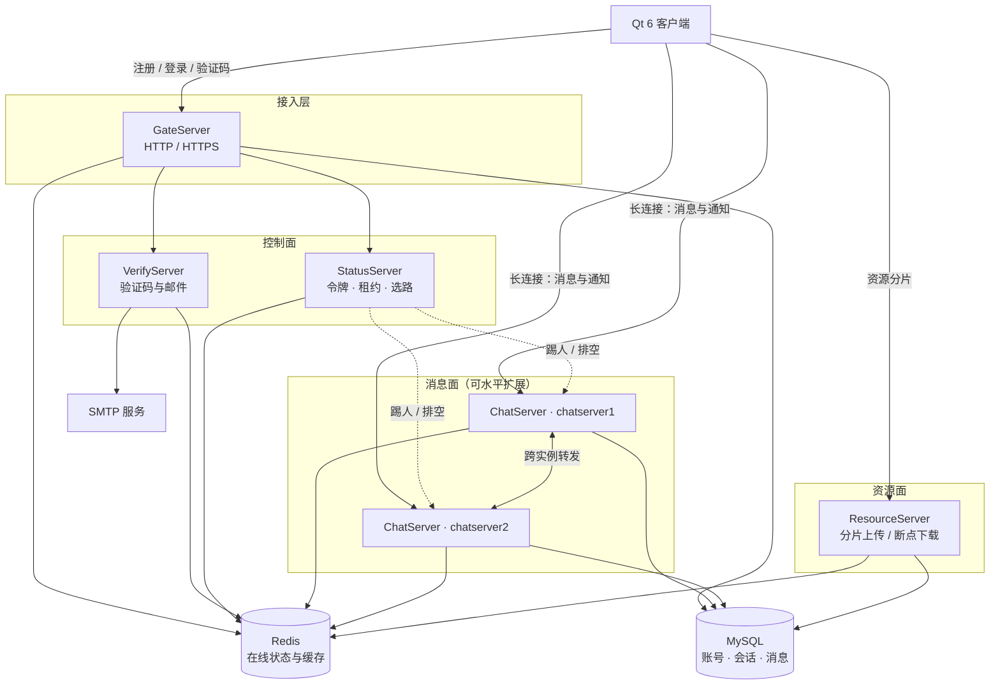

<p align="center">
  
</p>

<h1 align="center">云笺 YunJian</h1>

<p align="center"><strong>全 C++ 的即时通讯系统</strong>：Qt 6 桌面客户端 + gRPC 微服务后端</p>

<p>


</p>

YunJian 是一套可以直接部署、也可以用来学习分布式 IM 设计的完整系统。客户端负责登录、好友、单聊、群聊与文件传输；后端由五个服务、六个进程组成（ChatServer 两个实例），分别处理 HTTP 网关、会话路由、长连接消息、验证码与资源传输。服务之间通过 gRPC 通信，在线状态放在 Redis，持久化数据放在 MySQL。

客户端面向 **Windows / macOS**，后端支持 **Windows / macOS / Linux** 三平台构建。仓库同时提供单容器 Docker 部署，服务器只需要安装 Docker。

---

## 核心特性

| 能力 | 说明 |
| --- | --- |
| 全 C++ 业务实现 | 客户端 Qt 6 / C++17，服务端 C++20；业务代码没有 Node、Python 或托管运行时 |
| 多实例消息服务 | ChatServer 一套代码按配置启动多个实例，跨实例消息经 gRPC 转发，客户端无感 |
| 加权负载调度 | StatusServer 按 `sessions / capacity` 为登录选择实例，自动跳过下线、过期与排空中的节点 |
| 租约式会话 | 每次登录分配 `epoch`，旧连接按围栏令牌被顶替；续租、释放、踢人均是原子脚本 |
| 可靠投递语义 | 消息先落库再回执，再尝试实时投递；对端离线不影响历史同步 |
| 丰富消息类型 | 文本、图片、视频、文件、群系统消息、合并转发；支持撤回、已读、草稿与本地搜索 |
| 群聊 | 建群、邀请、移除、管理员、群主权限、群头像、公告、@、免打扰 |
| 断点资源传输 | 独立资源通道，64 KB 分片、续传进度存 Redis、配额与僵尸分片清理 |
| 可运维 | 分级日志、`/healthz` 健康检查、实例排空、消息归档、Docker 一键部署 |
| 本地优先 | 客户端 SQLite 缓存、离线可读、增量同步、可关闭落盘；日志可在界面外排查 |

---

## 系统架构



| 服务 | 端口 | 职责 |
| --- | --- | --- |
| **GateServer** | 8080（HTTPS 时通常 8443） | HTTP 网关：验证码、注册、登录、重置密码；签发令牌并返回聊天与资源地址 |
| **VerifyServer** | 50051 | 生成 4 位验证码写入 Redis，通过 SMTP over SSL 投递 |
| **StatusServer** | 50052 | 会话租约与实例注册：签发令牌、分配 epoch、按负载选路、踢人与排空 |
| **ChatServer** | 8090 / 8091，gRPC 50055 / 50056 | 长连接、登录校验、好友与群聊、消息落库与投递、归档 |
| **ResourceServer** | 9090 | 头像与聊天资源的分片上传、续传、断点下载与配额控制 |

---

## 快速开始

### 方式一：Docker（推荐）

服务器只需安装 Docker，镜像内已经包含编译工具链、MySQL、Redis 与全部服务。

```bash
cd server
docker build --platform linux/amd64 -f deploy/docker/Dockerfile -t yunjian-server:amd64 .

cd deploy/docker
cp .env.example .env          # 至少填写 PUBLIC_HOST
docker compose up -d
docker compose logs -f
```

首次启动会依次完成：拉取代码 → 初始化 MySQL 并导入 `backup/yunjian.sql` → 编译 → 启动六个服务进程（两个 ChatServer 实例）。健康检查：

```bash
curl http://<PUBLIC_HOST>:8080/healthz
```

完整步骤、TLS、洗库与升级见 [部署与运维](docs/12-deployment.md)。

### 方式二：本地构建

前置：CMake ≥ 3.21（后端预设要求 3.27）、vcpkg、MySQL 8、Redis；客户端另需 Qt 6.5。

```bash
# 数据库
docker run -d --name chat-mysql -p 3306:3306 -e MYSQL_ROOT_PASSWORD=123456 mysql:8
docker run -d --name chat-redis -p 6380:6379 redis:latest redis-server --requirepass 123456

docker exec -i chat-mysql mysql -uroot -p123456 -e \
  "CREATE DATABASE IF NOT EXISTS yunjian DEFAULT CHARACTER SET utf8mb4 COLLATE utf8mb4_unicode_ci;"
docker exec -i chat-mysql mysql -uroot -p123456 yunjian < backup/yunjian.sql

# 后端
cd server
export VCPKG_ROOT=/path/to/vcpkg
cmake --preset macos-clang        # Windows: windows-msvc
cmake --build --preset macos-clang

# 客户端
cd ../client
cmake --preset macos-clang        # Windows: windows-mingw
cmake --build --preset macos-clang
```

每个服务从**当前工作目录**读取 `config.ini`，启动时要进入各自产物目录：

```bash
cd server/build/macos-clang/bin
(cd VerifyServer   && ./VerifyServer)
(cd StatusServer   && ./StatusServer)
(cd ChatServer     && ./ChatServer)
(cd ChatServer2    && ./ChatServer)
(cd ResourceServer && ./ResourceServer)
(cd GateServer     && ./GateServer)
```

构建细节、多实例机制与打包见 [构建与运行](docs/02-build.md)。

---

## 端口

| 端口 | 服务 | 是否对外开放 |
| --- | --- | --- |
| 8080 / 8443 | GateServer HTTP / HTTPS | 是 |
| 8090 / 8091 | ChatServer 客户端长连接 | 是 |
| 9090 | ResourceServer 资源传输 | 是 |
| 50051 / 50052 | VerifyServer / StatusServer gRPC | 否 |
| 50055 / 50056 | ChatServer 实例间 gRPC | 否 |
| 3306 | MySQL 经典协议 | 否（建议只绑回环） |
| 6380 | Redis | 否（建议只绑回环） |

---

## 仓库结构

| 目录 | 内容 |
| --- | --- |
| `client/` | Qt 6 客户端：`core/` 业务与状态、`network/` 通信、`bridge/` QML 边界、`qml/` 界面、`resources/` 资源 |
| `server/common/` | 公共库 `yunjian_common`：配置、日志、Redis、MySQL、TLS、线程池 |
| `server/proto/` | 全仓唯一的 proto 定义 |
| `server/services/` | 五个服务：Gate / Status / Chat / Verify / Resource |
| `server/tests/` | CTest 单元与集成测试 |
| `server/deploy/docker/` | Dockerfile、compose、配置模板与部署脚本 |
| `backup/` | 两份结构一致的数据库快照：含演示数据与干净库 |
| `docs/` | 技术文档，入口见 [docs/README.md](docs/README.md) |

ChatServer 是“一套代码、配置驱动多实例”：`services/ChatServer/config/` 下每份 `*.ini` 会在构建后生成独立运行目录 `bin/<实例名>/`，新增实例只需增加配置并登记到 StatusServer 白名单。

---

## 文档

| 文档 | 内容 |
| --- | --- |
| [00 项目导览](docs/00-tour.md) | 五个服务、六个进程、登录与消息的代码路径、日志位置 |
| [01 架构设计](docs/01-architecture.md) | 分层、线程模型、核心时序、路由与容错 |
| [02 构建与运行](docs/02-build.md) | 预设、vcpkg、多实例、产物布局、打包 |
| [03 通信协议](docs/03-protocol.md) | 帧格式、消息号、字段、HTTP 与 gRPC、错误码 |
| [04 数据模型](docs/04-data-model.md) | 七张表、索引、查询模式、Redis 键空间、本地库 |
| [05 配置参考](docs/05-configuration.md) | 每个服务的配置项、默认值与常见变更 |
| [06 客户端](docs/06-client.md) | 分层、通信、状态、QML、本地缓存与日志 |
| [07 GateServer](docs/07-gate-server.md) | HTTP 管线、口令线程池、登录限流 |
| [08 StatusServer](docs/08-status-server.md) | 令牌、租约、epoch、实例注册与排空 |
| [09 ChatServer](docs/09-chat-server.md) | 连接、逻辑分片、消息与群聊、跨实例投递 |
| [10 VerifyServer](docs/10-verify-server.md) | 验证码生成、邮件投递、错误映射 |
| [11 ResourceServer](docs/11-resource-server.md) | 分片协议、续传、配额、清理与鉴权 |
| [12 部署与运维](docs/12-deployment.md) | Docker、TLS、域名、备份、升级、健康检查 |
| [13 安全设计](docs/13-security.md) | 威胁模型、口令、令牌、传输、资源与本地数据 |
| [14 测试](docs/14-testing.md) | 单元与集成测试、运行方式、扩展方法 |
| [15 排障手册](docs/15-troubleshooting.md) | 按症状定位：登录、连接、消息、资源、TLS |
| [16 已知限制](docs/16-limitations.md) | 当前边界、影响与演进方向 |

---

## 工程约定

- **标准**：服务端 C++20，客户端 C++17，禁用编译器扩展；源码 UTF-8 无 BOM。
- **协议同步**：消息号在服务端 `ChatServer/include/const.h` 与客户端 `core/global.h` 各有一份，请求与响应必须相邻，两端都有编译期断言。
- **配置即实例**：服务按工作目录读取 `config.ini`，一份配置对应一个运行实例。
- **错误码单一来源**：跨服务错误码定义在 `server/common/include/Protocol.h`；资源通道使用独立的 12xx 段。
- **提交前验证**：`ctest --preset <preset>` 必须全绿；新增协议字段要同时修改两端的校验与测试。

---

## 已知限制

- 密码在应用层做可逆 XOR 变形，安全性依赖传输层；**部署时必须配置 TLS 证书**，否则网关、聊天与资源通道都是明文。
- 服务间 gRPC 使用明文，设计前提是只走回环或容器内网。
- StatusServer 与 ResourceServer 目前是单实例；ChatServer 可多实例。
- 单帧请求上限 8 KB，超长文本会拆分为多条消息。
- 单端登录：同一账号后登录会顶掉前一个连接。

完整列表与演进方向见 [已知限制](docs/16-limitations.md)。

---

## 开源协议

**GNU General Public License v3.0**，详见 [LICENSE](LICENSE)。
