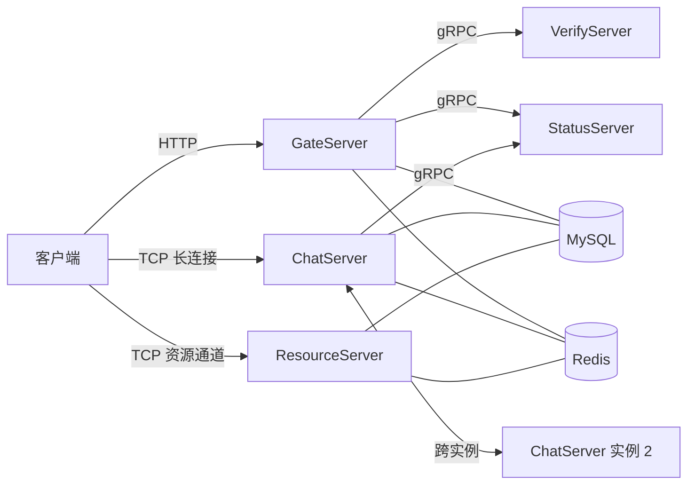
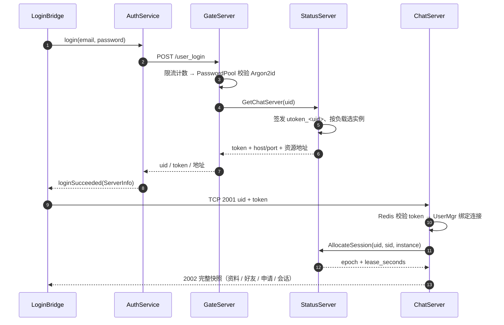
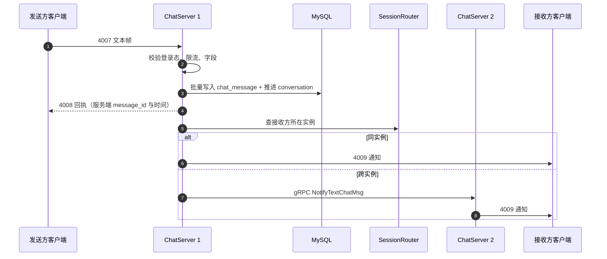

# 00 · 项目导览

这篇文档回答三个问题：**服务怎么分工**、**一次请求经过哪些文件**、**出问题先看哪里**。读完可以对代码建立整体坐标，再按需进入专题文档。

## 0.1 五个服务、六个进程



| 进程 | 入口 | 主要职责 | 详细文档 |
| --- | --- | --- | --- |
| GateServer | `services/GateServer/src/GateServer.cpp` | HTTP、口令校验、签发路由结果 | [07](07-gate-server.md) |
| VerifyServer | `services/VerifyServer/src/VerifyServer.cpp` | 验证码与邮件 | [10](10-verify-server.md) |
| StatusServer | `services/StatusServer/src/StatusServer.cpp` | 令牌、租约、实例表、踢人 | [08](08-status-server.md) |
| ChatServer | `services/ChatServer/src/ChatServer.cpp` | 长连接、好友、消息、群聊 | [09](09-chat-server.md) |
| ResourceServer | `services/ResourceServer/src/ResourceServer.cpp` | 头像与聊天资源传输 | [11](11-resource-server.md) |

## 0.2 一次登录的代码路径



涉及的关键文件：

| 步骤 | 文件 |
| --- | --- |
| HTTP 入口与四个接口 | `services/GateServer/src/LogicSystem.cpp` |
| 口令哈希线程池 | `services/GateServer/src/PasswordPool.cpp` |
| 选路与签发令牌 | `services/StatusServer/src/StatusServiceImpl.cpp` |
| 登录、快照与租约 | `services/ChatServer/src/logic/LogicSystemSession.cpp` |
| 连接与帧读写 | `services/ChatServer/src/CSession.cpp` |
| 客户端登录页 | `client/bridge/loginbridge.cpp` |
| 客户端会话建立 | `client/core/service/sessionservice.cpp` |

## 0.3 一条消息的代码路径



要点：

- **先落库再投递**。回执不依赖对方在线；投递失败只影响"立刻看到"，历史消息仍然完整。
- **投递在独立线程**。跨实例 RPC 截止 800 ms，不会阻塞业务线程。
- **同一连接严格有序**。消息按会话哈希进入 4 个逻辑分片之一，同一分片串行处理。

## 0.4 代码地图

| 想改什么 | 从哪里开始 |
| --- | --- |
| 新增长连接消息 | 两端 `const.h` / `global.h` 加号 → `RegisterCallBacks()` → 客户端 `TcpMgr` 注册处理 |
| 改表结构字段 | `backup/yunjian.sql` → 对应 DAO → 协议 JSON → 客户端模型 |
| 改登录流程 | `LogicSystemSession.cpp` + `sessionservice.cpp` |
| 改消息投递 | `LogicSystemChat.cpp` + `SessionRouter` + `ChatServiceImpl` |
| 改资源上传 | `ResourceHandler.cpp` + `FileWorker.cpp` + 客户端 `fileservice.cpp` |
| 改群权限 | `GroupDao.cpp` 的 `GroupRole` 判断 + `LogicSystemGroup.cpp` |
| 改界面 | `client/qml/`，状态与命令走 `bridge/`，不要直接访问网络层 |

## 0.5 日志

| 进程 | 控制台 | 文件 |
| --- | --- | --- |
| 服务端全部 | stdout | `<服务目录>/logs/<服务名>.log`，32 MB × 5 |
| 客户端 | Debug 构建默认开 | `<AppData>/YunJian/yunjian/logs/client.log`，8 MB × 4 |

服务端日志级别在各自 `config.ini` 的 `[Log]` 调整；客户端在 `client/config.ini` 的 `[Log]` 调整。排障时先调到 `debug`，复现后改回 `info`。

## 0.6 最小运行与验证

```bash
# 1. 依赖
docker run -d --name chat-mysql -p 3306:3306 -e MYSQL_ROOT_PASSWORD=123456 mysql:8
docker run -d --name chat-redis -p 6380:6379 redis:latest redis-server --requirepass 123456
docker exec -i chat-mysql mysql -uroot -p123456 -e \
  "CREATE DATABASE yunjian DEFAULT CHARACTER SET utf8mb4 COLLATE utf8mb4_unicode_ci"
docker exec -i chat-mysql mysql -uroot -p123456 yunjian < backup/yunjian.sql

# 2. 构建
cd server && cmake --preset macos-clang && cmake --build --preset macos-clang

# 3. 启动（每个服务一个终端，必须在各自目录）
cd build/macos-clang/bin
(cd VerifyServer && ./VerifyServer)
(cd StatusServer && ./StatusServer)
(cd ChatServer && ./ChatServer)
(cd ChatServer2 && ./ChatServer)
(cd ResourceServer && ./ResourceServer)
(cd GateServer && ./GateServer)

# 4. 验证
curl http://127.0.0.1:8080/healthz
cd ../../.. && ctest --preset macos-clang
```

客户端使用 `backup/yunjian.sql` 的演示账号登录（密码均为 `123456`）：

| 账号 | 邮箱 |
| --- | --- |
| `test1` | `123@123.com` |
| `test2` | `456@456.com` |
| `test3` | `789@789.com` |

下一步：读 [01 架构设计](01-architecture.md) 理解为什么这样分层，或直接进入 [09 ChatServer](09-chat-server.md) 看消息处理细节。
