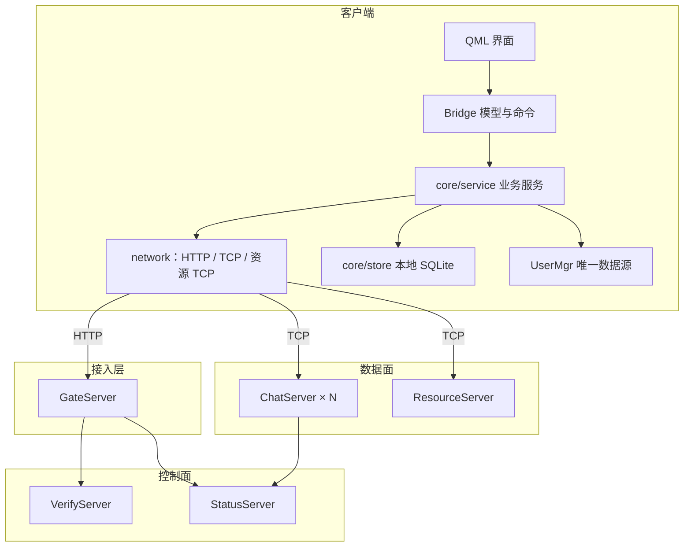
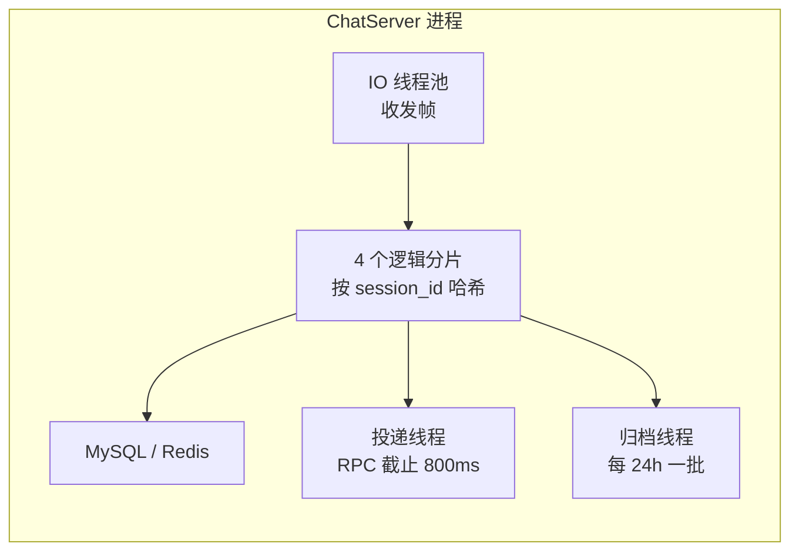
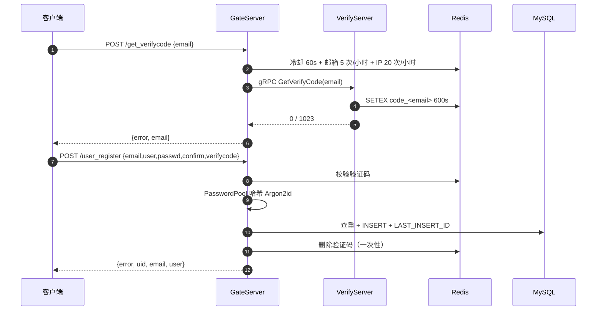
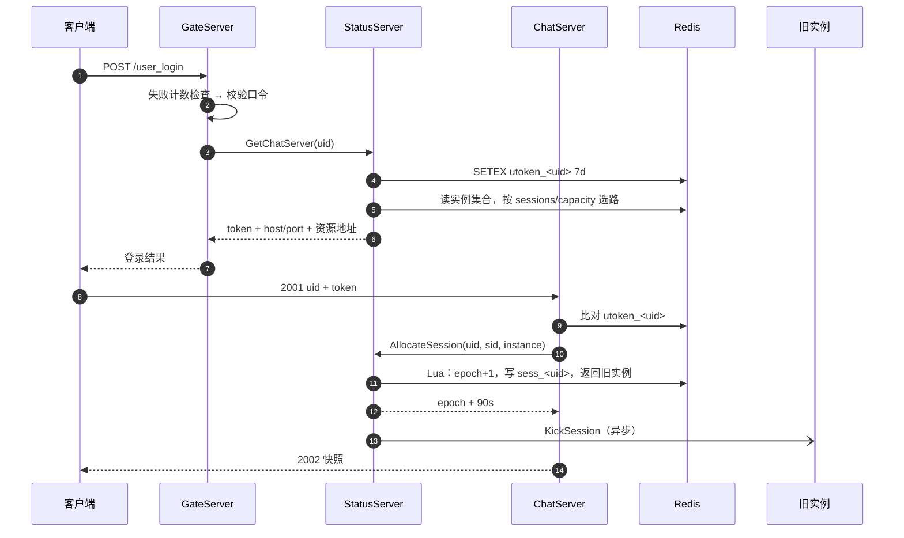
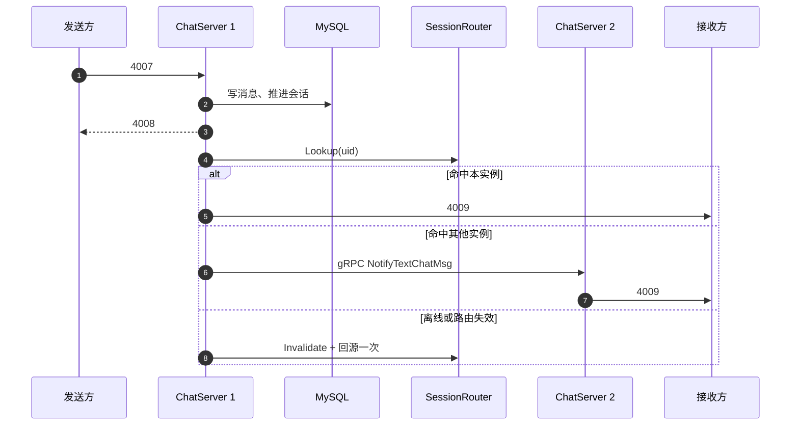
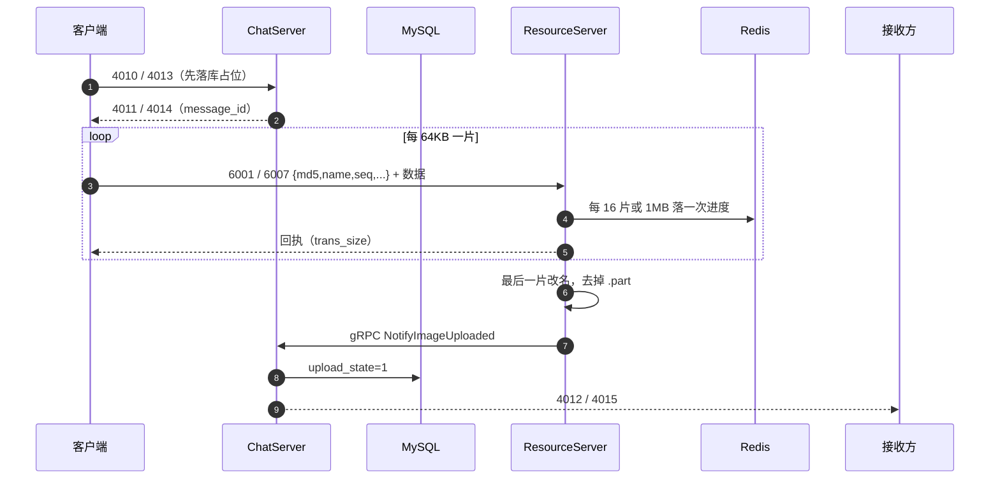

# 01 · 架构设计

## 1.1 设计原则

| 原则 | 落地方式 |
| --- | --- |
| **控制面与数据面分离** | 登录路由、令牌、租约集中在 StatusServer；消息只在 ChatServer 与客户端之间流动 |
| **状态外置** | 在线位置、租约、验证码、缓存全部在 Redis；服务进程本身无状态，可重启 |
| **先持久化再投递** | 消息写入 MySQL 成功后才回执，投递失败不影响历史一致性 |
| **按连接串行、按会话分片** | 单条连接的消息严格有序；不同连接在 4 个逻辑线程上并行 |
| **失败快速、语义明确** | 数据库/缓存不可用时返回可重试错误码，不静默降级；超时全部有界 |
| **一套代码多实例** | ChatServer 的实例名、端口、对端列表全部来自配置，镜像不变 |

## 1.2 分层

**依赖方向**：`qml → bridge → core/service → network`，反向不允许。网络层只负责收发，不解释业务；业务层不直接操作 QML 对象；`UserMgr` 是内存数据的唯一写入点。

## 1.3 进程与线程

| 进程 | IO 线程 | 业务线程 | 关键约束 |
| --- | --- | --- | --- |
| GateServer | 1 个 `io_context` | `PasswordPool`（默认 2 线程） | 哈希不占 IO 线程；队列满回 `1101` |
| StatusServer | gRPC 线程池 | 无 | 每次租约变更是一条 Lua 脚本，原子完成 |
| ChatServer | `IOContextPool`（= CPU 核数） | 4 个逻辑分片 + 1 个投递线程 + 1 个归档线程 | 同连接串行；跨实例 RPC 只在投递线程 |
| VerifyServer | gRPC 线程池 | 无 | 发信同步执行，超时由 SMTP 客户端控制 |
| ResourceServer | `IOContextPool` | 4 个逻辑线程 + 4 个落盘线程 + 2 个下载线程 | 同一文件按名字哈希到固定线程，避免并发写 |

> **为什么按连接分片而不是按消息类型**：同一连接的消息必须按序处理（例如先发文本再撤回）。按连接哈希可以保证顺序，同时让不同连接并行。

## 1.4 注册

## 1.5 登录与会话租约

租约的三种结局：

| 场景 | 结果 |
| --- | --- |
| 续租成功 | `RenewSessions` 刷新 TTL；返回状态 0 |
| 被更高 epoch 顶替 | 旧连接续租返回状态 2，ChatServer 主动断开并推 `2007(reason=1)` |
| 租约过期 | 续租时按原 `session_id` 重新授予，避免状态服务短暂故障导致全员掉线 |

## 1.6 单聊消息与跨实例转发

路由缓存：在线 30 秒、私聊离线 1 秒、群聊离线 5 秒。缓存只用于加速，权威始终是 `sess_<uid>`。

## 1.7 群消息广播

群消息不逐个成员查路由，而是：

1. 从 `conversation_member` 取全部成员；
2. 调 `BatchLookupRoute` 一次拿到在线成员 → 实例映射；
3. 本实例成员直接投递；
4. 其他实例按实例聚合，**每个实例只发一次 gRPC**，由对方实例再分发给本地成员；
5. 发送者自己跳过。

这样 N 个成员最多产生"实例数"次 RPC，而不是 N 次。

## 1.8 资源上传

## 1.9 容错边界

| 故障 | 行为 |
| --- | --- |
| Redis 不可用 | 登录/续租失败并返回 `1101`；已建立连接继续工作到下一次续租 |
| MySQL 不可用 | 查询带 5 秒 deadline，连接标记污染后丢弃；返回 `1002` |
| 状态服务故障 | 续租失败，租约 90 秒后过期；恢复后按原 `session_id` 重新授予 |
| 对端实例不可达 | 投递 RPC 截止 800 ms，消息已在库，接收方下次登录可见 |
| 客户端断线 | 1/2/4/8/15 秒退避重连 6 次；被顶号或凭证失效不重连 |
| 单帧过大 | 服务端回 `1106` 后继续服务；资源通道单帧上限 128 KB |

## 1.10 扩展点

| 维度 | 当前 | 扩展方式 |
| --- | --- | --- |
| 消息吞吐 | ChatServer 多实例 | 增加配置实例并登记白名单；状态服务自动参与选路 |
| 在线状态 | Redis 单实例 | Redis Cluster 需把 `sess_/epoch_` 放同一 slot（按 uid 哈希） |
| 资源存储 | 本地磁盘 | 替换 `FileSystem` 的落盘实现或前置对象存储 |
| 消息保留 | 一年后归档到 `chat_message_archive` | 调整 `[Archive]`，或把归档表迁到冷存储 |
