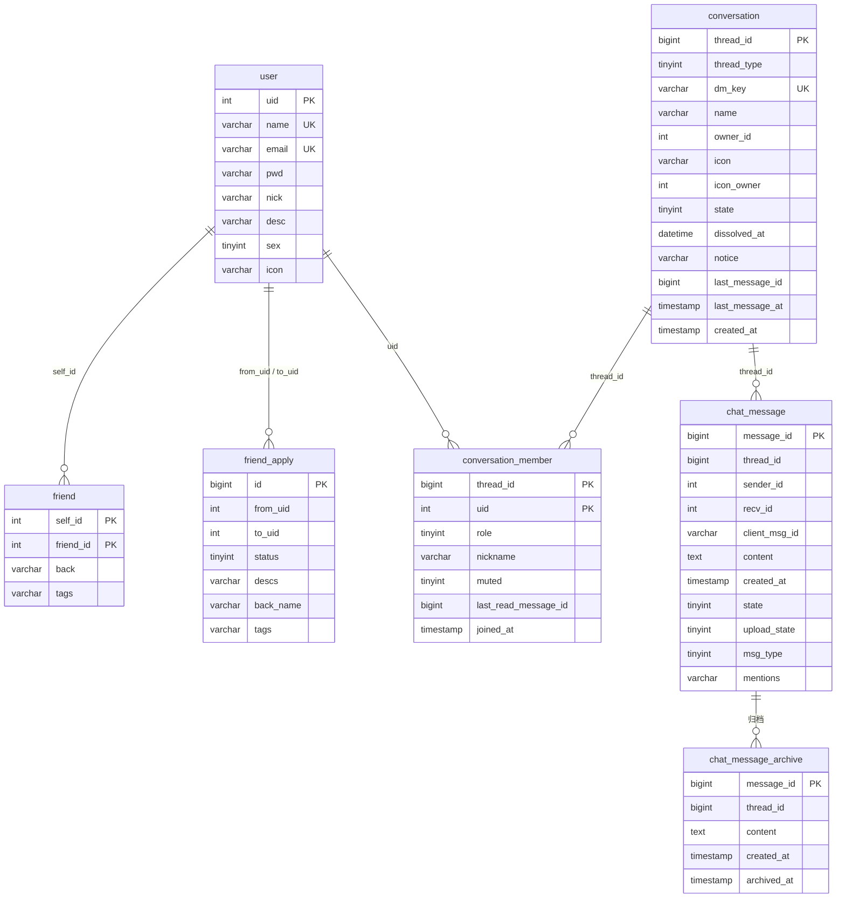

# 04 · 数据模型

## 4.1 总览

持久化分三层：**MySQL** 存业务事实，**Redis** 存在线状态与短期缓存，**客户端 SQLite** 存本地副本。三者的权威顺序是 MySQL > Redis（可重建）> SQLite（可丢弃）。



## 4.2 表设计要点

### `user`

| 列 | 说明 |
| --- | --- |
| `uid` | 自增主键，全局唯一 |
| `name` / `email` | 唯一键；用户名用于搜索与登录，邮箱登录时统一小写 |
| `pwd` | libsodium Argon2id 字符串，包含盐与参数 |
| `nick` / `desc` / `sex` / `icon` | 公开资料；`icon` 是资源名，空表示用默认头像 |

注册依赖 `LAST_INSERT_ID()` 返回 uid：0 表示重名/重邮箱，-1 表示数据库失败。

### `friend`

**双向各一行**，主键 `(self_id, friend_id)`，不再有自增 id。备注与标签跟随方向：A 给 B 的备注只影响 A 的列表。

判断"是否好友"必须两行都在（`COUNT(*) = 2`），只有一行时发送消息会被拒绝。

### `friend_apply`

`(from_uid, to_uid)` 唯一；重复申请复用同一行，`status` 复位为 0。

| status | 含义 |
| --- | --- |
| 0 | 待处理 |
| 1 | 已通过 |
| 2 | 预留（当前客户端只提供同意） |

索引 `(to_uid, id)` 服务"我收到的申请"，`(from_uid, id)` 服务"我发出的申请"。

### `conversation`

单聊与群聊共用一张表，`thread_type` 1 单聊 / 2 群聊。

| 列 | 说明 |
| --- | --- |
| `dm_key` | 单聊去重键 `小uid:大uid`，唯一索引；群聊为 NULL |
| `name` / `owner_id` | 群名与群主；单聊为空与 0 |
| `icon` / `icon_owner` | 群头像资源名与上传者 uid |
| `state` / `dissolved_at` | 群解散软删；列表查询统一 `state = 0` |
| `last_message_id` / `last_message_at` | 会话排序与增量同步游标，只前进 |

索引 `(state, last_message_at, thread_id)` 与列表查询 `WHERE state = 0 ORDER BY last_message_at DESC, thread_id DESC` 完全对齐。

### `conversation_member`

成员、角色、群昵称、免打扰与**唯一已读游标**。

| 列 | 说明 |
| --- | --- |
| `role` | 0 成员 / 1 管理员 / 2 群主 |
| `nickname` | 我在本群的昵称，不修改 `user.nick` |
| `muted` | 群免打扰 |
| `last_read_message_id` | 已读位置；未读数 = 该会话中 `message_id > 游标` 且不是自己发的消息数 |

外键 `thread_id → conversation`，`ON DELETE CASCADE`；索引 `(uid, thread_id)` 服务"我参与的会话"。

### `chat_message`

| 列 | 说明 |
| --- | --- |
| `client_msg_id` | 客户端 UUID；与 `(thread_id, sender_id)` 组成幂等键 |
| `content` | 文本正文；图片是资源名；视频/文件是 JSON 元数据；合并转发是快照 JSON |
| `state` | 0 正常 / 1 已撤回 |
| `upload_state` | 0 资源未就绪 / 1 已就绪 |
| `msg_type` | 0 文本 / 1 图片 / 2 视频 / 3 文件 / 4 群系统 / 7 合并转发 |
| `mentions` | 逗号分隔的 uid 串，最多 2048 字节 |

索引：

- `(thread_id, message_id)`：会话内分页；
- `(created_at, message_id)`：归档扫描；
- 幂等唯一键 `(thread_id, sender_id, client_msg_id)`：重发只保留一条。

### `chat_message_archive`

无外键，结构与主表一致，多一列 `archived_at`。归档线程每批 2000 条，先 `INSERT IGNORE` 再 `DELETE`，重复执行安全。

## 4.3 典型查询

### 会话列表

```sql
SELECT c.thread_id, c.thread_type, UNIX_TIMESTAMP(c.last_message_at),
       c.name, c.owner_id, c.icon, c.icon_owner,
       cm.role, cm.muted, cm.last_read_message_id,
       (SELECT COUNT(*) FROM chat_message m
         WHERE m.thread_id = c.thread_id
           AND m.message_id > cm.last_read_message_id
           AND m.sender_id <> ?) AS unread
FROM conversation c
JOIN conversation_member cm ON cm.thread_id = c.thread_id AND cm.uid = ?
WHERE c.state = 0
ORDER BY c.last_message_at DESC, c.thread_id DESC
LIMIT ?
```

每行还带 `at_me`：最近未读消息的 `mentions` 是否包含自己。登录首屏最多 50 条，后续按 `(last_message_at, thread_id)` 复合游标翻页。

### 历史消息

```sql
SELECT message_id, sender_id, recv_id, client_msg_id, content,
       msg_type, state, upload_state, mentions, UNIX_TIMESTAMP(created_at),
       message_id <= (SELECT last_read_message_id FROM conversation_member
                       WHERE thread_id = ? AND uid = ?) AS is_read
FROM chat_message
WHERE thread_id = ? AND message_id < ?
ORDER BY message_id DESC
LIMIT ?
```

客户端拿到后按 `message_id` 升序渲染；`load_more` 表示还能继续向前翻。

### 批量写入

一条 `INSERT ... VALUES (...),(...)` 写完整批，再按 `(thread_id, sender_id, client_msg_id)` 一次取回 `message_id` 与 `created_at`。随后在**事务外**推进 `conversation.last_message_id`，条件 `last_message_id < ?`，避免与其它写入互相锁等待。

## 4.4 Redis 键空间

| 键 | 类型 | TTL | 写入方 | 用途 |
| --- | --- | --- | --- | --- |
| `utoken_<uid>` | string | 7 天，登录续期 | Status / Chat | 访问令牌；重置密码时删除 |
| `ubaseinfo_<uid>` | string JSON | 1 小时 | Chat / Resource | 用户资料缓存 |
| `nameinfo_<name>` | string | 1 小时 | Chat | 用户名 → uid |
| `sess_<uid>` | hash | 90 秒 | Status | `sid / inst / epoch`，在线租约 |
| `epoch_<uid>` | string | 无 | Status | 单调递增围栏令牌 |
| `sess_rate_<uid>` | string | 10 秒 | Status | 登录频率限制（5 次 / 10 秒） |
| `inst_<name>` | hash | 90 秒 | Chat → Status | 实例地址、容量、连接数、排空标记 |
| `instances` | set | 无 | Chat → Status | 实例名集合 |
| `code_<email>` | string | 600 秒 | Verify | 验证码 |
| `code_cd_<email>` | string | 60 秒 | Gate | 验证码冷却 |
| `code_hr_<email>_<bucket>` | string | 1 小时 | Gate | 邮箱小时配额（5 次） |
| `code_ip_<ip>_<bucket>` | string | 1 小时 | Gate | IP 小时配额（20 次） |
| `loginfail_<account>_<bucket>` | string | 60 秒 | Gate | 登录失败计数（5 次） |
| `loginfail_ip_<ip>_<bucket>` | string | 60 秒 | Gate | IP 登录失败计数（20 次） |
| `file_upload_<md5>` | hash | 1 小时 | Resource | 上传进度、路径、归属 |

约定：

- 所有键都带业务前缀，禁止裸键；
- 限流键的 bucket 用 `time / 窗口秒数`，跨窗口自然失效；
- `sess_` 与 `epoch_` 必须落在同一 Redis 分片（按 uid 哈希），否则 Lua 原子性失效。

## 4.5 客户端本地库

路径 `<AppData>/XiguChat/xiguchat/users/<uid>/chat.db`，SQLite schema v4，WAL 模式。

| 表 | 内容 |
| --- | --- |
| `thread` | 会话、置顶/免打扰/隐藏、草稿、最后一条预览、未读与 `at_me` |
| `message` | 消息副本、状态、资源名、本地路径、撤回标记 |
| `friend` | 好友资料与备注 |
| `friend_tag` | 好友标签 |
| `grp` | 群资料、角色、群头像、群昵称 |
| `group_member` | 群成员缓存 |

本地库只存"已经下发过的数据"，服务端仍是权威。清空本地库不会丢消息，重新登录会按 `last_message_id` 拉回。

## 4.6 数据保留

| 数据 | 保留策略 |
| --- | --- |
| `chat_message` | 默认 365 天，之后搬到 `chat_message_archive` |
| `chat_message_archive` | 长期保留，可另行归档到冷存储 |
| `friend_apply` | 长期保留；重新申请复位状态 |
| 已解散群 | `state = 1` 软删，成员与消息保留 |
| 资源文件 | 删除好友或撤回消息不会删文件；由配额与人工清理控制 |
