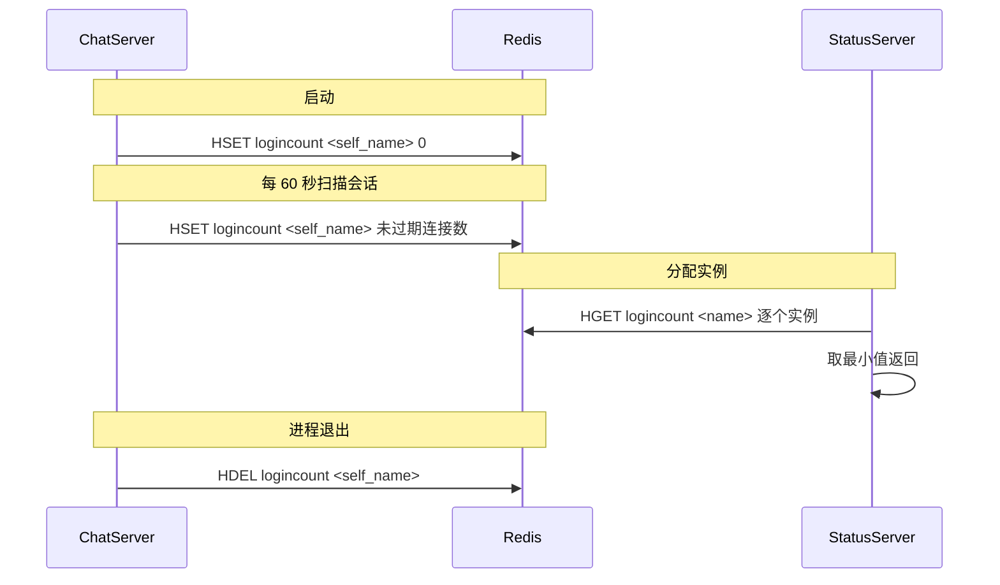
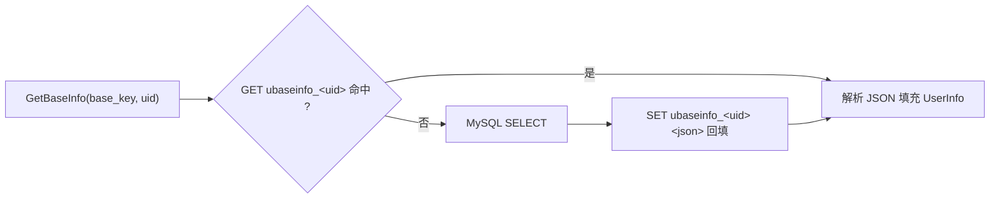

# 04 · 数据模型

数据分两层：**MySQL 负责持久化**（用户、好友关系、好友申请、会话与消息），**Redis 负责运行时状态**
（token、用户缓存、实例位置、连接计数、验证码）。

> `backup/xigu.sql` 包含账号与好友基础数据。聊天表结构不随仓库分发，
> 由部署环境按本文档的字段与索引手动创建。

---

## 4.1 MySQL

数据库：`xigu`，字符集 `utf8mb4 / utf8mb4_unicode_ci`。
后端通过 **X DevAPI（X Protocol，默认 33060）** 访问，连接参数在各自 `config.ini` 的 `[Mysql]` 段。

### 表 `user`

| 列 | 类型 | 说明 |
| --- | --- | --- |
| `id` | int, AUTO_INCREMENT | 物理主键 |
| `uid` | int, UNIQUE | **业务用户 ID**，由 `user_id` 表递增分配 |
| `name` | varchar(255), INDEX | 用户名，唯一性由存储过程保证 |
| `email` | varchar(255), UNIQUE | 邮箱，登录账号 |
| `pwd` | varchar(255) | Argon2id 哈希串（`$argon2id$v=19$...`，约 98 字符） |
| `nick` | varchar(255) | 昵称 |
| `desc` | varchar(255) | 个性签名（SQL 中需反引号转义：`` `desc` ``） |
| `sex` | int | 性别：0 未知 / 1 男 / 2 女（以客户端 `UserInfoPage`、`FriendInfoPage` 的显示规则为准） |
| `icon` | varchar(255) | 头像：默认值为 Qt 资源路径（如 `:/res/head_1.jpg`）；上传后保存资源文件名（`<md5>.png`），由 ResourceServer 写入 |

### 表 `friend`

| 列 | 类型 | 说明 |
| --- | --- | --- |
| `id` | int unsigned, AUTO_INCREMENT | 主键 |
| `self_id` | int | 关系持有者 uid |
| `friend_id` | int | 好友 uid |
| `back` | varchar(255), 默认空串 | 本人给好友设的备注；空串表示没设 |
| `tags` | varchar(512), 默认 `'[]'` | 本人给好友打的分组标签，JSON 字符串数组 |

唯一索引 `(self_id, friend_id)`。好友关系是**双向两行**：A 同意 B 的申请时，
`AddFriend` 会分别插入 `(A,B)` 与 `(B,A)`，用 `INSERT IGNORE` 避免重复。
两条 INSERT 固定按 `self_id` 升序执行：两个用户同时互相同意时写入的是同一对行，
顺序一致才不会形成 AB/BA 循环等待。

`back` 是**单方面**的：A 的这行只影响 A 看到的名字，与 B 自己设的备注无关。
加好友与同意好友时都不写默认备注，留空就是空串；之后由 1047 单独修改。
客户端显示名统一按 **备注 > 昵称 > 用户名** 回落，因此空备注不会让列表出现空白。

`tags` 与 `back` 同一层级、同样单方面：A 给 B 打的标签只影响 A 的联系人分组，
不会出现在 B 的列表里。选 JSON 数组而不是逗号分隔，是因为标签可能带逗号或引号，
标准转义比自定义分隔符可靠；写入时开启 `emitUTF8`，汉字按原文存，避免 `\uXXXX`
把每个字撑到 6 字节。最多 10 个、单个 12 字符，512 字节足够。

> 标签没有独立的关系表：好友数量是个人量级，按标签筛选在客户端完成，
> 用不上多对多查询；一列 JSON 让 `SELECT friend_id, back, tags` 一次取回整份好友列表。
> 两张表的 `tags` 列都由服务启动时的 `EnsureFriendTagColumns` 幂等补齐，不需要手工建表。

### 表 `friend_apply`

| 列 | 类型 | 说明 |
| --- | --- | --- |
| `id` | bigint, AUTO_INCREMENT | 主键，同时用作分页游标 |
| `from_uid` | int | 申请人 |
| `to_uid` | int | 被申请人 |
| `status` | smallint, 默认 0 | 0 待处理 / 1 已同意 |
| `descs` | varchar(255), 默认空串 | 申请留言；同意后作为申请方的第一条欢迎消息 |
| `back_name` | varchar(255), 默认空串 | 申请方给对方设置的备注；同意后用于反向好友记录 |
| `tags` | varchar(512), 默认 `'[]'` | 申请方给对方选的分组；同意后复制到反向好友记录的 `tags` |

唯一索引 `(from_uid, to_uid)`；`AddFriendApply` 用
`ON DUPLICATE KEY UPDATE descs = VALUES(descs), back_name = VALUES(back_name), tags = VALUES(tags)` 更新重复申请。
重新申请会整组覆盖上一次的留言、备注和标签，不会残留旧分组。

### 表 `user_id`

单行表，保存当前已分配的最大 uid。注册时 `UPDATE user_id SET id = id + 1` 后取回，
作为新用户的 uid。这是一把隐式的全局自增锁，位于 `reg_user` 事务内。

### 存储过程 `reg_user`

```sql
CREATE PROCEDURE reg_user(IN new_name VARCHAR(255), IN new_email VARCHAR(255),
                          IN new_pwd   VARCHAR(255), OUT result INT)
```

| 返回值 | 含义 |
| --- | --- |
| `-1` | 执行异常（已 `ROLLBACK`） |
| `0` | 用户名或邮箱已存在 |
| `>0` | 新分配的 uid |

流程：`START TRANSACTION` → 检查 name → 检查 email → `user_id` 自增 → 插入 `user` → `COMMIT`。
`DECLARE EXIT HANDLER FOR SQLEXCEPTION` 负责回滚并返回 -1。

> **重要**：`new_pwd` 存的是 DAO 层算好的 Argon2id 哈希串，存储过程只做搬运，
> 因此数据库里**不存在明文密码**。

### 会话与消息表

聊天表结构如下（建表 SQL 由部署环境自行维护，不纳入仓库）：

| 表 | 用途 |
| --- | --- |
| `chat_thread` | 单聊/群聊共用的全局会话 ID 和类型；`updated_at` 在每次写消息时刷新 |
| `private_chat` | 两个按 uid 升序保存的单聊参与者；唯一索引避免重复会话 |
| `group_chat` / `group_chat_member` | 群聊资料与成员关系，本阶段只建表，群聊业务尚未接入 |
| `chat_message` | 全局自增 `message_id`、会话、发送/接收者、客户端去重 ID、正文、消息类型、上传状态与 `created_at` |

时间字段有两个用途，都按 UNIX 秒下发：

- `chat_message.created_at`：消息落库时间，决定聊天内的时间条与客户端会话排序；
  重发同一条消息（唯一键命中）时保留原值，不会因为重试而改时间。
- `chat_thread.updated_at`：会话最后活动时间，登录首屏用它排序，
  避免历史消息还没拉回来时列表先按加好友顺序显示、随后又跳一次。

SQL 里统一用 `UNIX_TIMESTAMP(created_at)` 取值，避免把数据库时区的字符串直接下发给客户端。
写入不显式传时间：用列的 `CURRENT_TIMESTAMP` 默认值，插入后按 `message_id` 读回时间戳——
这样重发同一条（唯一键命中、没有真正插入）时拿到的是库里原来的时间，而不是这次重试的时刻。

`chat_message.msg_type`：0 文本、1 图片、2 视频、3 文件。图片消息的 `content` 存资源文件名（md5）；
视频与文件的 `content` 存元数据 JSON（`{"name":原始文件名,"size":字节数,"resource":资源名,"thumb":首帧资源名}`）。
视频/文件的 `resource` 优先等于原文件名，重名时带 `(2)` 等后缀，落盘与下载都按它拼路径；
`file_name` 始终保留上传者看到的原名用于展示。`status=0` 表示资源还没上传完成；
ResourceServer 在最后一片落盘后通过 gRPC 通知 ChatServer 把 `status` 改成 1。
视频与文件不区分上传者/接收者，接收方收到通知只建卡片，资源本体由用户点击后下载。

消息分页使用 `(thread_id, message_id)` 索引及游标 `message_id > last_id`；会话分页使用 `thread_id > last_id`。
首次单聊先用普通查询取已有会话，缺失时直接插入 `chat_thread` + `private_chat`，由
`uk_private_users` 唯一键裁决；撞键的一方回滚掉自己新建的会话行，再读对方已提交的 `thread_id`。
这里不用 `SELECT ... FOR UPDATE` 占位：查不到行时它锁的是索引间隙，随后的 INSERT 又需要插入意向锁，
两个并发请求会各自持有间隙锁并互相等待。
客户端当前仍只保存在内存，不含 SQLite；每次登录会同步会话及服务端历史消息，后续本地缓存可用全局 `message_id` 增量续传。
当前 QML 客户端已经按会话持有 `ChatThreadData`，消息对象包含 `msgid`、`thread_id`、`message_id`、发送者/接收者和状态。
发送中的消息先进入会话并显示转圈，服务器回包后变为已发送，失败变为失败标记。
历史或实时收到的对方消息在内存中标记为未读；未读/已读的展示与回执闭环尚未接通。
消息容器每次合并后按有效 `message_id` 升序排列，待确认的本地消息暂放在末尾，收到服务器 ID 后重新排序，避免历史分页与实时消息交错时乱序。

---

## 4.2 Redis

连接：hiredis，连接池容量 5，启动即 `AUTH`。
键前缀常量定义在 `ChatServer/include/const.h`（其他服务复制了各自需要的部分）。

| 键 | 类型 | 写入方 | 读取方 | TTL | 说明 |
| --- | --- | --- | --- | --- | --- |
| `code_<email>` | String | VerifyServer | GateServer | 600s | 验证码，`SETEX` 写入 |
| `utoken_<uid>` | String | StatusServer | ChatServer | 无 | 登录令牌（UUID） |
| `uip_<uid>` | String | ChatServer | ChatServer | 无 | 该用户当前所在实例名 |
| `ubaseinfo_<uid>` | String(JSON) | ChatServer、ResourceServer | ChatServer | 无 | 按 uid 缓存的用户资料；头像上传后由资源服务器刷新 |
| `nameinfo_<name>` | String(JSON) | ChatServer、ResourceServer | ChatServer | 无 | 按用户名缓存的用户资料；头像上传后由资源服务器刷新 |
| `logincount` | Hash | ChatServer | StatusServer | 无 | field=实例名，value=在线连接数 |
| `file_upload_<md5>` | String(JSON) | ResourceServer | ResourceServer | 3600s | 分段上传进度：路径、文件名、uid、seq、总大小、已落盘大小、是否头像 |

未使用的历史前缀：`ipcount_`（`IPCOUNTPREFIX`），当前代码中无引用。

### `logincount` 与最小连接数调度



设计要点：

- 计数是扫描快照，包含尚未登录但未超时的 TCP 连接，不是严格的在线用户数。
- 登录与断连不直接增减计数，调度数据最多滞后一个扫描周期。
- StatusServer 跳过缺失、非法计数；全部无效时返回失败。
- 计数没有 TTL，实例崩溃可能留下旧值，需要独立的探活机制。

### 用户资料缓存策略

`GetBaseInfo(base_key, uid, userinfo)` 是标准的 **Cache-Aside**：



有三处需要注意：

1. 缓存**无 TTL**：只能靠写入方主动覆盖。目前有两个写入点——头像上传完成后由 ResourceServer
   重写两份键，本人修改资料后由 ChatServer 重写两份键；其余路径不会自动失效。
2. 资料缓存读写均不使用 `pwd`，已有 Redis 键中的历史字段不会因更新程序自动删除。
3. `GetBaseInfo` 在 `LogicSystem`、`ChatServiceImpl`、`ChatGrpcClient` 三处重复实现，
   逻辑完全一致——是明确的重复代码，应收敛到 `UserMgr` 或独立的 `UserCache` 组件。

### 验证码的复用语义

`VerifyServiceImpl::GetVerifyCode` 先 `GET code_<email>`：

- 命中 → **复用旧验证码**，不再生成、但仍会再发一次邮件；
- 未命中 → 生成新验证码并 `SETEX 600`。

因此在 10 分钟有效期内重复点击"获取验证码"，用户会收到多封内容相同的邮件。

---

## 4.3 客户端侧数据（`client/core/userdata.h`）

客户端不直接访问数据库，用下列结构承载服务端下发的数据：

| 结构 | 用途 |
| --- | --- |
| `SearchInfo` | 用户搜索结果 |
| `AddFriendApply` | 收到的好友申请（通知） |
| `ApplyInfo` | 好友申请列表项（含 `status`） |
| `AuthInfo` / `AuthRsp` | 同意好友申请的双向通知与响应 |
| `FriendInfo` | 好友（含 `_chat_msgs` 会话记录） |
| `UserInfo` | 当前登录用户 / 好友通用资料 |
| `TextChatData` / `TextChatMsg` | 单条文本消息 / 一批消息 |

`UserMgr`（单例）持有 token、好友列表、申请列表与分页游标
（`_chat_loaded` / `_contact_loaded`，每页 13 条），是 UI 层唯一的数据源。
`UserInfo` 额外带 `_desc`（个性签名），`AuthInfo` / `AuthRsp` 带 `_back`（本人给对方设的备注），
两者都只在登录/通过申请时由服务端下发。

### 三个名字与显示名规则

用户名、昵称、备注职责不同，不能互相替代：

| 字段 | 唯一性 | 可见范围 | 修改方 |
| --- | --- | --- | --- |
| `name` 用户名 | 全局唯一 | 所有人 | 注册后不可改 |
| `nick` 昵称 | 可重复 | 所有人 | 本人（1045） |
| `back` 备注 | 只在自己这一行 | 仅本人 | 本人（1047） |

显示名统一按 **备注 > 昵称 > 用户名** 回落，由 `userdata.h` 的 `DisplayName()` 实现：
会话列表、联系人、聊天标题、气泡名字、资料页都走同一条规则。
服务端只下发三个原始字段，不参与显示名拼接。

### 标签与联系人筛选

标签是"我给好友打的分组"，与备注同级：单方面、只在自己这一侧生效、一个好友可以有多个。
客户端在 `FriendInfo::_tags` 持有 `QStringList`，`UserMgr::AllTags()` 汇总去重后供联系人页
生成筛选条；筛选由 `FriendListModel` 在行视图层完成，不改变 `UserMgr` 里的原始顺序。

会话模式会关闭筛选（`setFilterEnabled(false)`），否则会话列表会被联系人页选中的标签一起过滤。
筛选后列表为空时只在列表区域给提示，不改变"新的朋友"入口与空态引导的判断——
那些判断统一用 `totalCount`，与筛选结果无关。

---

## 4.4 当前边界

| 数据 | 现状 |
| --- | --- |
| 客户端本地消息缓存 | 尚未接入 SQLite；当前登录时从服务端按会话拉取历史消息 |
| 离线消息 | 消息正文已持久化；离线期间不推送，下一次登录的历史同步可取回 |
| 消息送达状态 | `chat_message.status` 已预留，送达/已读回执闭环尚未实现 |
| 好友标签 | 只用于联系人分组与筛选；没有"按标签群发"、没有标签重命名（改名等价于逐个好友改） |
| 群聊 | 表结构已预留，群聊创建、成员授权和广播业务尚未实现 |
