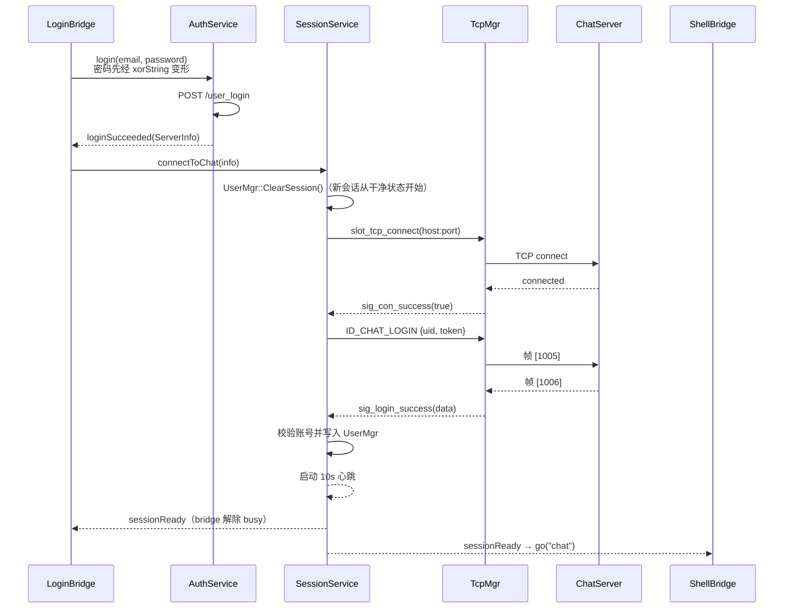

# 06 · 客户端（Qt 6 / QML）

## 6.1 技术概览

| 项 | 值 |
| --- | --- |
| 语言 / 标准 | C++17 |
| Qt 版本 | 6.5（Core / Gui / Network / Quick / QuickControls2 / QuickDialogs2） |
| UI 方式 | QML，`qt_add_qml_module` 编入 qrc，入口 `qml/Main.qml` |
| 样式 | `qml/Theme.qml` 单例：日间 / 夜间语义色、字号与尺寸，无样式表文件 |
| 资源 | `resources/rc.qrc`：应用图标 PNG 与内置头像；操作图标由 QML 绘制 |
| 目标名 | `xiguchat`（macOS 为 `xiguchat.app`） |

QML 负责布局、焦点、动画和弹窗的临时表单状态；业务状态与网络协议由 C++ 管理。
页面通过 `Q_INVOKABLE` 发起动作，通过 `Q_PROPERTY` 与列表模型读取结果。

## 6.2 分层结构

`main.cpp` 创建 `QGuiApplication`，设置应用标识、字体与图标，从 `config.ini` 拼出网关 URL，再加载根窗口。
界面调用方向为 `qml → bridge → core/service → network`。`core/userdata` 是共享数据类型，
`UserMgr` 是会话数据源；网络层解析消息后发信号，由服务层更新数据，不负责切换页面。

**qml — 界面**

| 文件 | 说明 |
| --- | --- |
| `Main.qml` | 根 `Window`：持有 `ShellBridge`，用 `Loader` 换页并按页设窗口尺寸；掉线提示浮层 |
| `Login` / `Register` / `Reset` | 认证三页，共用 `AuthPage` 外壳、320 像素表单列与折纸信封角色；内容过长时滚动 |
| `ChatWindow` | 聊天主界面：侧栏 + 左列（会话 / 联系人 / 设置）+ 右侧页面栈；联系人空态、加好友浮层与聊天页好友过滤 |
| `SettingsPanel` / `UserInfoPage` | 设置索引与个人资料：账号信息、头像入口和外观切换 |
| `AvatarEditor` | 系统文件选择与模态裁剪框，提供预览、缩放、重置及保存 / 取消 |
| `FriendDialogs` | 添加好友与通过申请的弹层及临时表单 |
| `SearchField` | 联系人页与聊天页共用的搜索输入，只负责输入、焦点和清空 |
| `AddFriendPopover` | 联系人页加好友浮层：说明、搜索按钮与结果状态 |
| `FriendSearchPopup` | 聊天页好友过滤结果，浮在会话列表上方 |
| `Avatar` | 显示已有头像，无头像时回退名字首字；软件渲染时不启用遮罩特效 |
| `ChatPage` | 会话页：标题 + 消息流 + 输入区 |
| `FriendInfoPage` | 好友资料页：头像 / 名字 / ID / 昵称 / 性别 / 备注 / 个性签名 / 标签；底部「发消息」与「编辑资料」 |
| `ApplyFriendPage` | 好友申请页：申请人 + 申请信息 + 添加 / 已添加 |
| `ChatBubble` | 文本气泡；图片消息的圆角缩略图、传输进度与未下载占位 |
| `Theme.qml` | 外观单例：日夜颜色、字号、圆角、气泡最大宽度；本地保存外观选择 |
| `AppIcon` | 统一 Canvas 线条图标，包含密码可见、主题切换与聊天工具图标 |
| `BrandMark` | 页面品牌图形，与窗口共用 `xiguchat.png` |
| `PaperCompanion` | 原创折纸信封角色，根据焦点、密码显示状态与请求状态改变表情 |
| `AppInput` / `AppButton` / `AppLink` / `CodeButton` / `SideButton` / `Spacer` / `AuthPage` | 组件 |

**bridge — QML 与 C++ 的边界**

| 文件 | 说明 |
| --- | --- |
| `shellbridge` | 当前页面（`page`）、掉线提示（`notice`）、`go(target)`；接管踢人与断线信号 |
| `pagebridge` | 页面基类，只提供 `go(target)` 导航契约 |
| `loginbridge` / `registerbridge` / `resetbridge` | 认证三页的状态与动作，含输入校验、验证码倒计时、错误文案 |
| `chatbridge` | 三个列表模型 + 选中会话 + 联系人页加好友浮层 + 聊天页好友过滤 + 发消息/申请 + 设置导航与个人资料 |
| `friendlistmodel` | 会话与联系人共用：`uid / name / nick / icon / desc / lastText / initial` |
| `applylistmodel` | 好友申请，另有 `pendingCount` 供侧栏红点使用 |
| `messagemodel` | 当前会话的文本、头像、图片缩略图与传输进度角色，增量插入 |
| `composerbridge` | 图片插入（缩略图 + 上传压缩图）、粘贴纯文本、按顺序提取片段、按好友保存草稿 |
| `imagecropper` | `QQuickPaintedItem`：图片解码、八手柄正方形裁剪、圆角预览与本地 PNG 保存 |

**core — 业务与数据**

| 文件 | 说明 |
| --- | --- |
| `service/authservice` | HTTP 认证：登录、验证码、注册、重置；服务端错误码 → 界面文案 |
| `service/sessionservice` | 会话生命周期：TCP 登录、12s 超时、10s 心跳；登录数据与消息/好友通知写入 UserMgr |
| `service/chatservice` | 文本按 JSON 字节数分帧、发送与本地记录 |
| `service/friendservice` | 搜索用户、发起申请、通过申请 |
| `global` | 枚举（`ReqId` / `Modules` / `ErrorCodes`）、`gate_url_prefix`、`ServerInfo` |
| `singleton` | CRTP 单例模板（`std::once_flag` + `shared_ptr`） |
| `userdata` | 数据结构（`SearchInfo` / `ApplyInfo` / `FriendInfo` / `TextChatMsg`） |
| `usermgr` | 登录用户、好友与申请列表；变更时发信号，列表模型据此刷新 |

**network — 传输**

| 文件 | 说明 |
| --- | --- |
| `httpmgr` | HTTP 短连接（`QNetworkAccessManager`），按 `Modules` 分发回包 |
| `tcpmgr` | TCP 长连接（`QTcpSocket`）+ 自定义帧编解码 |

## 6.3 启动流程

`main.cpp`：

1. 创建 `QGuiApplication`，设置应用名 `xiguchat`、组织名 `XiguChat`，供本地外观设置使用；
2. 按平台设置字体：macOS 用苹方 / Helvetica Neue，Windows 用 Microsoft YaHei UI / Segoe UI，Linux 用 Noto Sans CJK SC / Noto Sans；
3. `setWindowIcon(QIcon(":/res/xiguchat.png"))`
   （Windows/Linux 显示在标题栏与任务栏；macOS 标题栏不显示图标，Dock 图标来自 bundle 内的 `.icns`）；
4. 用 `QSettings` 读可执行文件同目录的 `config.ini`，拼出 `gate_url_prefix = "http://host:port"`；
5. `QQmlApplicationEngine::load("qrc:/qt/qml/XiguChat/qml/Main.qml")`。

`Main.qml` 在 `Component.onCompleted` 里装入登录页，窗口标题为 `xiguchat`。
认证窗口固定为：登录 `420×560`、注册 `420×740`、重置密码 `420×680`。
聊天窗口进入时至少为 `1060×740`，最小可缩到 `960×680`，支持拉伸。

## 6.4 通信层

### `HttpMgr`（HTTP 短连接）

- 继承 `QObject` + `Singleton<HttpMgr>` + `enable_shared_from_this`；
- `PostHttpReq(QUrl, QJsonObject, ReqId, Modules)` 用 `QNetworkAccessManager` 发 POST；
- 回包后按 `Modules` 分发：`sig_reg_mod_finish` / `sig_reset_mod_finish` / `sig_login_mod_finish`，
  通用信号为 `sig_http_finish`。这样各服务只需连接自己模块的信号。

### `TcpMgr`（TCP 长连接）

- 运行在独立网络线程：`main.cpp` 先构造 `TcpThread`，它创建 `QThread`，调用
  `TcpMgr::MoveToThread()`；该函数同时把成员 `_socket` 单独迁移到同一线程
  （`moveToThread` 不会带走没有父子关系的成员对象）；
- 构造函数中连接 `connected` / `readyRead` / `disconnected` / `errorOccurred`，并调用
  `initHandlers()` 注册 `QMap<ReqId, std::function<...>>` 分发表；
- **元对象注册**：`registerMetaType()` 注册 `ServerInfo`、`ReqId` 与所有 `std::shared_ptr`
  形式的用户数据。跨线程是队列连接，参数要运行时打包，缺少注册时槽函数不会触发；
- **粘包/半包处理**：`readyRead` 累积到 `_buffer`，用 `_b_recv_pending` 标记"头部已解析、等待完整包体"，
  循环拆帧。每次解析头部都重新创建 `QDataStream`——它的读取位置是内部状态，不会随
  `_buffer` 被消费而复位，复用同一个对象会让第二帧从旧偏移开始读；头部与包体用
  `remove(0, n)` 原地消费。长度字段校验为 `0 < len <= 32763`（服务端 `short` 发送上限），
  非法长度直接断开，避免按错误长度无限等待。断开连接时 `resetRecvState()` 清空缓冲与半包游标，
  防止旧连接的残帧拼到新连接；
- **发送**：`QDataStream` 设为 `BigEndian`，写 `quint16 id` + `quint16 len`，再 append JSON；
  数据进入 `_send_queue`，由 `bytesWritten` 在当前块写完后继续取队首，避免发送缓冲区满时丢包；
- **线程边界**：连接、关闭、发送分别通过 `sig_connect_tcp` / `sig_close_connection` /
  `sig_send_data` 投递到网络线程，外部不直接碰 socket；
- 对外信号：`sig_con_success` / `sig_con_failed` / `sig_login_failed` / `sig_login_success` /
  `sig_user_search` / `sig_friend_apply` / `sig_add_auth_friend` / `sig_auth_rsp` / `sig_text_chat_msg` /
  `sig_notify_offline` / `sig_connection_closed`。

> `sig_con_failed` 挂在 `QAbstractSocket::errorOccurred` 上（排除 `RemoteHostClosedError`），
> 让"连不上"在 1 秒内就能提示，而不是等超时。主动重连时 `_manual_close` 会抑制一次
> `disconnected`，避免旧连接关闭被当成新登录失败。

### `FileTcpMgr`（资源服务器）

- 同样运行在 `FileTcpThread` 中，与聊天网络线程分开；
- 帧头是 `quint16 id` + `quint32 len`，包体上限 16KB；
- 接收循环与聊天端同一套规则：每帧新建 `QDataStream`、`remove(0, n)` 消费缓冲、
  `0 < len <= 16KB` 校验；断开/重连时清空半包缓冲与解析游标；
- 处理 `1037/1039/1041/1043` 四组消息：通用上传、进度同步、断点下载、头像上传；
- 上传状态保存在 `UserMgr::UploadFileInfo`；聊天图片用拥塞窗口（最多 8 片在途），
  头像固定 1 片，收到回包后按连续确认的序号补发，进度不会因乱序回包回跳；
- 下载状态保存在 `DownloadFileInfo`，`seq == 1` 覆盖写、其余追加，`is_last` 为真时结束；
  每片回包发出 `sig_download_progress`，头像与聊天图片共用，由接收方按资源名区分；
- 暂停只停止发送下一片，继续前由 `FileService` 发 `ID_SYNC_FILE_REQ` 对齐服务器进度。

`FileService`（`core/service/fileservice.cpp`）负责业务编排：头像保存后上传、登录后拉取
本机/好友缺失头像、进度与暂停状态、下载结果的本地缓存。头像与聊天资源共用同一个上传通道，
头像进度走 `uploadStateChanged`，聊天资源按资源名发出 `chatResourceProgress/Finished/Failed`，
再由 `ChatService` 回写消息进度与状态。缓存文件按 PNG 签名与 `IEND` 尾块判断完整性，
下载中断留下的半截文件会被删除后重新请求；资源连接断开或换账号时，在途下载记录、
半截文件与聊天资源上传记录一并清理。详细协议见 [13-ResourceServer](13-resource-server.md)。

接收方图片：`TcpMgr` 把 1033 交给 `ChatService::HandleImageNotify`，先按 `msgid` 合并到会话，
本机已有压缩图时直接生成缩略图；没有则排入下载队列。登录时解析 1029 的历史图片走同一个入口：
先查 `images/<md5>.<ext>`，命中就直接显示缩略图，缺失才排队下载。

队列最多同时下两张，实时通知插到队首；每张完成后按资源名把所有引用它的消息换成缩略图。
资源连接可能晚于历史同步或通知建立，任务会留在队列里，`RetryImageDownloads` 在连接就绪后
按会话消息重新补齐，不会因为连接没就绪就把请求丢掉。

### 视频与文件消息

输入区工具栏提供图片、视频、文件夹三个入口。视频与文件选中后只记录路径、文件名与大小，
追加到输入框上方的附件区；附件卡片先横向排列，一行放不下自动换行，区域最多显示两行，
更多时在附件区内部滚动，编辑区高度保持不变。可以一次添加多个视频/文件，切换会话会清空附件。

视频与文件都按**上传者的原文件名**保存（去掉路径分隔符和系统保留字符，超长截断）：
`videos/<原文件名>`、`files/<原文件名>`；同名但内容不同时追加 `(2)`、`(3)` 后缀，
内容 md5 相同时复用已有文件。图片仍按内容 md5 命名，避免相似图片互相覆盖。
发送视频时由 `VideoThumbnailer`（`QMediaPlayer` + `QVideoSink` 抓首帧，6 秒超时）生成
`videos/thumbs/<md5>.jpg`；资源上传顺序是**先缩略图、后视频本体**，两者都完成后资源服务器
才通知接收方。首帧提取失败时视频照常发送，卡片显示通用视频图标，不阻塞消息。
文件不做预览，复制到 `files/<原文件名>` 后上传本体。

发送方卡片显示进度条与暂停/继续按钮；暂停在资源层生效（见
[13-ResourceServer](13-resource-server.md)），继续时先与服务器对齐已写分片。视频卡片用首帧
铺底并叠加播放按钮，首帧通过 `MultiEffect` 圆角蒙版裁切，方形视频也不会露出直角；文件卡片
用扩展名色块 + 文件名 + 大小/状态 + 右侧操作按钮（QQ 风格）。未发送成功时按钮变为“重试”，
本地文件仍在，不需要重新选。

接收方收到 1036 或历史同步时**不自动下载视频/文件本体**，只把首帧缩略图排入下载队列；
卡片状态为“未下载”，操作区提供“下载”与“另存为”。点“另存为”可以先选目标路径，
`ChatBridge` 记下目标并开始下载，完成后自动复制；点“下载”只落到账号缓存目录。
下载中可暂停/继续，完成后视频的播放按钮进入内置查看器，文件卡片出现“打开”与“文件夹”
（在系统文件管理器中定位）。下载缓存直接使用资源名，因此视频/文件在本机就是原名；
另存为会记住目标位置，之后“打开/文件夹”优先指向另存的文件，而不是再下载一份。

文本、图片、视频与文件消息都支持右键菜单：文本可复制文字；图片可查看大图、复制图片、
另存为、打开文件夹；视频/文件按状态提供下载、暂停/继续、打开、打开文件夹、另存为与复制文件名。

### 媒体查看器

`ViewerOverlay` 覆盖在聊天区之上，点击图片或已下载的视频打开：

- 图片：滚轮或底部按钮缩放 0.5×–5×，拖拽平移，双击在 100% 与 220% 之间切换，`Esc` 或点空白关闭；
- 视频：`MediaPlayer` + `VideoOutput` 播放，带播放/暂停、时间、可点击跳转的进度条，关闭时停止播放并释放源；
- 当前会话的图片与已下载视频按消息顺序串成一个列表，左右按钮或方向键切换；
  首尾不循环，只提示“已经是第一张/最后一张”；
- 查看器不再占用顶部一行：图片直接铺满上方区域，关闭按钮与左右切换一样浮在右上角，
  标题只作为内部字段保留，不在界面显示。

文件不走内置查看器，卡片上的“打开”交给系统默认程序，“另存为”使用 `FileDialog`
默认定位到系统下载目录并带出上传者的原文件名；本机已有文件时用 `QSaveFile` 原子复制，
未下载时排队等待下载完成，保存结果通过 `resourceSaved` 回到界面提示。另存成功后，
“文件夹”定位到另存位置；用户把文件移走或改名时提示“另存的文件已被移动或删除”，
缓存文件也被删除时消息回到“未下载”，可以重新下载。

### 本机资源目录

所有账号相关文件统一放在 `AppData/users/<uid>/`，本地登录多个账号互不干扰：

| 路径 | 内容 |
| --- | --- |
| `avatar.png` | 当前账号头像 |
| `contacts/<ownerUid>/<icon>` | 好友/申请人的头像缓存 |
| `images/<md5>.<ext>` | 聊天压缩图，与服务器保存的是同一份，点开大图直接读它 |
| `images/thumbs/<md5>_thumb.jpg` | 气泡/输入区缩略图，不覆盖压缩图 |
| `images/pending/<uuid>.<ext>` | 输入区待上传的临时压缩图，登录时清理 |
| `videos/<原文件名>` | 视频本体，重名时带 `(2)` 等后缀；用户点击下载后才出现 |
| `videos/thumbs/<md5>.jpg` | 视频首帧，仍按内容 md5 命名，接收方自动下载用于卡片预览 |
| `files/<原文件名>` | 文件本体，重名时带后缀；用户点击下载后才出现 |

路径由 `UserMgr::AccountRootPath()` 统一生成，`ChatService` 与 `ComposerBridge` 不再各自拼目录。
目录只按 uid 分层：uid 就是账号身份，本地测试和正式部署上的同名 uid 视为同一个账号，不做网关区分。

### 登录的两阶段握手

## 6.5 QML 层设计要点

### 页面切换

`ShellBridge` 是唯一持有"当前页面"的对象。QML 里 `bridge.go("register")` → `ShellBridge::go()`
→ `page` 变化 → `Main.qml` 用 `Loader.setSource()` 重建页面并调整窗口尺寸。

登录、注册、重置和聊天之间切换时 Loader 销毁上一页并创建新页。`setSource()` 与
`source` 绑定都能在 URL 变化时完成这一点；相同 URL 的赋值不保证重建。
认证请求处理中禁止离开当前表单，防止迟到的回包被新表单接收。

### 主题

`qml/Theme.qml`（`pragma Singleton`）集中定义语义颜色、字号、圆角、输入框高度与气泡宽度上限。
日间使用纸白底与墨绿文字，夜间使用深绿灰底与浅色文字，陶土色用于强调与提醒。
页面绑定 `panelBg`、`textPrimary`、`primary` 等语义属性，切换外观时同步更新。

认证窗口右上角和聊天侧栏底部的日月按钮调用 `Theme.toggle()`。
`QtCore.Settings` 将 `dark` 保存到本机的 `Appearance` 分类，下次启动恢复；
外观选择不经过 bridge 或服务端，也不写入网关配置 `config.ini`。

`CMakeLists.txt` 中 `set_source_files_properties(qml/Theme.qml PROPERTIES QT_QML_SINGLETON_TYPE TRUE)`
必须写在 `qt_add_qml_module` **之前**，否则单例属性全读成 `undefined`。

### 图标与折纸角色

页面品牌标识使用 `BrandMark` 显示应用图形，不附加文字品牌名。
图形源文件为 `resources/xiguchat.svg`，页面与运行时窗口共用导出的 PNG。

`AppIcon` 使用 24 单位的 Canvas 坐标与统一圆头线条，按 `name / color / size` 绘制，
颜色或尺寸变化时重绘。密码显示按钮与其他操作共用这一套图标。

`PaperCompanion` 由 QML 图形与 Canvas 组成：普通输入聚焦时留意表单，
密码隐藏输入时合上信封折盖遮眼，显示密码时侧身，请求处理中轻微抬起。
表情只接收交互状态，不接收密码内容；紧凑空态不运行眨眼计时器。

### 消息气泡

只有文本消息使用气泡：`TextMetrics` 的自然宽度与可用宽度取小后排版，`implicitHeight`
回推气泡高度，长英文单词与长数字串由 `WrapAtWordBoundaryOrAnywhere` 断行。
气泡使用圆角矩形，自发消息靠右，接收消息靠左；头像与文字颜色随主题变化。

图片消息不套气泡，直接显示圆角缩略图：显示上限 220×180，圆角由 `MultiEffect` 蒙版裁切，
软件渲染时退化为直角。自己发送的图片左侧显示状态图标（转圈/对勾/失败）；上传或下载期间
图片底部叠一条 3 像素进度条，按已确认/已落盘的字节推进，**不显示百分比**；上传完成后状态改为
已发送并隐藏进度条，下载完成后直接换成缩略图。接收方消息不显示状态图标，但下载时同样有进度条。

> 中文正文**不要叠加 `lineHeight` 倍率**：屏显中文字体的行盒（约 1.4em）已经够宽松，
> 再乘系数会把多出来的高度全堆在基线下方，表现为"上紧下松"。

### 左列模式与右侧页面

主界面由 72 像素导航栏、280 像素索引列和可伸缩内容区组成。
左列 `mode`（`ChatBridge::mode`）与右侧 `pane` 一起决定界面，点侧栏会同时切换两者：

| 操作 | mode | 右侧 pane |
| --- | --- | --- |
| 点侧栏「聊天」 | 0 会话 | 当前会话（没有会话则空态） |
| 点侧栏「联系人」 | 1 联系人 | 好友申请页 |
| 点侧栏「设置」或自己的头像 | 2 设置 | 个人资料页 `showSettings()` |
| 会话列表点条目 | 0 | 聊天页 `openChat(uid)` |
| 联系人列表点条目 | 1 | 好友资料页 `openProfile(uid)` |
| 资料页点「发消息」 | 0 | 聊天页 |
| 联系人列表「新的朋友」 | 1 | 好友申请页 `openApplyList()` |

联系人列表在搜索框下方提供「新的朋友」入口，再以「全部联系人」标题分隔好友列表。
没有好友时按待处理申请数切换：有申请只显示带红点的「新的朋友」，没有申请才显示加好友引导卡。
申请数量来自 `ApplyListModel::pendingCount`；好友数量与消息摘要来自实际列表数据。

好友标签是联系人页的分组手段：搜索框下方有一行标签，选中后列表只保留该分组，标题变成
「「同事」· 3 位」。这一行**不做横向滚动**：按 `TextMetrics` 估算每个 chip 的宽度，只渲染放得下的
标签，放不下的收进右端「更多」；点「更多」打开 `TagFilterPopover`，浮层里能看到全部标签
（含「全部」）并可滚动选择。标签很多时也不会把一行挤成看不见的滑动区域。
筛选只改列表视图，「新的朋友」入口与空态引导仍按 `totalCount` 判断；筛选结果为空时在列表区
提示「「同事」下还没有好友」。切换回会话模式会关闭筛选，会话列表不会被联系人页选中的标签过滤。

### 会话顺序、时间与未读

会话列表按**最后一条消息时间倒序**，最近说话的排最前；没有消息的会话排在后面，相对顺序不变。
登录首屏先用 1028 下发的 `chat_thread.updated_at` 排序，历史拉回后换成真实消息时间，
避免列表先按加好友顺序出现、随后再跳一次。联系人模式不排序，保持加好友顺序。

行摘要按消息类型生成，不会把元数据直接显示出来：

| 最后一条 | 摘要 |
| --- | --- |
| 文本 | 正文 |
| 图片 | `[图片]` |
| 视频 | `[视频]` |
| 文件 | `[文件] 原文件名` |
| 已撤回 | `撤回了一条消息` |

时间文案集中由 `core/timeformat.h` 生成，列表与聊天内共用同一套相对日判断：

| 距今 | 会话列表 | 聊天时间条 |
| --- | --- | --- |
| 今天 | `14:32` | `14:32` |
| 昨天 | `昨天` | `昨天 14:32` |
| 前天 | `前天` | `前天 14:32` |
| 3–6 天前 | `周三` | `周三 14:32` |
| 今年更早 | `3月5日` | `3月5日 14:32` |
| 去年及以前 | `2025/3/5` | `2025年3月5日 14:32` |

聊天内的时间条与上一条间隔不足 5 分钟不显示（第一条必显），值由 `MessageModel` 的
`timeText` 角色算好，QML 只判断空串。

未读数存在服务端（`chat_message.is_read`）：登录时由 1006 与 1028 的 `unread` 恢复
（两处回包都带，先到的先用，后到的覆盖），之后客户端本地增减，打开会话时清零并上报已读。
所以退出重进、换设备登录，红点都还在，不会因为关掉程序就丢掉。

"正在看哪个会话"由三个条件共同决定：会话模式 + 停在会话页 + 有当前会话（`ChatBridge::refreshActivePeer`）。
任意一个不满足就退出"正在看"状态；从联系人页切回来时会自动恢复，不需要重新点一次会话。
满足时收到新消息直接算已读，不再累加红点。

打开会话时列表强制贴底：切换后有一个 320ms 的贴底窗口（`settling`），
模型重建与首屏图片加载都在窗口内完成，期间的位置变化不改写"用户是否在底部"的判断；
用户一旦主动拖动，窗口立即结束，避免翻历史时被拉回。

各详情页都是 `ChatWindow` 的子项，用 `visible` 切换而不是重建，滚动位置和输入内容不会丢。
好友资料页的标题与列表共用同一条显示名规则：**备注 > 昵称 > 用户名**。页内所有字段统一
「左侧标签 + 右侧内容」排版（标签固定在 x=0，内容从 x=82 起占满剩余宽度），依次是昵称、
性别、备注、个性签名、标签；长文本整段换行，行高跟着内容增长，不再为签名单独开一块。
好友没写签名时显示「这一页还空着。」，只是展示兜底，不会写回数据库。
底部只保留两个真实动作：主按钮「发消息」与次按钮「编辑资料」（备注 + 标签）。
语音、视频等能力尚未实现，入口已移除，避免长期摆着两个不可点的按钮。

### 聊天页标题

标题区只有一行：显示名用 20px 加粗，好友写过个性签名时在名字后面用 12px 次要色跟一段签名，
按基线对齐；名字最多占 62% 宽度，超长各自省略，不会把签名挤没。没有签名时名字独占整行，
不显示占位符。原来那句「对话」副标题已去掉，避免和签名争夺同一行。
签名在打开会话时用 1049 拉一次最新值；好友在线时改昵称或签名会通过 1051 直接推过来，
标题、列表与打开中的资料页即时刷新，不必重开会话。

### 头像编辑

设置入口位于联系人下方，左列为 `SettingsPanel`，右侧 `UserInfoPage` 显示自己的账号资料。
页面顶部是头像与显示名，下方「更换头像」「编辑资料」并排；资料行依次是用户名、昵称、性别、个性签名。

「编辑资料」打开 `ProfileDialogs` 的 `self` 形态：昵称（上限 20 字符，留空则显示用户名）、
性别（不公开 / 男 / 女）、个性签名（上限 60 字符）。保存中按钮转「保存中…」并禁止重复提交，
成功后由服务端回包刷新本地资料，失败时保留表单并在底部显示原因。用户名只读，仅用于登录与搜索。
「更换头像」打开 `QtQuick.Dialogs.FileDialog`；选图后由 `AvatarEditor` 的模态 `Popup`
承载 `ImageCropper`。可拖动选框移动、拖动八个手柄调整大小，滚轮或按钮缩放，方向键微调、
`Shift` 加速、`Home` 重置。选区保持正方形，圆角比例与现有 `Avatar` 一致，旁边显示两种尺寸预览。

`ImageCropper` 只读取本地 PNG / JPEG / BMP / WebP，限制 16 MB、3200 万像素；
`QImageReader` 自动应用 EXIF 方向，有效 ICC 色彩空间转换为 sRGB。
输出为完整的 `512×512` PNG，显示时再由 `Avatar` 加圆角，避免重复裁掉角落。
`QSaveFile` 原子替换 `QStandardPaths::AppDataLocation/users/<uid>/avatar.png`；
账号目录只按 uid 分层，同一账号的本地头像与服务器上下载的是同一份文件。

写盘成功后，`UserMgr::SetLocalAvatar` 发布本地头像；`GetIcon()` 优先返回本地头像，
服务端 `_icon` 保留。`UserIconChanged` 驱动个人资料、侧栏及自己的消息头像刷新，
data URL 避免同路径图片缓存导致显示旧图。再次登录会恢复对应文件，退出时清空当前内存状态。
取消、读图失败或写盘失败均不发布新头像；编辑期间切换账号时拒绝保存。

桌面选图交给 Qt 的平台文件对话框，平台未提供原生实现时使用 Qt 回退界面。
只读取用户选择的文件，不调用相册或相机接口，也不请求全盘访问权限；Windows / macOS / Linux
的文件权限由系统处理，读取拒绝、目录不可写或磁盘空间不足时在编辑框内提示。
正式沙箱打包时还需按发行方式配置用户所选文件的读取权限。
保存后由资源服务器上传新头像并更新 `user.icon`；换设备登录时会下载同一份头像，服务端不可用时仍保留本机文件。

### 好友搜索与添加

联系人页和聊天页的搜索框职责不同：

- **联系人页**：搜索框获得焦点、或点标题栏加号，都会打开 `AddFriendPopover`；输入用户名或 ID 后按 Enter 或点“搜索”，发 `ID_SEARCH_USER_REQ`。
- **聊天页**：只过滤本地好友，匹配用户名和昵称（包含匹配、不区分大小写），结果由 `FriendSearchPopup` 浮在会话列表上方；不请求服务端，也包含还没有会话的好友。点击结果进入会话，`Enter` 打开第一条，`Esc` 清空。

联系人页加好友结果都留在浮层里：

| 情况 | 浮层行为 |
| --- | --- |
| 自己 | 提示“这是你自己的账号” |
| 已是好友 | 显示头像、名字、ID 与“发消息” |
| 已发过申请 | 提示“已经发过申请，等待对方通过” |
| 陌生人 | 显示头像、名字、ID、说明与“添加到通讯录” |
| 没找到 | 提示确认名字或 ID 是否写对，可重新搜索 |

点“添加到通讯录”才打开 `FriendDialogs` 的申请表单；搜索和结果不再使用模态弹窗。
提交后表单关闭、浮层留在原地，按 1010 回执显示“正在发送申请 / 申请已发送 / 发送失败”，
失败时可点“重新发送”，成功后这条记录立刻出现在「新的朋友」里。

「新的朋友」同时显示两个方向：`direction = 0` 是别人申请我，可点“添加”；
`direction = 1` 是我发出去的，显示“等待验证”，通过后变成“已通过”。
`ApplyListModel::pendingCount` 只统计前者，所以侧栏红点不会被自己发出的申请点亮。
自己通过一条申请后，`SessionService::friendApproved` 会带界面进入与该好友的会话，直接看到两条欢迎消息。

联系人列表按好友数与待处理申请数决定内容：

| 好友数 | 待处理申请 | 列表区域 |
| --- | --- | --- |
| 0 | 0 | 引导卡“通讯录还是空的”+“添加朋友” |
| 0 | > 0 | 仅“新的朋友”行，带红点与“N 条申请待处理” |
| > 0 | 任意 | “新的朋友”行（有申请时带红点与副标题）+“全部联系人”+好友列表 |

聊天页加号是功能菜单，当前只有“加好友”；菜单挂在加号下方向右展开，大部分落在内容区，不遮挡会话列表。
点击后切到联系人并打开加好友浮层。聊天页空态按好友数、待处理申请数和会话数分别给出“添加朋友 / 去处理 / 去联系人”的入口。

添加好友和通过申请共用 `FriendDialogs` 弹层，标题与底部操作固定，表单内容按需滚动。
加好友表单包含验证信息（默认填自己的用户名）、备注名（默认留空）、标签选择。
备注是可选项：不填就不写库，之后可在好友资料页随时补上，两侧规则一致。
预设标签与已选标签联动，也可输入自定义标签；点已选标签上的 × 移除。
标签会随申请一起提交，不再只是界面状态。

- 标签由共用组件 `TagEditor.qml` 维护：已选标签可点 × 移除，回车或点预设标签增删，最多 10 个、
  单个 12 字符。申请与"编辑好友资料"共用同一个组件，行为保持一致。
- `ID_ADD_FRIEND_REQ` 的 `tags` 会随申请保存到 `friend_apply`，同意后成为自己的好友分组；
  之后可在好友资料页修改。

### 个人资料与删除好友

个人资料页把"改"拆成两种粒度：

- 头像本身就是入口：悬停出现「更换头像」，点一下直接进头像编辑，不再单独放按钮。
- 每个可改字段（昵称、性别、签名）悬停时右侧出现「修改」，点一下只针对这一项打开编辑弹窗。
- 底部的「编辑资料」是批量入口，一次改完三项。

好友资料页底部保留「发消息」与「编辑资料」，下面是一个带边框的「删除好友」次要按钮；
联系人/会话列表的每一行右键也提供「删除好友」。两处共用同一个确认弹层，
弹层由 `ChatBridge` 控制开关，不依赖具体页面。

加好友的提示分两侧：

- **申请方**（收到 1015）：同意方的默认招呼当作一条普通消息，会话行出现红点，界面不跳页；
- **同意方**（收到 1014）：直接进入会话，默认招呼不算未读——人已经在看了，再挂红点没有意义。

客户端曾经把 1014 与 1015 接到同一个信号上，导致同意方也被算成未读、跳转反而丢了；现在两条路径分开。

删除是**单向**的：服务端只删自己那一行关系，**不推送任何通知**。

| 角色 | 好友列表 | 会话 | 发消息 |
| --- | --- | --- | --- |
| 删除者 | 没有对方 | 保留，历史可查 | 失败，提示「对方已不是你的好友」 |
| 被删除者 | 仍有对方 | 保留，一切照旧 | 失败，提示相同 |

关系彻底消失需要两边都删。删除方和被删除方都可以重新发好友申请——只要两行不齐，
申请就当作普通新申请处理（服务端会把旧申请记录的状态复位成待处理）。

客户端点确认后**先在本地移除**，联系人列表立刻少一个人，不等回包；失败回包再把这一行放回去。

登录后**不自动打开任何会话**：右侧停空态「选一位朋友，聊聊吧」，未读保持原样，
用户点了会话才算"正在看"。否则一进聊天页，第一个会话的未读会被瞬间清掉。
申请方被通过时也不会被强行切页，只把会话与红点放进列表。

为了让"删了好友还能看历史"成立，会话对象与会话列表不依赖好友关系：`UserMgr` 里
`_friend_map` 存所有会话对象（好友 + 已删好友），`_friend_list` 只存好友；
会话模式遍历前者，联系人模式遍历后者。

登录后**不自动打开任何会话**：右侧停空态「选一位朋友，聊聊吧」，未读保持原样，
用户点了会话才算"正在看"。否则一进聊天页，第一个会话的未读会被瞬间清掉。

设置页底部有「退出登录」：先切回登录页再关闭长连接，并清空账号数据，
不会触发"连接已断开"的掉线提示。

### 消息状态与撤回

不再用单勾/双勾：勾号分不清"已发送"和"已读"，而且每条都挂图标噪声很大。
现在只在**自己发的最后一条消息**旁边给两个字结论：

| 状态 | 展示 | 说明 |
| --- | --- | --- |
| `Sending` | 不显示 | 10 秒内视为正常；超时自动转失败 |
| `Sent` | `未读` | 服务端已收，对方还没读到这条 |
| `Read` | `已读` | 对方打开会话读到这条 |
| `Failed` | `! 点击重发`（红色，可点） | 回执报错、好友被删或连接断开 |

更早的消息不挂状态——一屏十几条都写"未读"，信息价值远小于视觉噪声。
10 秒超时由 `ChatService::StartSendTimeout` 兜底：网络半死（连着但不通）时心跳不一定立刻断，
不能让用户一直等。

重发：点击失败提示即可。文本直接重发；图片用缩略图重传；视频/文件用本机原文件重发。
三者都是"删掉旧记录 + 重新走一遍发送流程"，所以不会出现两条相同内容。
原文件已被移动或删除时返回失败，界面提示重新选择。

撤回入口在消息右键菜单里，仅对自己发的、未撤回、两分钟内的消息出现（不生成灰掉的菜单项）。
服务端是最终裁判：超时返回 `1012`、非本人返回 `1013`。撤回后本地把正文与资源一起清空，
双方都只保留一行提示：自己看到「你撤回了一条消息」，对方看到「「昵称」撤回了一条消息」。
自己撤回的文本额外保留一份原文，提示后面带「重新编辑」，点一下填回输入框——
服务端那份已经清空，所以只在本次登录内有效。

### 消息排列

消息从**顶部**开始往下排；停在底部时自动跟随最新一条，向上翻历史后不再被拉回底部。
`ChatPage` 用 `stickBottom` 记录用户是否在底部（距底 64px 内都算），滚轮或拖动离开即置为
`false`，自己发送成功会重新置为 `true`。滚动结束后如果仍在底部，会再补一次 `positionViewAtEnd`，
避免快速滚动时新加载的图片把底部推高、停在最后一张图上。图片加载导致的内容高度变化由
40ms 定时器合并，减少连续跳动。

每行只创建一种气泡：`msgType < 2` 用 `ChatBubble`，视频/文件用 `MediaBubble`，由 `Loader`
按类型实例化。之前两种组件同时存在，隐藏的图片也会解码缩略图，长会话快速滚动时会明显卡顿。

### 消息输入

工具入口（表情、图片、视频、文件）在输入框顶部左侧，发送按钮在顶部右侧，编辑区占满剩余高度，
默认可容纳约 7 行文字。`Enter` 提交、`Shift+Enter` 换行，界面不显示快捷键提示，
输入法组合期间不抢回车。

视频/文件附件显示在工具行下方、编辑区上方：卡片先横向排列，一行放不下自动换行；
区域最多两行高，附件更多时在区域内纵向滚动并显示细滚动条，编辑区高度不变。

`TextEdit` 使用富文本保存内联图片，粘贴普通文字时由 `ComposerBridge` 插入纯文本，
不接受剪贴板中的 HTML 样式。图片、视频与文件都可以直接拖入输入框：
图片按 URL 插入富文本，视频/文件追加到附件区；从 Finder 或资源管理器复制的文件走同一套
`ComposerBridge::clipboardFiles()` 分流，剪贴板里的位图与文本仍交给 `paste()`。
可以一次添加多个附件，同一路径不会重复添加；切换会话会清空附件。

右键输入框打开上下文菜单：剪切、复制、粘贴、全选、复制全部内容、移除全部附件；
“复制全部内容”会把内联图片一起放进剪贴板，没有选中文字时也能用。单张附件卡片右键
可以只移除当前附件。

图片插入时同时生成两份：

- **气泡缩略图**：长边 480×360 的 JPEG（有透明像素时用 PNG），以 data URL 留在富文本里，
  输入区按 160×100 显示，聊天里再缩到 220×180；
- **上传压缩图**：长边 1600 的 JPEG/PNG，写到 `AppData/users/<uid>/images/pending/<uuid>.<ext>`，
  `parts()` 把路径交给 `ChatService`，由它算 md5、复制到同账号的 `images/<md5>.<ext>` 后走
  1037 断点上传。整批发送成功后临时文件删除，失败时保留以便直接重试。

文字走 1017，图片先发 1031 由服务端落库，收到 1032 后开始上传。上传进度按资源名回写消息，
完成后消息状态变为已发送；资源服务器未连接或上传失败时标为失败。重新登录后历史图片加载
`images/thumbs/<md5>_thumb.jpg`（超过 480×360 时自动生成），不会按压缩图原尺寸撑满屏幕；
缺失的压缩图进入下载队列，先显示占位，下载完成后替换成缩略图。
`images/<md5>.<ext>` 保留的是**和服务器同一份压缩图**（长边 1600），生成缩略图不会覆盖它；
后续点开大图可以直接读本机文件，不需要再次从资源服务器下载。视频与文件走 1034/1035/1036，
入口与卡片见上文；表情工具仍为占位。

`ChatService` 保留正文的空格与换行，按 JSON 序列化后的 UTF-8 字节数拆分长文本，
每帧不超过 1800 字节，为服务端 2048 字节上限及转发开销留余量；不会拆开 emoji 的 UTF-16 代理对。
界面只在提交被接受后清空输入。`ComposerBridge` 按好友 uid 保存草稿，切换好友时一起切换文档。

输入框套在 `Flickable` 中跟随光标滚动，滚轮可回看输入内容。

### 列表

三个 `QAbstractListModel` 直接引用 `UserMgr` 里的对象，不复制数据。
`ListView` 按需创建可见条目的 delegate；
`UserMgr` 在好友/申请数据修改前发 `AboutToChange`，修改后发 `Changed`，模型据此成对重置。
消息模型维护已经向视图公布的行数，在 `beginInsertRows()` 与 `endInsertRows()` 之间更新计数；
好友模型收到 `FriendChatChanged(uid)` 时只刷新该行摘要。

## 6.6 数据与状态

`UserMgr`（单例）是唯一数据源，模型只是它的视图：

| 成员 | 用途 |
| --- | --- |
| `_user_info` | 当前登录用户 |
| `_localIcon` / `GetIcon()` | 当前账号的本地头像覆盖与统一读取入口 |
| `_apply_list` | 好友申请 |
| `_friend_list` / `_friend_map` | 好友列表与 uid→好友 索引 |
| `FriendListChanged` / `ApplyListChanged` / `FriendChatChanged(uid)` | 变更通知，模型据此重置或单行刷新 |
| `UserIconChanged` | 个人资料、侧栏与消息头像刷新通知 |

`CheckFriendById()` 用于加好友结果判断“已是好友”；`AlreadyApply()` 用于收到申请通知时按申请人去重。

`ClearSession()` 在每次登录建立新会话时调用：好友与申请清空，
避免退出后换账号登录看到上一个人的数据。

## 6.7 资源

| 资源 | 位置 | 说明 |
| --- | --- | --- |
| 图标主图 | `resources/xiguchat.svg` | 原创应用图形源文件 |
| 页面与窗口图标 | `resources/xiguchat.png`、`qml/BrandMark.qml` | PNG 编入 qrc，供品牌组件与 `setWindowIcon` 使用 |
| Windows 应用图标 | `resources/xiguchat.ico`、`resources/xiguchat.rc` | RC 资源通过 MinGW windres 编译并嵌入 EXE |
| macOS 应用图标 | `resources/xiguchat.icns` | 随应用 bundle 放入 `Resources/` |
| 内置头像 | `resources/res/head_1.jpg` 至 `head_5.jpg` | 支持数据库现有 `:/res/...` 路径 |
| 界面图标 | `qml/AppIcon.qml` | Canvas 绘制，包含密码可见与日夜切换图标 |
| 折纸角色 | `qml/PaperCompanion.qml` | QML 图形与 Canvas 绘制，无位图依赖 |

`rc.qrc` 中 PNG 的 alias 为 `res/xiguchat.png`，C++ 以 `:/res/xiguchat.png` 引用。
QML 侧走 `qrc:/res/...`。

## 6.8 输入校验

| 规则 | 位置 | 说明 |
| --- | --- | --- |
| 邮箱 | `LoginBridge::checkEmail()` | 正则 `(\w+)(\.|_)?(\w*)@(\w+)(\.(\w+))+` |
| 密码 | `LoginBridge::checkPassword()` | 长度 6~15，字符集 `[a-zA-Z0-9!@#$%^&*.]` |
| 注册 | `RegisterBridge` | 用户名/邮箱/密码/确认四段分别校验，错误文案就在桥接对象里 |
| 服务端错误码 | `AuthService` | 按登录/注册/重置分别映射（见 `03-protocol.md`） |

## 6.9 与安全相关的实现现状

| 事项 | 现状 |
| --- | --- |
| 密码传输 | `xorString()` 做可逆 XOR 变形（按字符串长度取模），**不是加密**，且 HTTP 未启用 TLS |
| 本地存储 | 保存外观偏好，以及按账号隔离的头像、好友头像缓存、聊天图片、视频首帧、视频与文件，不保存密码或 token |
| 输入注入 | HTTP 走 JSON；MySQL 走 X DevAPI 的参数化 `sql("... ?").bind()`，无字符串拼接 |

## 6.10 客户端侧已知缺口

- **客户端本地消息缓存尚未接入**：服务端已持久化，重新登录会按会话拉取历史；客户端重启后仍从远端全量拉取，本地 SQLite 待后续章节。
- 无断线重连：断开后显示「连接中断了」，通过「返回登录」重新登录。
- 消息状态已有“发送中 / 已发送 / 失败”；未读/已读的展示与已读回执尚未闭环。
- 图片、视频、文件均已打通落库、资源上传、接收方通知与下载：图片自动补拉并生成缩略图，
  视频自动补首帧、本体手动下载，文件手动下载；聊天资源支持单条暂停/继续，查看器支持图片缩放与视频播放。
- 视频首帧依赖 QtMultimedia 后端（Windows 为 WMF，macOS 为 AVFoundation，Linux 需 GStreamer 插件）；
  无解码器或容器不受支持时卡片退化为通用视频图标，视频仍可正常传输与播放。
- 右键菜单目前是基础版：复制、另存为、打开/定位与传输控制，暂无转发、删除、多选。
- 查看器只串联当前会话的图片与已下载视频，未下载的视频需先下载后才能加入播放序列。
- 资源上传/下载的断点记录只在内存里，客户端退出后重新从第 1 片开始；服务端保留一小时续传进度。
- 表情工具仍为占位；文件不做内容预览。
- 头像已支持裁剪、上传与好友头像下载；其他个人资料字段目前只读。
