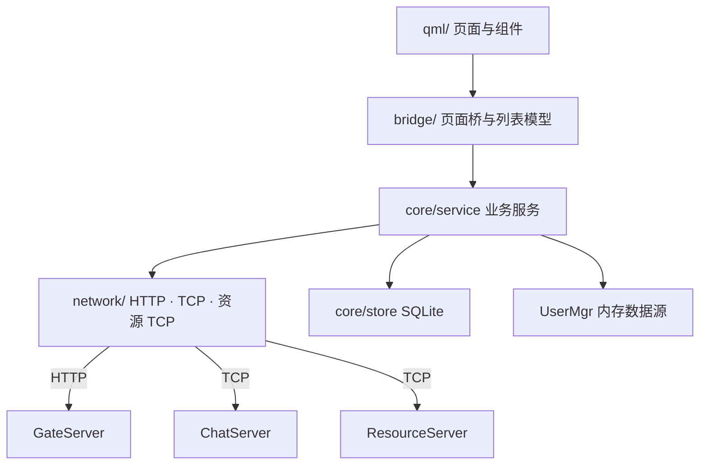
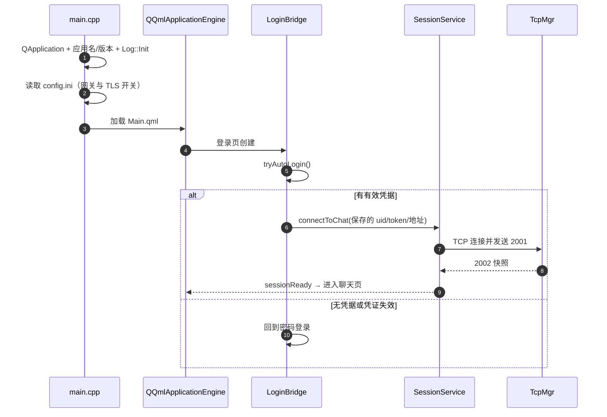
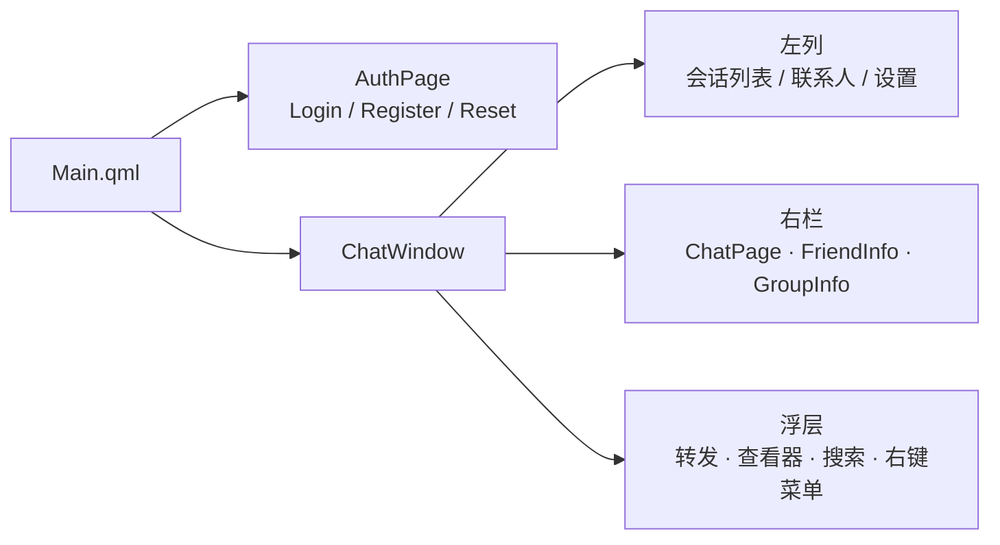

# 06 · 客户端

## 6.1 技术概览

| 项 | 选择 |
| --- | --- |
| 语言 / 框架 | C++17 + Qt 6.5（Core / Gui / Widgets / Network / Quick / QuickControls2） |
| UI | 纯 QML / Qt Quick；`QApplication` 与 `QSystemTrayIcon` 只作托盘与系统通知 |
| 平台 | Windows（MinGW 11.2）、macOS（AppleClang）；Linux 不发布 |
| 本地存储 | SQLite（WAL），schema v4 |
| 日志 | Qt 日志类别 + 文件轮转，8 MiB × 4 |
| 版本 | 1.2.0 |

## 6.2 分层

规则：

- **单向依赖**：`qml → bridge → core/service → network`，网络层不解释业务。
- **唯一数据源**：`UserMgr` 持有用户、好友、群、会话与消息窗口；所有写入走 `AppendChatMsgs` / `RemoveChatMsgs`。
- **模型只读**：QML 通过 `ConversationModel`、`MessageModel`、`FriendListModel` 等只读模型渲染，命令通过 bridge 的 `Q_INVOKABLE` 发起。

| 目录 | 职责 |
| --- | --- |
| `core/global.*` | 协议号、错误码、XOR、全局开关 |
| `core/log.*` | 日志初始化、类别、轮转 |
| `core/userdata.*` | 数据结构：用户、好友、群、会话、消息 |
| `core/usermgr.*` | 唯一数据源、本地缓存编排、未读与 @ 状态 |
| `core/service/*` | 认证、会话、聊天、好友、群、资料、文件、自动登录 |
| `core/store/localstore.*` | SQLite 建表、迁移、读写 |
| `network/httpmgr.*` | HTTP 短连接 |
| `network/tcpmgr.*` | 聊天长连接与消息分发 |
| `network/filetcpmgr.*` | 资源通道分片与进度 |
| `bridge/*` | 页面桥、列表模型、文本解析、头像裁剪、托盘、窗口装饰 |
| `qml/*` | 页面、组件、主题令牌 |

## 6.3 启动

关键行为：

- 聊天与资源各用一个网络线程，文件分片不会阻塞消息收发。
- 登录成功后才把令牌写入偏好设置；登出、改密、`1010/1011` 时清除。
- 主题跟随系统或手动深浅色，选择存本地，不经过服务端。

## 6.4 通信层

### HTTP（`HttpMgr`）

负责验证码、注册、登录、重置密码。请求走 `QNetworkAccessManager`，响应统一转成 `QJsonObject` 交给 `AuthService`。网关地址由 `scheme + host + port` 拼成，`port` 为空时使用协议默认端口。

### 聊天长连接（`TcpMgr`）

| 项 | 值 |
| --- | --- |
| 帧头 | 2 字节 ID + 2 字节长度（大端） |
| 请求上限 | 8 KB |
| 心跳 | 每 10 秒发 2003 |
| 心跳看门狗 | 35 秒未收到回包判定断线 |
| 登录超时 | 连接 + 2002 一共 12 秒 |
| 重连 | 1/2/4/8/15 秒退避，最多 6 次 |
| 不重连 | 被顶号（2007 reason=1）、`1010`、`1011`、主动登出 |

消息分发按响应号注册处理函数：只解析一次 JSON，成功走业务信号，失败把 `error` 交给上层。
处理器按复杂度分两类：只做解析与上抛的复用 `emitJson`；需要构造自定义信号的保留专用实现。

### 资源通道（`FileTcpMgr`）

独立线程与连接，帧头 2 + 4 字节。上传按 64 KB 分片，维护拥塞窗口；断线后先发 6003 同步服务器进度，再从缺失分片继续。下载按片请求，收到后写入目标文件，支持暂停/继续。

## 6.5 服务层

| 服务 | 职责 |
| --- | --- |
| `AuthService` | 校验码、注册、登录、重置密码 |
| `SessionService` | 建立长连接、2001/2002、心跳、断线重连、会话快照落库、登出 |
| `ChatService` | 文本/图片/视频/文件发送、历史分页、已读、撤回、重发、资源下载 |
| `FriendService` | 搜索、申请、同意、备注与标签、删除 |
| `GroupService` | 建群、群资料、成员操作、群设置与推送处理 |
| `ProfileService` | 本人资料与头像上传 |
| `FileService` | 分片上传/下载、头像与群头像缓存、进度与失败回调 |
| `AutoLoginStore` | 记住登录的凭据读写（QSettings） |

## 6.6 状态与本地缓存

`UserMgr` 维护：

- 本人资料、好友表、群表、会话表；
- 当前打开会话的完整消息窗口 `_window_thread`；
- 未读计数与 `_at_me_threads`；
- 上传/下载在途状态。

本地库表：`thread`、`message`、`friend`、`friend_tag`、`grp`、`group_member`。写入按会话增量进行，登录时先恢复缓存，再用服务端快照合并。清空本地库不会丢消息，重新登录会按游标拉回。

内存策略：只保留当前会话整段消息，其余会话保留一条预览；打开会话时按页从本地库读取，再向服务端补增量。

## 6.7 界面

| 区域 | 主要文件 |
| --- | --- |
| 登录 / 注册 / 重置 | `AuthPage.qml`、`Login.qml`、`Register.qml`、`Reset.qml` |
| 聊天窗 | `ChatWindow.qml`、`ChatPage.qml`、`ChatBubble.qml`、`MediaBubble.qml` |
| 好友 | `FriendInfoPage.qml`、`ApplyFriendPage.qml`、`FriendSearchPopup.qml`、`TagEditor.qml` |
| 群聊 | `GroupInfoPage.qml`、`CreateGroupDialog.qml` |
| 转发与搜索 | `ForwardDialog.qml`、`MessageSearchPanel.qml` |
| 设置与外观 | `SettingsPanel.qml`、`GeneralSettingsPage.qml`、`AppearanceMenu.qml`、`Theme.qml` |
| 通用组件 | `PageHeader`、`SettingsRow`、`AppButton`、`AppInput`、`AppTextArea`、`Avatar`、`SearchField`、`ContextMenu` 等 |

视觉规范集中在 `Theme.qml`：日间为白色面板与低对比蓝灰背景，夜间为深墨蓝表面；墨蓝/雾蓝用于操作与焦点，朱红只用于提醒和危险状态。字号、表面层级、间距、导航宽度、标题栏高度及圆角由令牌统一管理。

主窗口在 64px 一级导航、280px 索引栏和自适应内容区之间保持稳定结构。聊天、联系人和设置共享导航外壳；右侧资料、申请及设置页使用同一 `PageHeader`。从聊天打开联系人资料时保留会话列表和草稿，返回仍回到当前会话；通讯录资料选择独立于聊天资料；设置区单独记住个人资料或通用页。聊天列表、联系人列表与聊天页实例在切换时保持存活，保留滚动和输入上下文。

尚未分配会话编号的新好友，草稿和附件按好友分别暂存；获得编号后，文字草稿沿用该会话的本地存储。转发时先选收件人，再确认发送，选择期间不能切换底层会话。

消息气泡按类型渲染：文本、图片、视频、文件、群系统消息、合并转发卡片。合并转发卡片显示标题、三行预览与"查看 N 条转发消息"，点击打开只读的记录查看器。

## 6.8 媒体与文件

- **图片**：发送前在输入区压缩，原图与缩略图分开缓存；接收方先拉缩略图，点开再下载原图。
- **视频**：发送时抽首帧作为独立资源上传，接收方先看到封面；点击播放时若本地没有才下载。
- **文件**：按原文件名保存，重名自动加序号；支持另存为、打开所在目录。
- **合并转发**：最多 20 条、整包 ≤ 6 KB，快照只保留展示字段；逐条转发则复用原消息内容与本地文件重新发送。

## 6.9 本地数据与日志

| 项 | 说明 |
| --- | --- |
| 缓存目录 | `<AppData>/XiguChat/xiguchat/users/<uid>/` |
| 权限 | 目录 0700，数据库与 WAL 0600 |
| 删除 | `secure_delete=ON`；清空全部记录后 `VACUUM` |
| 可关闭 | `[Storage] localCache=false` 时不落盘 |
| 日志 | `logs/client.log`，8 MiB × 4；类别 `xc.net / xc.store / xc.app` |
| 脱敏 | 不写令牌、密码与消息正文 |

自动登录令牌保存在偏好设置（macOS 0600 plist，Windows HKCU），7 天滑动续期，登出或凭证失效即清除。安全取舍见 [13 安全设计](13-security.md)。

## 6.10 平台与打包

| 平台 | 构建 | 打包 |
| --- | --- | --- |
| Windows | `cmake --preset windows-mingw` | `windeployqt --qmldir client/qml` |
| macOS | `cmake --preset macos-clang` | `macdeployqt xiguchat.app -qmldir=client/qml` |

macOS 的标题栏文字与深浅色由 `bridge/windowchrome_mac.mm` 处理；Windows 保持系统标题栏。托盘与通知使用 `QSystemTrayIcon`，不引入 QWidget 页面。

## 6.11 扩展指引

| 需求 | 做法 |
| --- | --- |
| 新增消息类型 | 两端加 `msg_type` → `ChatService` 构造内容 → `MessageModel` 暴露 → `ChatPage` 选择气泡组件 |
| 新增页面 | 在 `qml/` 建文件 → 加进 `CMakeLists.txt` 的 `QML_FILES` → `ShellBridge::go()` 注册 |
| 新增本地字段 | `LocalStore` 升 `kSchemaVersion` 并加一步迁移，旧库按阶梯升级 |
| 新增网络请求 | 在对应 service 里发帧，在 `TcpMgr` 注册响应处理，bridge 只暴露命令与只读属性 |
