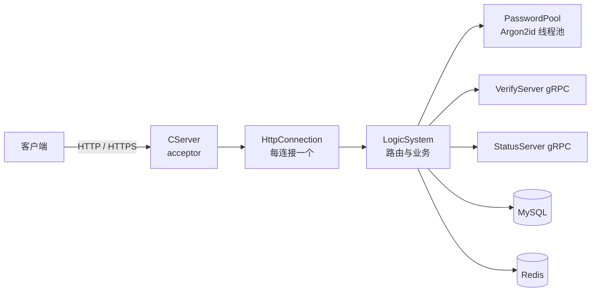
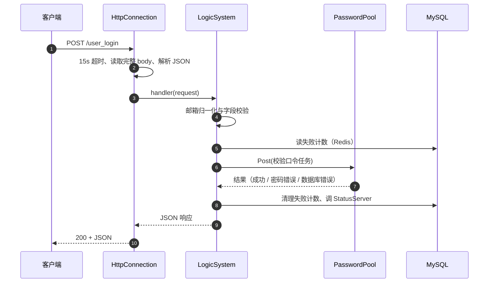
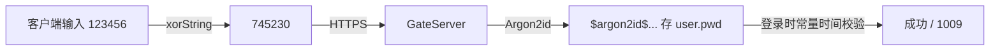
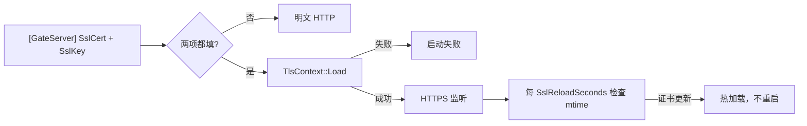

# 07 · GateServer

GateServer 是唯一面向客户端的 HTTP 入口，负责账号相关的四件事：发验证码、注册、登录、重置密码。它不保存长连接，也不处理聊天消息。

## 7.1 进程结构

| 组件 | 说明 |
| --- | --- |
| `CServer` | 监听端口、接受连接；TLS 打开时先完成握手 |
| `HttpConnection` | 单请求处理，15 秒超时，响应后关闭（`keep_alive=false`） |
| `LogicSystem` | URL 路由与四个接口的业务逻辑 |
| `PasswordPool` | 固定线程数，队列满直接返回 `1101` |
| `PasswordHash` | libsodium Argon2id（INTERACTIVE 档，64 MiB / t=2） |

## 7.2 请求流程

> **为什么哈希必须进池**：Argon2id 单次占 64 MiB、Release 约 40 ms、Debug 约 1 s。网关的 `io_context` 只有 1 个线程，直接在 IO 线程做哈希会把所有请求一起卡住。

## 7.3 接口

| 接口 | 核心逻辑 | 主要错误 |
| --- | --- | --- |
| `GET /healthz` | Redis `PING` + MySQL `Ping`，返回 `status/redis/mysql/uptime_seconds` | — |
| `POST /get_verifycode` | 60 秒冷却 → 邮箱 5 次/小时 → IP 20 次/小时 → gRPC 发码 | `1022`、`1023`、`1002` |
| `POST /user_register` | 字段校验 → 验证码比对 → 查重 + INSERT → 删除验证码 | `1003/1004/1005/1006` |
| `POST /reset_pwd` | 验证码 → 用户名与邮箱匹配 → 更新口令 → 删除验证码 → **吊销旧令牌** | `1003/1004/1007/1008` |
| `POST /user_login` | 失败计数 → 校验口令 → StatusServer 选路与签发令牌 | `1009/1105/1002` |

字段与响应格式见 [03 通信协议](03-protocol.md#39-http-接口)。

## 7.4 限流

| 场景 | 维度 | 阈值 | 计数键 |
| --- | --- | --- | --- |
| 验证码冷却 | 邮箱 | 60 秒 | `code_cd_<email>` |
| 验证码小时配额 | 邮箱 | 5 次 / 小时 | `code_hr_<email>_<bucket>` |
| 验证码小时配额 | IP | 20 次 / 小时 | `code_ip_<ip>_<bucket>` |
| 登录失败 | 账号 | 5 次 / 60 秒 | `loginfail_<account>_<bucket>` |
| 登录失败 | IP | 20 次 / 60 秒 | `loginfail_ip_<ip>_<bucket>` |

只统计失败、成功清零；数据库不可用时**不累加**失败次数，避免把服务故障算到用户头上。

## 7.5 口令处理

- 客户端发出的不是明文，而是逐字符 XOR 后的字符串；服务端直接对它做 Argon2id。
- 这是**可逆变形，不是加密**，安全性完全依赖 HTTPS。生产部署必须配证书。
- 哈希参数由 libsodium 的 INTERACTIVE 档决定，不随配置调整；调整会让历史哈希失效。

## 7.6 TLS

- 只填一项视为配置错误，进程拒绝启动。
- 证书必须是 `fullchain`（叶子 + 中间 CA），私钥不能带口令。
- 续期只需覆盖两个文件，默认 60 秒内生效。
- 客户端 `scheme=https`，`host` 必须是证书域名。

## 7.7 失败与容量

| 情况 | 行为 |
| --- | --- |
| Redis 不可用 | 验证码限流、登录失败计数失败 → 返回 `1002`；不降级为放行 |
| MySQL 不可用 | 查询 5 秒 deadline，超时连接丢弃；返回 `1002` |
| 哈希队列满 | 立即返回 `1101`，客户端可重试 |
| 请求超时 | 15 秒关闭连接 |
| 单机容量 | 受限于 `Password[Threads]`；登录高峰可加到 4，内存峰值约 256 MiB |

## 7.8 部署要点

- 网关是唯一对公网暴露的 HTTP 端口；`8090/8091/9090` 也需要公网可达（长连接与资源）。
- 反向代理场景下要保留真实客户端 IP（用于 IP 限流），当前直接取 socket 对端地址；前置代理时需改为读取可信头。
- 日志里账号一律脱敏（`MaskEmail`），不打印口令与令牌。
