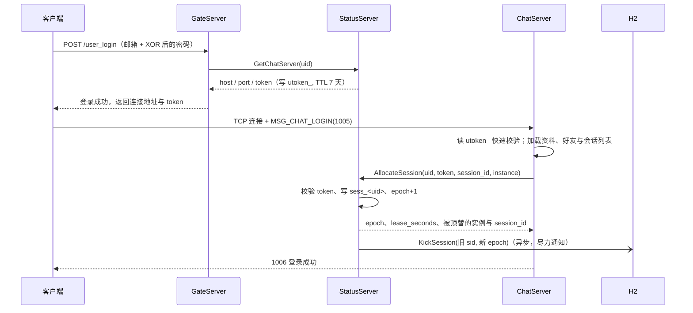

# 08 · StatusServer（会话租约与实例注册）

| 项 | 值 |
| --- | --- |
| 源码 | `server/services/StatusServer/` |
| 产物 | `bin/StatusServer/` |
| 监听 | gRPC `[StatusServer].Host:Port`，默认 `127.0.0.1:50052` |
| 依赖 | gRPC / protobuf、Boost.Asio（信号）、Boost.Uuid、hiredis |
| 角色 | 会话租约的唯一权威、实例注册与选路、在线位置查询、顶号通知 |

StatusServer 不转发聊天消息。它只负责"谁在线、在哪台实例、哪个 epoch 说了算"，
消息投递仍由 ChatServer 之间直连完成。这样控制面集中、数据面不绕路。

## 8.1 模块构成

| 文件 | 职责 |
| --- | --- |
| `src/StatusServer.cpp` | 入口：构建 gRPC Server、信号处理、退出前排空踢人队列 |
| `src/StatusServiceImpl.cpp` | 10 个 RPC 的实现与参数校验 |
| `src/SessionRegistry.cpp` | 租约与 epoch，Redis Lua 原子脚本 + 进程内条带锁 |
| `src/InstanceRegistry.cpp` | 实例注册、心跳、负载、draining 与选路 |
| `src/ChatControlClient.cpp` | 到 ChatServer 的控制链路，只实现 `KickSession`，异步队列 |
| `src/RedisMgr.cpp` | Redis 连接池；连接与读写都有超时，池获取有界等待 |

## 8.2 数据模型

| 键 | 类型 | 内容 | TTL |
| --- | --- | --- | --- |
| `sess_<uid>` | hash | `sid` / `inst` / `epoch` | 90 秒，续租刷新 |
| `epoch_<uid>` | string | 围栏令牌计数器 | 无 |
| `utoken_<uid>` | string | 登录令牌 | 7 天，每次登录刷新；主动登出立即删除 |
| `inst_<name>` | hash | `host` / `client_port` / `rpc_port` / `capacity` / `conns` / `sessions` / `draining` / `started_at` | 90 秒，心跳刷新 |
| `instances` | set | 已注册实例名 | 无，注册与过期时增删 |

`epoch` 取 `max(计数器 + 1, Redis 当前毫秒)`：即使 Redis 被清空，也不会回退到旧会话的
epoch 以下。单端登录下 `sess_<uid>` 的键就是 uid，proto 里预留了 `device_class`，
将来做多端只改键不改接口。

## 8.3 RPC 一览

| RPC | 调用方 | 说明 |
| --- | --- | --- |
| `GetChatServer` | GateServer | 按 `sessions/capacity` 选路并签发 token |
| `AllocateSession` | ChatServer | 校验 token、分配 epoch、写入租约、异步顶掉旧会话 |
| `RenewSessions` | ChatServer | 批量续租；同时承担实例心跳与负载上报 |
| `ReleaseSession` | ChatServer | 断开时释放；`sid` 与 `epoch` 必须同时匹配 |
| `LogoutSession` | ChatServer | 主动登出：匹配 `sid + epoch` 时原子删除租约与令牌 |
| `LookupRoute` / `BatchLookupRoute` | ChatServer、ResourceServer | 在线位置查询，批量上限 200 |
| `RegisterInstance` / `UnregisterInstance` | ChatServer | 启动注册、退出注销 |
| `DrainInstance` | 运维 | 停止分配新登录，已有会话在宽限期内继续续租 |

所有响应都是"gRPC 成功、业务结果看 `error`"。错误码 1101–1105 表示状态服务不可用、
会话被顶替、租约过期、实例未注册与登录过于频繁。

## 8.4 登录时序



租约申请放在资料加载**之后**：新设备登录失败时不会把旧设备踢掉。
令牌错误在加载前就返回，避免无谓查询。

## 8.5 续租与顶号

- ChatServer 每 30 秒调用 `RenewSessions`，一次携带本实例全部已认证会话（每批 200）。
  这个请求同时刷新 `inst_<name>` 的 TTL，因此**没有会话时也要发**，否则实例会从可选列表消失。
- 续租时租约不存在（状态服务故障期间过期）→ **重新授予新 epoch**，返回 `status=1`，
  ChatServer 更新本地 session 的 epoch。这样状态服务重启不会让在线用户掉线。
- 续租时 `sid` 不同 → `status=2`（Fenced），ChatServer 发 1021(reason=1) 后 300ms 断开。
  踢人通知丢失时，这是兜底路径，最迟一个续租周期内生效。
- `ReleaseSession` 只有 `sid` 与 `epoch` 都匹配才删除；旧连接的清理永远删不掉新会话。
- 主动登出走 `LogoutSession`：同一个 Lua 脚本先校验 `sid + epoch`，再删除租约和令牌；
  被顶掉的旧连接调用它不会误删新会话的 `utoken_`。租约已过期时不删令牌，交给 7 天 TTL。

## 8.6 故障语义

| 故障 | 行为 |
| --- | --- |
| StatusServer 重启 | 租约在 Redis，实例与客户端都不掉线；续租自动恢复 |
| StatusServer 不可用 | 新登录返回 1101（fail-closed）；已登录会话继续收发，续租失败只记日志 |
| Redis 不可用 | 拒绝新登录；已有连接在租约到期前继续工作，消息仍落 MySQL |
| 实例崩溃 | `inst_` 90 秒过期后不再分配；该实例上的会话由客户端重连到其他实例 |
| 目标实例不可达 | 消息已落库，实时推送失败只影响"立刻看到"，登录同步补拉 |

## 8.7 配置与运维

```ini
[StatusServer]
Host = 127.0.0.1
Port = 50052
[ResourceServer]
Host = 127.0.0.1
Port = 9090
[chatservers]
Name = chatserver1,chatserver2   ; 允许注册的实例名白名单，留空表示不校验
```

- 实例地址不再写在 StatusServer 配置里，由 ChatServer 启动时通过 `RegisterInstance` 上报
  `AdvertiseHost`、客户端端口与 RPC 端口。
- 下线一台实例：调用 `DrainInstance(name, grace)`，新登录不再分配过去；
  宽限期结束后再停进程，停服时 ChatServer 会调用 `UnregisterInstance`。
- 状态服务本身可以滚动重启：重启期间新登录短暂返回 1101，已登录用户无感。
