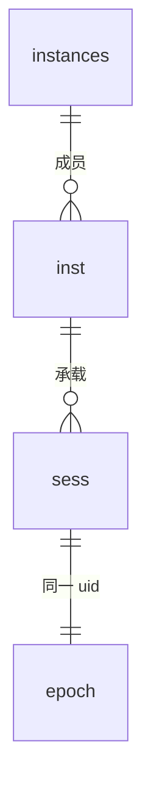
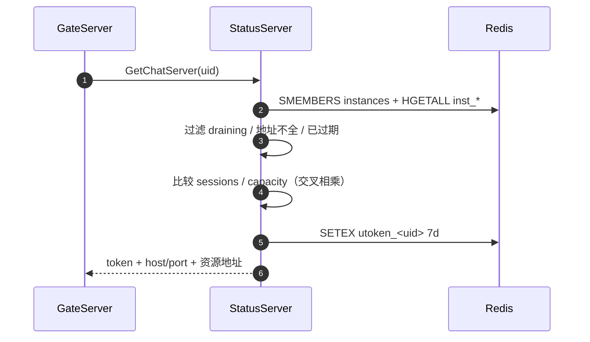
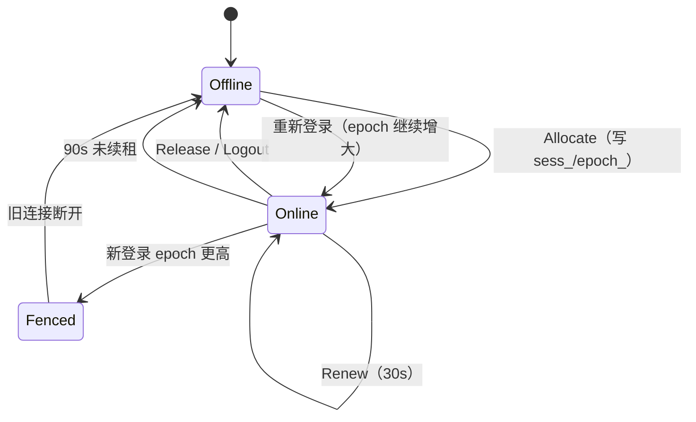
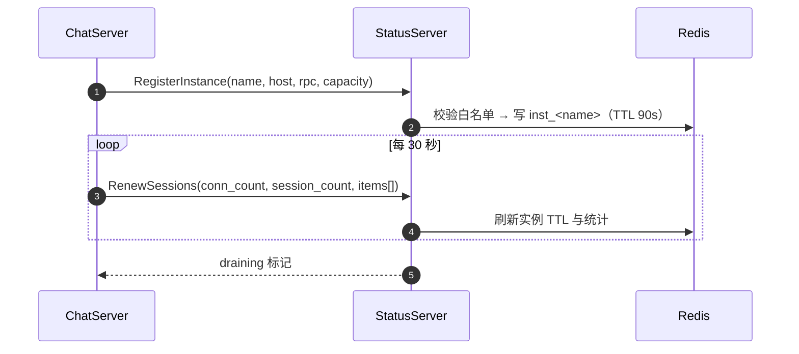
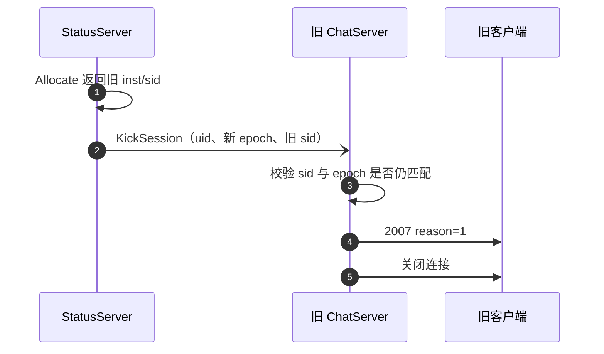

# 08 · StatusServer

StatusServer 是控制面的单一事实来源：谁在线、在哪个实例、令牌是否有效、新登录应该落到哪台机器。

## 8.1 职责

| 能力 | RPC | 调用方 |
| --- | --- | --- |
| 选路并签发令牌 | `GetChatServer` | GateServer |
| 分配会话租约 | `AllocateSession` | ChatServer |
| 续租与心跳 | `RenewSessions` | ChatServer |
| 释放 / 登出 | `ReleaseSession` / `LogoutSession` | ChatServer |
| 查询在线位置 | `LookupRoute` / `BatchLookupRoute` | ChatServer / ResourceServer |
| 实例注册 | `RegisterInstance` / `UnregisterInstance` / `DrainInstance` | ChatServer |
| 顶号通知 | `KickSession`（下行） | Status → Chat |

## 8.2 Redis 数据

| 键 | 结构 | TTL | 含义 |
| --- | --- | --- | --- |
| `utoken_<uid>` | string | 7 天 | 访问令牌，登录时覆盖 |
| `sess_<uid>` | hash | 90 秒 | `sid` / `inst` / `epoch` |
| `epoch_<uid>` | string | 无 | 单调递增的围栏令牌 |
| `sess_rate_<uid>` | string | 10 秒 | 登录频率计数（5 次） |
| `inst_<name>` | hash | 90 秒 | 客户端地址、RPC 地址、容量、连接数、排空状态 |
| `instances` | set | 无 | 实例名集合 |



## 8.3 登录选路



选路规则：

1. 实例必须未排空、客户端地址与 RPC 端口完整；
2. 按 `sessions / capacity` 取最小，容量大的实例承担更多；
3. 比值相同按实例名排序，保证多次选路结果稳定，便于排查；
4. 没有可用实例返回 `1101`。

## 8.4 会话租约

### 分配（`AllocateSession`）

Lua 脚本一次完成：

```text
若 sess_<uid>.sid == 本次 sid：
    续期，返回 {0, epoch, "", ""}
否则：
    INCR sess_rate_<uid>，首次设置 10 秒过期
    超过 5 次 → {-1, 0, "", ""}（TooManyRequests）
    epoch = max(epoch_<uid> + 1, 当前毫秒时间)
    写 sess_<uid> = {sid, inst, epoch}，TTL 90 秒
    返回 {1, epoch, 旧实例, 旧 sid}
```

要点：

- **先校验令牌，再动租约**：失败的登录不产生任何状态变更，也不会把旧设备踢掉。
- epoch 取"自增"与"当前毫秒"的较大值，保证跨重启也单调递增。
- 分配成功后，状态服务异步通知旧实例踢人；即使通知丢失，旧连接下一次续租也会被围栏。

### 续租（`RenewSessions`）

```text
sid 匹配 → 续期 90 秒，返回 0
sid 已被替换 → 返回 2（Fenced）
租约不存在 → 按原 sid 重新授予，返回 1
```

"租约不存在就重新授予"是刻意设计：状态服务短暂故障导致 TTL 过期时，不应该让全部在线用户掉线。

### 释放（`ReleaseSession`）

必须同时匹配 `sid` 与 `epoch` 才删除，旧连接的清理永远删不掉新会话。不匹配只记日志。

### 状态机



## 8.5 实例注册与排空



- 白名单来自 `[chatservers] Name`；留空表示接受任意实例，只用于调试。
- 实例 90 秒无心跳即过期，不再参与选路。
- `DrainInstance(name, grace)` 把实例标记为排空，新登录不再分配；已在线用户继续服务，宽限期 0–3600 秒。
- 实例主动下线调用 `UnregisterInstance`，立即从集合与哈希删除。

## 8.6 踢人



- 踢人只发通知，不等待结果；旧连接即使没收到，也会在下一次续租返回 2 后自行断开。
- `KickSession` 校验 `sid` 与 `epoch`，避免误踢已经重新登录的新连接。

## 8.7 故障语义

| 故障 | 影响 | 兜底 |
| --- | --- | --- |
| StatusServer 重启 | 内存无状态，Redis 仍在，租约继续有效 | 恢复后正常服务 |
| Redis 不可用 | 登录选路、续租、踢人全部失败 | 返回 `1101`；连接在租约过期前继续工作 |
| 实例表残留 | 过期实例仍出现在集合里 | `List()` 顺手清理过期成员 |
| 踢人通知丢失 | 旧连接短暂在线 | 续租 Fenced 兜底 |
| 登录频率过高 | 同一 uid 10 秒内超过 5 次 | 返回 `1105`，防止重连风暴互踢 |

## 8.8 部署

- StatusServer 目前是单实例；它本身无状态，重启不影响 Redis 中的租约。
- 要水平扩展需要把 `sess_<uid>` 与 `epoch_<uid>` 固定到同一 Redis 分片，并保证同一 uid 的租约变更串行；当前通过进程内按 uid 分片的互斥锁实现。
- 端口 50052 只对内部开放，不要映射到公网。
