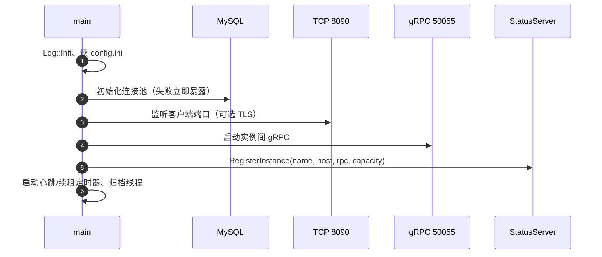
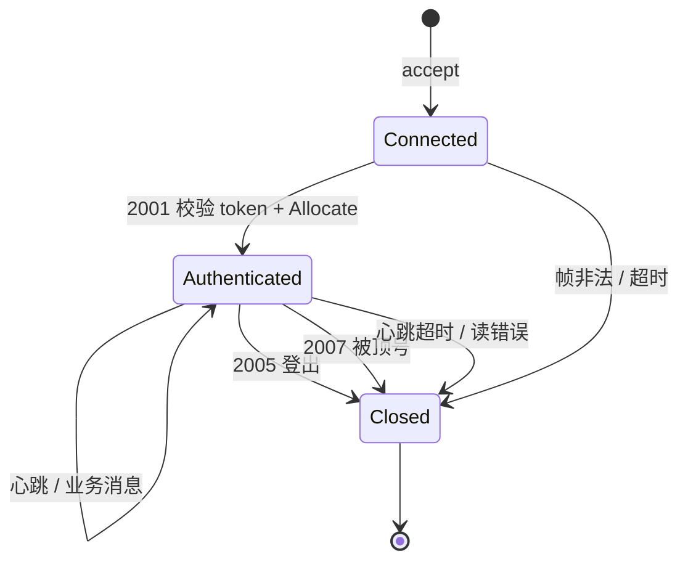
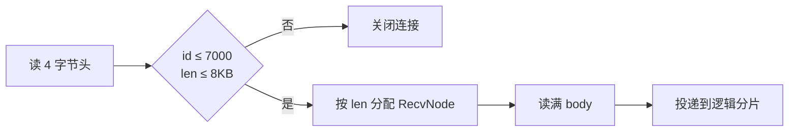
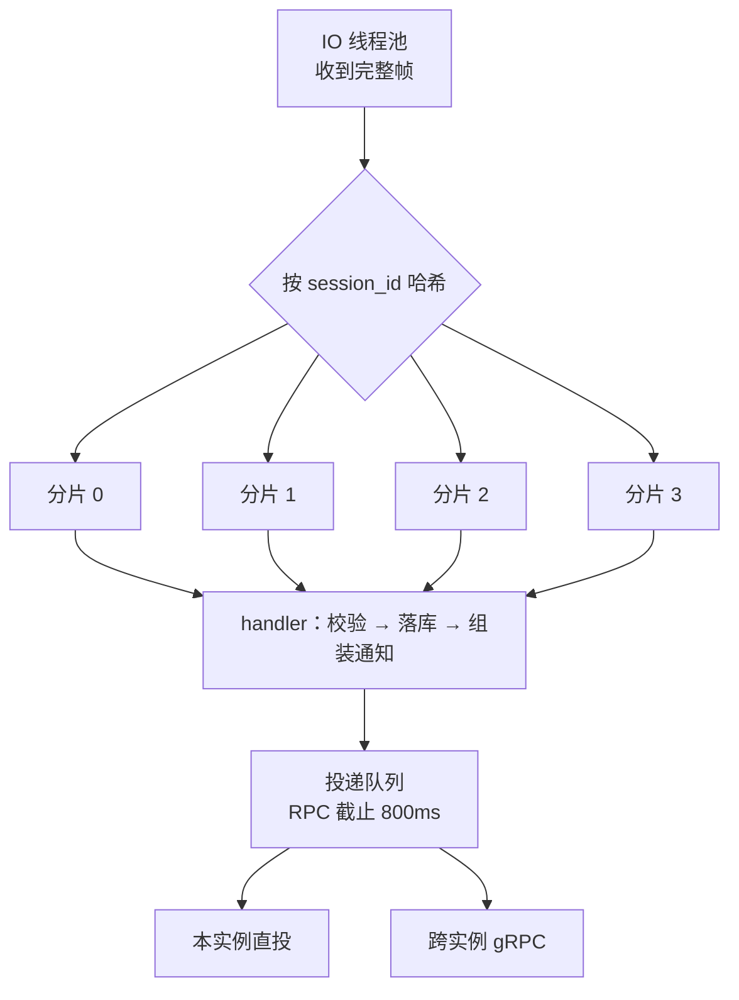
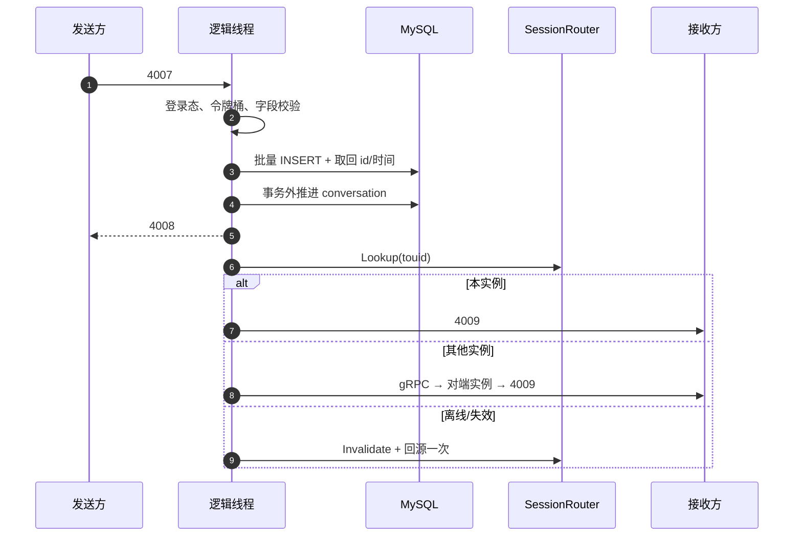
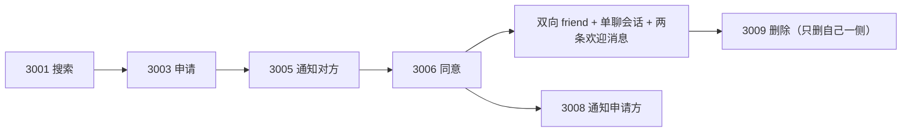
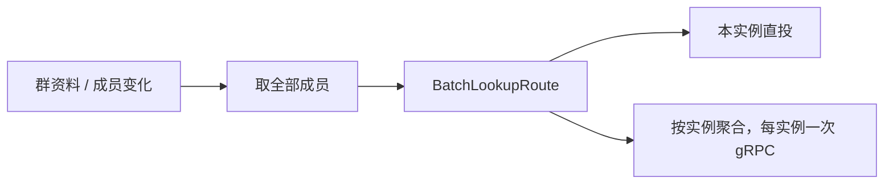
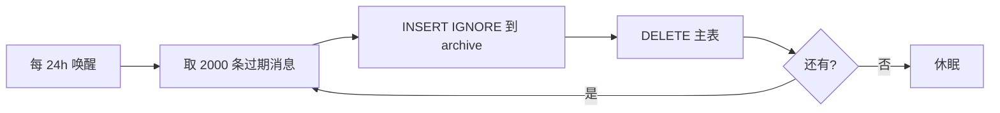

# 09 · ChatServer

ChatServer 是系统的消息面：维护客户端长连接、处理好友与群聊、把消息写入 MySQL 并投递给在线用户。同一份可执行文件按配置启动多个实例。

## 9.1 模块

| 模块 | 职责 |
| --- | --- |
| `CServer` | 监听、接受连接、心跳扫描、租约续期定时器、实例注册 |
| `CSession` | 单连接状态：读写、帧编解码、发送队列、令牌桶 |
| `LogicSystem` | 消息分发、4 个逻辑分片、投递线程、业务 handler |
| `logic/LogicSystemSession` | 登录、登出、心跳、快照 |
| `logic/LogicSystemFriend` | 搜索、申请、同意、资料、备注、删除 |
| `logic/LogicSystemChat` | 单聊消息、历史、已读、撤回 |
| `logic/LogicSystemGroup` | 群资料、成员、设置、广播 |
| `dao/*` | 用户、好友、消息、群聊的 SQL |
| `UserMgr` | `uid → session` 映射 |
| `SessionRouter` | 在线位置缓存，未命中回源 StatusServer |
| `ChatServiceImpl` | gRPC 服务端：跨实例通知、踢人 |
| `ChatGrpcClient` | 调用对端实例 |
| `ArchiveJanitor` | 过期消息搬到归档表 |

## 9.2 启动

注册必须放在 gRPC 开始监听之后，否则状态服务可能把登录分配过来，而踢人或转发还连不上端口。

## 9.3 连接状态机

| 参数 | 值 |
| --- | --- |
| 心跳阈值 | 20 秒无消息 |
| 扫描周期 | 30 秒（实际回收上限约 50 秒） |
| 单连接令牌桶 | 20 条/秒、突发 50，仅消息写入 |
| 发送队列上限 | 1000 条，超限断开 |
| 单帧上限 | 8 KB |

### 读

- 头部直接读进 `RecvNode`，不再经过会话级缓冲，减少一次拷贝。
- 长度用无符号读取，避免高位为 1 时绕过上限。

### 写

- 同一 socket 同时只有一个 `async_write`，其余进入 `_send_que`。
- 响应超过 65531 字节时回一个最小错误包（`1106`），不关闭连接。
- 队列积压超过上限才断开，避免慢客户端拖垮进程。

## 9.4 逻辑分片与投递

- 同一连接的消息固定在同一个分片，天然有序。
- 不同连接并行，慢查询只影响落到该分片的会话。
- 投递独立成线程：跨实例 RPC 再慢也不会阻塞业务处理。
- 逻辑队列上限 10000；投递队列上限 5000，满时**丢弃实时投递**（消息已落库，接收方下次登录可见）。
- `QueueDepth()` 暴露两个队列深度，供运维观察积压。

## 9.5 登录与登出

**2001 → 2002**

1. 校验 `uid` 与 `token`（Redis `utoken_<uid>`）；令牌缺失与不匹配统一回 `1010`。
2. 续期令牌（7 天滑动），失败不影响本次登录。
3. 读取本人资料、好友、申请、会话首屏（50 条）。
4. 申请租约：`AllocateSession` 返回 `epoch`；失败时回包**只带错误码**，不下发快照。
5. 绑定 `UserMgr` 与连接，设置 epoch，返回 2002。

> 快照在租约之前读取：新设备登录失败时不能把旧设备踢掉。代价是被限流时多做了几次查询。

**2005 登出**：释放租约（带 `sid + epoch`）→ 删除令牌 → 回 2006 → 关闭连接。

**2007 被踢**：`reason=1` 顶号、2 过期、3 服务端下线；客户端收到后不再重连。

## 9.6 单聊消息

写入细节：

- 幂等键 `(thread_id, sender_id, client_msg_id)`：重发只保留一条，回执仍返回原 `message_id`。
- 一次 `INSERT` 写完整批，再按客户端 msgid 一次取回 id 与时间，避免逐条往返。
- `conversation.last_message_id` 在事务外更新，条件 `last_message_id < ?`，只前进不回退。

错误语义：

| 情况 | 返回 |
| --- | --- |
| 非好友（任一方删除） | `1014` |
| 群不存在 / 已解散 / 不在群 | `1002 + group_invalid` |
| 刷屏超限 | `1105` |
| 正文超长 | 客户端已按 7000 字节拆帧 |

## 9.7 好友

| 规则 | 说明 |
| --- | --- |
| 搜索 | 纯数字按 uid，否则按用户名；不返回邮箱 |
| `relation` | 0 非好友、1 好友、2 我已申请、3 对方申请我、4 单向关系（一方已删除）、-1 自己 |
| 申请幂等 | 已是好友时按成功处理，不重复通知 |
| 同意 | 建双向关系；复用或创建 `dm_key` 会话；写两条欢迎消息 |
| 删除 | 只删自己一行；不通知对方，不删历史 |
| 备注 / 标签 | 只改自己方向的行 |

## 9.8 群聊

| 限制 | 值 |
| --- | --- |
| 单群成员 | 200 |
| 一次建群邀请 | 50 |
| 群名 | 1–30 字符 |
| 群公告 | 200 字符 |
| 群昵称 | 16 字符 |
| 群头像 | `<32 位 md5>.png` |

权限矩阵：

| 操作 | 成员 | 管理员 | 群主 |
| --- | --- | --- | --- |
| 改群名 / 公告 / 头像 | — | ✓ | ✓ |
| 邀请成员 | — | ✓ | ✓ |
| 移除普通成员 | — | ✓ | ✓ |
| 移除管理员 | — | — | ✓ |
| 设 / 撤管理员 | — | — | ✓ |
| 退群 | ✓ | ✓ | 需先解散 |
| 解散 | — | — | ✓ |

群事件通过 5009 推送：

改群名、公告、头像、成员变化都会写一条 `msg_type=4` 的群系统消息，计入会话排序。

## 9.9 已读与撤回

**已读**：客户端上报 `{thread_id, message_id}`，服务端推进 `conversation_member.last_read_message_id`。单聊向对方推 4018（单勾变双勾）；群聊只更新自己的未读与 `at_me`。

**撤回**：2 分钟内、必须是发送者。成功后：

1. `chat_message.state=1`，`content` 清空；
2. 发送方回执 4020；
3. 对方推 4021，气泡替换为"撤回了一条消息"；
4. 已下载到本机的文件不删除（见 [16 限制](16-limitations.md)）。

## 9.10 归档

`ArchiveJanitor` 每个实例都会运行，按 `created_at` 找过期消息：

`INSERT IGNORE` + 主键保证重复执行安全；两个实例同时跑也不会重复写入。默认保留 365 天，可在 `[Archive]` 调整或关闭。

## 9.11 并发与故障

| 场景 | 行为 |
| --- | --- |
| 两个连接同时登录同一 uid | 租约串行分配，epoch 高的胜出，低的收到 2007 |
| 旧连接清理晚于新登录 | 释放要求 `sid + epoch` 同时匹配，删不掉新会话 |
| 路由缓存过期 | 投递失败 → 失效缓存 → 回源重试一次 |
| 对端实例不可达 | RPC 800 ms 截止；消息已落库，接收方登录后可见 |
| MySQL 超时 | 连接标记污染后丢弃；返回 `1002` |
| 逻辑队列积压 | 观察 `[stats] logic_queue`；持续增长说明处理能力不足 |

## 9.12 扩展点

- **加实例**：新增 ini + 白名单 + 对端配置，无需改代码。
- **改投递策略**：`PostDeliveryTask` 与 `BroadcastGroupEvent` 是唯一出口。
- **加消息类型**：`ChatContentItem.msg_type` → DAO 写入 → `BuildMessageItem` → 客户端渲染。
- **换存储**：DAO 层按用户/好友/消息/群聊拆分，替换实现不影响业务 handler。
