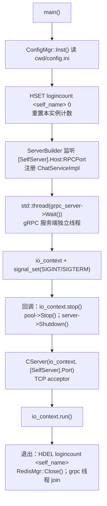
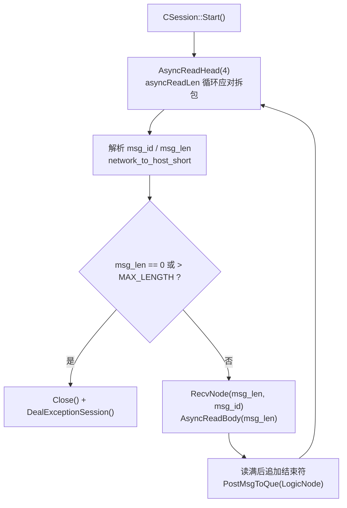
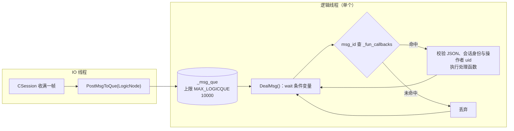
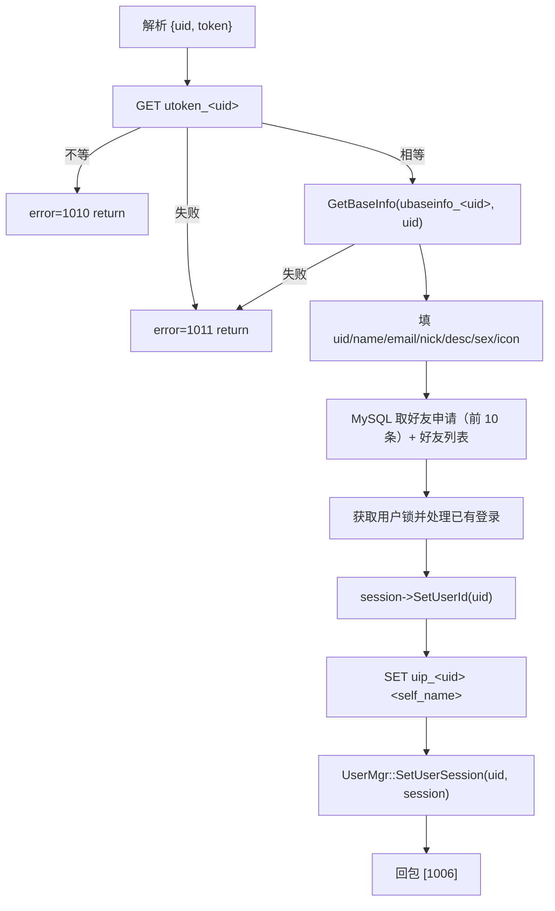
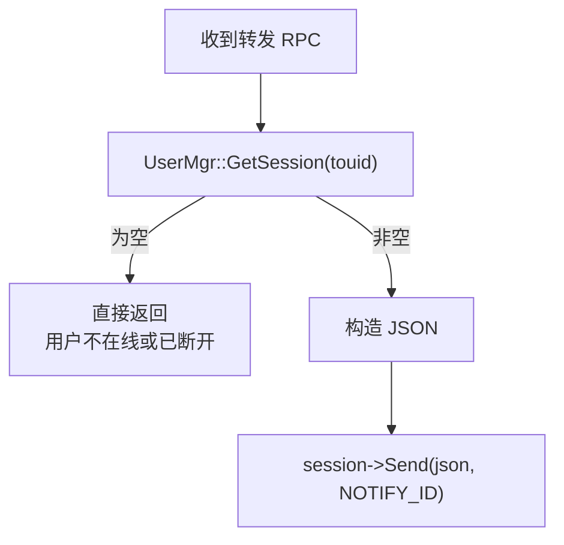

# 09 · ChatServer（长连接消息服务，多实例）

| 项 | 值 |
| --- | --- |
| 源码 | `server/services/ChatServer/` |
| 产物 | `bin/<实例名>/`，每份 `config/*.ini` 一个实例 |
| 监听 | TCP `[SelfServer].Port`（客户端，8090 / 8091）；gRPC `[SelfServer].RPCPort`（服务间，50055 / 50056） |
| 依赖 | Boost.Asio、gRPC / protobuf、jsoncpp、hiredis、mysql-connector-cpp |
| 角色 | 承载客户端长连接；处理登录、搜索、好友申请/认证、文本/图片/视频/文件消息；跨实例转发 |

## 9.1 模块构成

| 文件 | 职责 |
| --- | --- |
| `src/ChatServer.cpp` | 入口：初始化计数、启动 gRPC 服务端线程、启动 TCP `CServer` |
| `src/CServer.cpp` | TCP acceptor；`_sessions` 表；`ClearSession` 负责断连清理 |
| `src/CSession.cpp` | 单会话：异步读头/体、发送队列、帧编解码 |
| `src/MsgNode.cpp` | `RecvNode` / `SendNode` 消息节点 |
| `src/LogicSystem.cpp` | 逻辑队列 + 单线程消费 + 消息处理函数注册表 |
| `src/UserMgr.cpp` | `uid → CSession` 映射（供本实例直投） |
| `src/ChatServiceImpl.cpp` | gRPC 服务端：接收其他实例的转发并投递给本地会话 |
| `src/ChatGrpcClient.cpp` | gRPC 客户端：向对端实例发起转发（Stub 池 5） |
| `src/StatusGrpcClient.cpp` | StatusServer 客户端（**当前未被调用**） |
| `src/IOContextPool.cpp` / `ConfigMgr.cpp` / `RedisMgr.cpp` / `MysqlMgr.cpp` / `MysqlDao.cpp` | 基础设施 |

## 9.2 启动流程



## 9.3 会话与帧处理

### 接收



### 发送

`CSession::Send()` 有两个重载（`std::string` 与 `char*`），逻辑一致：

```
检查长度，投递到 socket 所属 IO 线程
if _send_que.size() >= MAX_SENDQUE(1000): 关闭并清理连接
push SendNode(msgid)
if 队列此前为空: 立即 async_write（否则由 HandleWrite 链式续写）
```

`HandleWrite` 由 IO 线程回调：`pop()` 已发送节点，若队列非空继续写下一个。
`shared_from_this()` 保证回调期间会话对象存活。
每个 io_context 只有一个工作线程，收发与关闭在该线程串行执行，三平台行为一致。
发送失败时终止续写，并在回调完成后释放发送缓冲区。

### 断连清理（`CServer::ClearSession`）

```
lock(_mutex)
find session_id → 未找到直接 return
erase
↓
uid = session->GetUserId()
if uid == 0: return                       # 未登录的连接不参与清理
UserMgr::RmvUserSession(uid, session_id)
```

`_user_uid == 0` 是"未登录"哨兵（真实 uid 从 1000 起）。
`DealExceptionSession` 与登录登记通过会话互斥锁排序，且只清理一次。
已认证会话取得 Redis 用户锁后，确认 `usession_<uid>` 仍属于自身，才删除会话键与位置键。
连接计数由定时器每 60 秒扫描后用 `HSET` 上报，登录和断连不直接增减计数。

## 9.4 逻辑层



| 特性 | 说明 |
| --- | --- |
| 单消费者 | TCP 业务处理串行执行；共享用户映射仍由互斥锁保护 |
| 优雅退出 | `_b_stop` 置位后先把队列剩余消息处理完再退出 |
| 未知 ID | 无注册 handler 时丢弃 |

注册的 handler：

| ID | 函数 | 说明 |
| --- | --- | --- |
| 1005 | `LoginHandler` | 校验 token、绑定会话、下发资料 |
| 1007 | `SearchInfo` | 按 uid / 用户名搜索 |
| 1009 | `AddFriendApply` | 好友申请 |
| 1013 | `AuthFriendApply` | 同意好友申请 |
| 1017 | `DealChatTextMsg` | 文本消息 |
| 1031 | `DealChatImgMsg` | 图片消息：只落库，资源随后由客户端上传 |
| 1033 | `CSession::NotifyImageRecv` | 服务端推送：图片已上传完成，接收方开始下载 |
| 1034 | `DealResourceChatMsg` | 视频/文件消息：只落库，资源随后由客户端上传 |
| 1036 | `CSession::NotifyResourceRecv` | 服务端推送：视频/文件已上传完成，接收方显示下载卡片 |

出队后释放队列锁，数据库/RPC 不持有队列锁；单条请求异常会关闭对应连接，不终止逻辑线程。
各 handler 用 `Defer`（析构时执行 lambda）处理正常业务分支的回包。

## 9.5 登录（1005）



> 无法取得用户锁时返回失败；同一连接不能重复登录或切换 uid。资料回包不含密码哈希。

## 9.6 消息路由：本实例 vs 跨实例

三个需要投递给他人的 handler（1009 / 1013 / 1017）共用同一套判定：

```cpp
to_ip_key  = "uip_" + std::to_string(touid);
b_ip       = RedisMgr::Get(to_ip_key, to_ip_value);
if (!b_ip) return;                       // 目标不在线（或位置键已过期）→ 静默丢弃
if (to_ip_value == self_name) {
    session = UserMgr::GetInstance()->GetSession(touid);
    if (session) session->Send(json, NOTIFY_ID);   // 本实例直投
    return;
}
ChatGrpcClient::GetInstance()->NotifyXxx(to_ip_value, req);  // 跨实例 gRPC 转发
```

| 路径 | 开销 |
| --- | --- |
| 本实例直投 | 一次 `UserMgr` 查找 + 一次 `Send()`，无网络往返 |
| 跨实例 | 一次 gRPC 调用（Stub 池复用连接）→ 对端 `ChatServiceImpl` → `UserMgr` → `Send()` |

### `ChatServiceImpl`（gRPC 服务端）

三个方法结构相同：



`NotifyAuthFriend` 会调 `GetBaseInfo` 补全发起方资料（name / nick / icon / sex）。

### `ChatGrpcClient`（gRPC 客户端）

- 构造时读 `[PeerServer].Servers`，为**每个对端**建一个 `ChatConPool`（5 条 Stub）；
  对端地址取自 `[<对端名>].Host` 与 `[<对端名>].Port`（**对端的 RPCPort**）；
- 每个转发方法：查池 → `getConnection()` → 发起 RPC → `Defer` 归还 Stub；
  失败置 `RPCFailed(1002)`。

## 9.7 好友相关流程

### 申请（1009）

1. 解析 `{uid, applyname, bakname, touid, tags}`，`applyname` 是申请留言（为空时用默认句）；
2. `MysqlMgr::AddFriendApply(uid, touid, welcome, bakname, tags)`：把申请留言写 `friend_apply.descs`、
   备注写 `back_name`、分组写 `tags`（JSON 数组）；重复申请用 `ON DUPLICATE KEY UPDATE` 整组覆盖；
3. 回 1010，`error` 表示申请是否已经落库；
4. 查 `uip_<touid>`；
5. 本实例 → 构造 1011 通知（`name` 是申请人资料名，`desc` 是申请留言）；跨实例 → `NotifyAddFriend`。

登录回包的 `apply_list` 同时包含两个方向：`GetApplyList` 取别人申请我的，`GetSentApplyList` 取我发出去的，后者带 `direction=1`，客户端在「新的朋友」里显示为等待验证。两条 SQL 都关联 `user` 表并取出 `user.icon`，申请人的头像变化后重新登录即可拿到新文件名，再由 ResourceServer 下载成本地缓存。

### 同意（1013）

1. 解析 `{fromuid, touid, back}`；
2. `AddFriend(uid, touid, back_name, my_tags, apply_desc, reverse_back, reverse_tags)` 开启事务并锁定对方向自己的好友申请，无申请则失败；
   `reverse_back` 与 `reverse_tags` 是申请方当初填的备注与分组，随回包/通知带回给申请方，避免重新登录才看到；
3. 同一事务内把申请状态置 1，再双向插入 `friend` 表（`INSERT IGNORE`）；两条插入固定按 `self_id` 升序执行，
   两个用户同时互相同意时不会出现 AB/BA 的锁顺序；
4. 创建或复用 `private_chat` 线程；线程创建失败不回滚好友关系，聊天在首次打开/发送时再建；
5. `AddFriend` 在事务内读取 `friend_apply.descs` 并返回给逻辑层；逻辑层随后按“申请方留言 → 同意方默认句”写入两条 `chat_message`，申请方在前；欢迎消息写失败只记录日志，不回滚好友关系；
6. 回 1014（附对方资料、`thread_id`、`welcome_msgs`）；
7. 通知对方 1015（本实例直投 / 跨实例 `NotifyAuthFriend`），带同样的 `thread_id`、
   申请方视角的 `welcome_msgs`，以及 `back` 与 `tags`（申请方当初填的备注与分组）。

> 好友关系写库失败才回滚并返回错误。欢迎消息属于附加内容，写失败只记录日志，不回滚好友关系。

### 资料、备注与标签（1045 / 1047 / 1049）

三个入口都以**会话绑定的 uid** 作为操作者，请求体里不带 uid/fromuid，客户端无法修改他人数据。

**1045 修改本人资料** `{nick, sex, desc}`：

1. `RequestValidation` 先校验三个字段类型与 `sex ∈ [0,2]`；
2. handler 按 UTF-8 字符数再校验长度（昵称 20、签名 60），避免绕过界面写入超长内容；
3. `MysqlMgr::UpdateUserProfile` 一次更新 `nick / sex / desc`（`desc` 是保留字，SQL 里加反引号）；
4. 重新读库，用完整资料覆盖 `ubaseinfo_<uid>` 与 `nameinfo_<name>` 两份缓存；
5. 回 1046，带最终落库值，客户端直接刷新本地资料。

**1047 修改好友备注与标签** `{touid, remark, tags}`：

1. 备注长度上限与昵称一致（20 字符），允许空串表示清除；标签在 `RequestValidation` 里已校验
   数量（≤10）与单个长度（≤12 字符），这里整组序列化成 JSON 数组；
2. `UpdateFriendRemark` 先 `SELECT 1 FROM friend WHERE self_id = ? AND friend_id = ?` 确认关系，
   再一条 `UPDATE` 同时写 `back` 与 `tags`。不能只看 UPDATE 的影响行数：值没变化时影响行数为 0，
   会被误判成"不是好友"；
3. 返回 1 已更新 / 0 不是好友 / -1 数据库错误，分别映射为成功、`UidInvalid(1011)`、`RPCFailed(1002)`；
4. 只写自己这一行，不通知对方；回包带回服务端确认后的备注与标签。

**1009 申请时带标签**：`tags` 与 `back_name` 一起写 `friend_apply`。同意时 `AddFriend` 在同一事务里
读回这两列，按方向分别写入两条 `friend` 记录——申请方的备注与标签写进申请方那行，
同意方自己填的写进同意方那行。申请被拒绝时标签留在 `friend_apply` 里，不会出现在任何好友列表。

**1049 拉取好友最新资料** `{touid}`：走 `GetBaseInfo`（优先读 `ubaseinfo_`，未命中查库回填），
只回 `uid / name / nick / desc / sex / icon`，不含邮箱与密码。不要求对方在线或已是好友。
客户端在打开会话与资料页时各拉一次，用来刷新昵称和个性签名。

> `friend` 与 `friend_apply` 的 `tags` 列由启动时的 `EnsureFriendTagColumns` 幂等补齐：
> 先查 `information_schema.columns`，缺列才 `ALTER TABLE ... ADD COLUMN`。启动流程里预热
> `MysqlMgr`，让这一步在启动阶段完成，而不是落到第一个登录请求上。

### 资料变更推送（1051）

改资料的入口有两个，最后汇到同一个推送方法 `LogicSystem::NotifyFriendsProfileChanged(uid)`：

| 入口 | 触发点 | 路径 |
| --- | --- | --- |
| 客户端改昵称/签名（1045） | `UpdateProfile` 写库并刷缓存后 | 逻辑层直接调用 |
| 客户端换头像（1043） | `FileWorker::UpdateAvatarInfo` 写完 `user.icon` 后 | 资源服务器 gRPC `BroadcastProfile` → 用户所在实例 |

推送流程：

1. 从 `user` 表读一次完整资料，保证推送内容与落库值一致（头像可能是资源服务器写的）；
2. `GetFriendIds` 取好友 uid 列表，逐个查 `uip_<uid>`：没有位置键说明对方离线，直接跳过；
3. 在本实例的好友直接 `session->Send(1051)`；
4. 跨实例的好友按**目标实例分组**，一个实例只发一次 `NotifyProfileChanged`，请求里带
   `fromuid`、这批 `touids` 与四个字段；对端只投递给本实例在线的那几个；
5. 推送不写库、不重试：失败时好友下次登录从 1006 回包拿到最新资料。

> 推送放在回包之前同步执行。好友数量是个人量级，跨实例 RPC 有 3 秒截止时间，
> 正常情况下用户感知不到；如果将来好友规模变大，应改为投递到逻辑队列异步分发。

gRPC 侧新增两个方法：`BroadcastProfile`（资源服务器 → 任意实例，带上 uid 即可）与
`NotifyProfileChanged`（实例间批量转发）。两者都在 `services/ChatServer` 与
`services/ResourceServer` 的 `ChatGrpcClient` 中对接。

**单聊会话创建（1025 / 首次发消息）**：先普通查询已有 `private_chat`，没有则直接插入
`chat_thread` + `private_chat`，由 `uk_private_users` 唯一键决定谁创建成功；撞键的一方回滚后
读对方已提交的 `thread_id`。这里不能用 `SELECT ... FOR UPDATE` 占位——查不到行时加的是间隙锁，
随后的 INSERT 需要插入意向锁，两个并发请求会互相等待并被 MySQL 判定为死锁（1213）。

## 9.8 文本消息（1017）与会话同步

1. 解析 `{fromuid, touid, thread_id, text_array:[{content, msgid}]}`；
2. 先按 `thread_id` 找到/创建单聊线程，把消息写入 `chat_message`，拿到 `message_id`；
3. 构造 1018 回执：`thread_id`、`message_id`、`time`，发送方状态 1；写库失败时状态 2；
4. 查 `uip_<touid>` → 本实例直投 1019 / 跨实例 `NotifyTextChatMsg`，接收方状态 3；
5. 目标离线时消息已持久化，不推送；下次登录按 1027/1029 同步。

`time` 是 `chat_message.created_at` 的 UNIX 秒值。写入不显式传时间，插入后按 `message_id`
读回：重发同一条（唯一键命中）时拿到的是库里原来的时间。跨实例转发把同一个值写入
`TextChatData.time`，接收方不会因为转发延迟看到偏晚的时间。

### 已读与撤回（1052 / 1055）

两个请求都不带操作者字段，身份只认会话；`RequestValidation` 只校验字段类型与正数，
归属校验在 DAO 里做。

**已读（1052）**：

1. 按 `thread_id` 查 `private_chat`，确认请求者属于该会话，同时取出对方 uid；
2. `UPDATE chat_message SET is_read = 1 WHERE thread_id = ? AND recv_id = ? AND message_id <= ? AND is_read = 0`；
3. 受影响行数为 0 说明没有新消息被标记，直接回包、不打扰对方——否则每次切会话都会推一条通知；
4. 有变化时推 1054：本实例直投，跨实例走 `NotifyChatEvent(event=1)`。

**撤回（1055）**：

1. 按 `message_id` 读记录，校验 `sender_id` 是本人、`recalled = 0`、`created_at` 在
   `RECALL_WINDOW_SECONDS`（120 秒）内；
2. `UPDATE chat_message SET recalled = 1, content = '', msg_type = 0 WHERE message_id = ? AND recalled = 0`；
3. 回 1056 给自己，推 1057 给对方（`NotifyChatEvent(event=2)`）。

`thread_id` 一律以库里的记录为准，客户端传错也不会把通知发到别的会话。对方离线时不推送，
状态已经在库里，下次拉历史由 `read` / `recalled` 字段还原。

> 跨实例统一走 `NotifyChatEvent`，一个 RPC 带 `fromuid / touid / thread_id / message_id / event`，
> 对端按 `event` 组装 1054 或 1057。这样已读与撤回不需要两套转发通道。

### 删除好友（1058）

`DeleteFriend` 只删 `self_id = 自己 AND friend_id = 对方` 这一行，以及自己发出的申请记录。
对方的行不动、也不推任何通知：他那边好友列表照旧，会话照旧，只是消息发不出去。

删除要让"发不出去"真正生效，关键在 `EnsureChatThread`：它**无论有没有 thread_id 都先校验
双向关系（两行都在）**，不通过直接返回 0。早期版本在 `thread_id > 0` 时直接返回，
删好友后旧会话仍能继续发消息，删除等于没做；只校验发送方那一行也不够，被删除者仍能把消息发进来。

消息保存失败时用 `IsMutualFriend` 复核（仅失败路径），回包里带 `not_friend: true`，
客户端才能给出「对方已不是你的好友」而不是笼统的发送失败。

图片消息（1031）只做前半段：校验字段与好友关系，把消息写入 `chat_message`
（`msg_type=1`、`status=0`、`content=资源文件名`），回 1032 后结束。
资源全部落盘后，ResourceServer 按 Redis `uip_<receiver>` 选择接收方所在实例，通过 gRPC
`NotifyImageUploaded` 把 `message_id`、双方 uid、`thread_id`、资源名与 `client_msg_id` 交给 ChatServer：
`ChatServiceImpl` 先更新 `chat_message.status=1`（带 `sender` 限定），如果接收方在本实例在线，
再调用 `CSession::NotifyImageRecv` 推送 1033。接收方离线时只更新状态，下次登录按历史消息同步；
ResourceServer 找不到实例或 RPC 失败时直接写库兜底。

视频/文件消息（1034）与图片同一条链路，区别在落库字段：`msg_type` 为 2/3，
`content` 存元数据 JSON（原始文件名、字节数、资源名、首帧资源名），原始文件名不参与路径拼接。
回 1035 后由客户端先传首帧、再传资源本体；ResourceServer 完成同样的 gRPC 通知，
`ChatServiceImpl::NotifyResourceUploaded` 更新状态后推送 1036（离线时只更新数据库）。

登录同步使用 1027（会话游标）和 1029（`thread_id + message_id > last`，升序，`load_more`）；客户端按最后一条 `message_id` 继续翻页。客户端本地 SQLite 尚未接入，当前每次登录从 `message_id=0` 拉取。历史消息带 `msg_type`：图片的 `content` 是资源文件名，视频/文件是元数据 JSON，客户端解析后渲染卡片，不自动下载本体。

## 9.9 多实例部署

详见 `02-build.md` §2.4。运行时要点：

- 同一份可执行文件，靠各自目录下的 `config.ini` 区分身份；
- `[SelfServer].Name` 必须与 `StatusServer` 登记的名字**完全一致**，否则 `uip_<uid>` 与
  `logincount` 的 field 对不上，路由会全部走跨实例路径；
- `[PeerServer]` 只需列**对端**，不必列自己；
- 新增实例后，**已存在实例的 ini 也要更新**（把新实例加进自己的 `PeerServer` 与对端段），
  否则跨实例转发会找不到连接池而静默失败。

## 9.10 并发与线程安全

| 结构 | 保护方式 |
| --- | --- |
| `_sessions`（CServer） | `std::mutex _mutex` |
| `_send_que`（CSession） | 仅由 socket 所属 IO 线程访问 |
| `_msg_que`（LogicSystem） | `std::mutex` + `condition_variable` |
| `_pools`（ChatGrpcClient） | 构造期写、运行期只读 |
| `UserMgr` | 逻辑线程、IO 线程与 gRPC 线程访问，映射由互斥锁保护 |

> 单次映射访问已有互斥保护；多个操作的业务一致性仍需通过会话标识与登录锁保证。

## 9.11 已知问题

- `StatusGrpcClient` 已链接但未调用；若启用可改为由 StatusServer 统一校验 token。
- `GetBaseInfo` 在 `LogicSystem`、`ChatServiceImpl`、`ChatGrpcClient` 三处重复。
- 断连时检查 session 标识后清理位置键；Redis 不可用或锁获取失败时仍可能残留。
- 心跳阈值 20 秒、扫描周期 60 秒，半开连接最多接近 80 秒才回收，计数更新存在延迟。
- 消息已落库；跨实例 RPC 失败时本次实时投递失败，但消息不会丢，需等下次登录同步，没有自动重试。
- 好友操作仍无重试、无补偿；欢迎消息写失败只记录日志。
- 昵称/头像变更不向好友广播，对方要等下一次登录或重新拉取才看到新资料。
- 资料缓存没有 TTL，只靠 1045 与头像上传两条写入路径主动覆盖。
