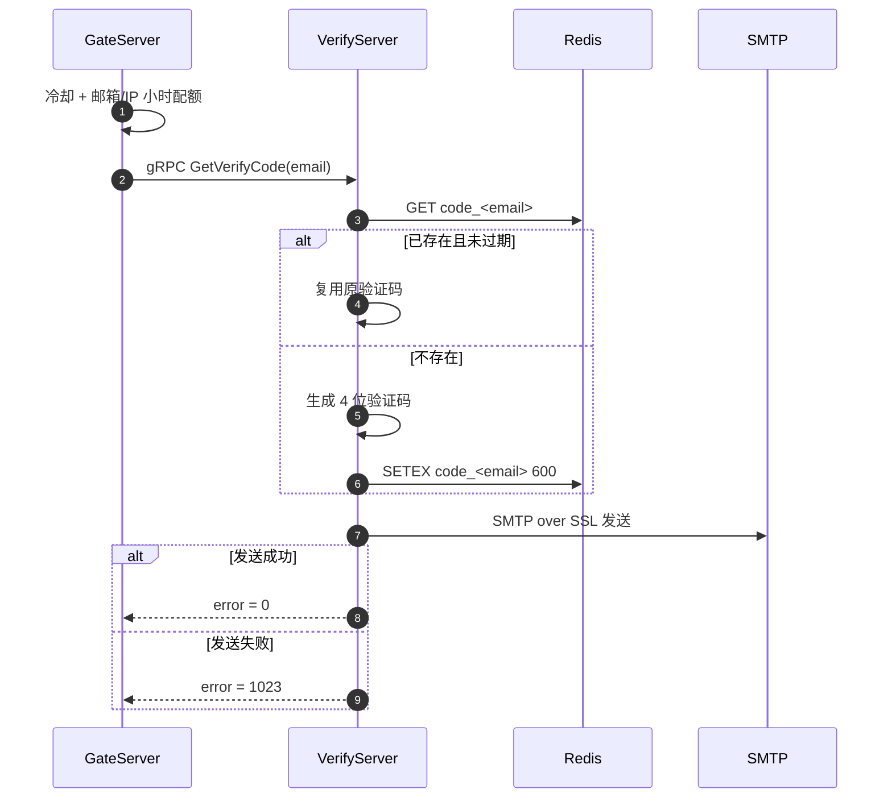
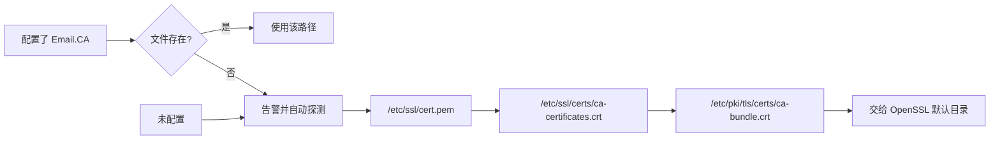

# 10 · VerifyServer

VerifyServer 只做一件事：生成验证码写入 Redis，然后通过 SMTP over SSL 发给用户。它不接触数据库，也不保存发信记录。

## 10.1 调用关系



## 10.2 验证码规则

| 项 | 值 |
| --- | --- |
| 长度 | 4 位 |
| 字符集 | 十六进制（UUID 前 4 位） |
| 有效期 | 600 秒 |
| 复用 | 有效期内重复申请返回同一个码，不重复发信 |
| 一次性 | 注册或重置成功后 GateServer 删除键 |
| 键 | `code_<email>` |

发送频控由 GateServer 负责（60 秒冷却、邮箱 5 次/小时、IP 20 次/小时），VerifyServer 自身不做限流，避免两处规则不一致。

## 10.3 邮件发送

| 项 | 说明 |
| --- | --- |
| 协议 | SMTP over SSL，默认 `smtp.qq.com:465` |
| 账号 | `[Email] User` / `Pass`（QQ 邮箱为授权码） |
| 发件人 | `From`，留空取 `User` |
| 主题 | 验证码 |
| 正文 | 纯文本：`您的验证码为 XXXX，请在 10 分钟内完成验证。` |
| 超时 | 由 Poco NetSSL 连接与读写超时控制 |

### CA 解析



Windows 没有系统 PEM 证书包，`CA` 留空即可，Poco 会使用 OpenSSL 默认路径。

> 证书校验失败会直接导致发信失败，不会静默跳过校验。自建 SMTP 或企业内网 CA 时才需要显式指定 `CA`。

## 10.4 错误映射

| 情况 | 返回 |
| --- | --- |
| 正常 | `0` |
| Redis 读写失败 | `1002` |
| SMTP 连接 / 认证 / 投递失败 | `1023` |
| 其它异常 | `1002` |

`GetVerifyCode` 永远返回 `grpc::Status::OK`，业务错误放在 `response.error`，调用方只需看一个字段。

## 10.5 配置

```ini
[VerifyServer]
Host = 0.0.0.0
Port = 50051

[Redis]
Host = 127.0.0.1
Port = 6380
Passwd = 123456

[Email]
Host = smtp.qq.com
Port = 465
User = your_email@qq.com
Pass = your_smtp_auth_code
From = your_email@qq.com
CA =
```

## 10.6 运维提示

- 注册收不到验证码：先看 GateServer 是否返回 `1022`（被限流），再看 VerifyServer 日志里的 SMTP 错误。
- 同一邮箱在 10 分钟内重复请求会收到同一验证码，这是正常行为。
- 换发信账号后不需要清理 Redis：旧验证码会在 10 分钟内自然过期。
- 服务无状态，可随时重启；重启不影响已写入 Redis 的验证码。
