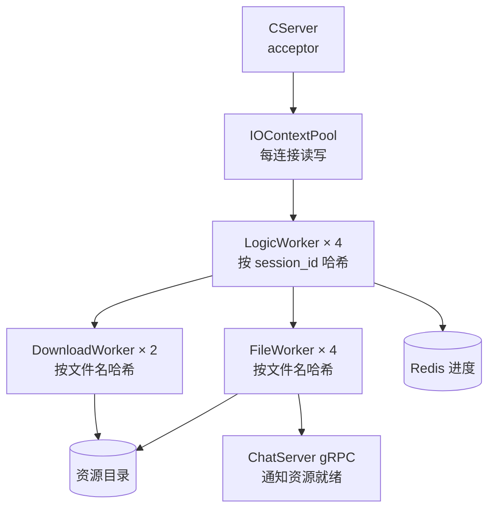
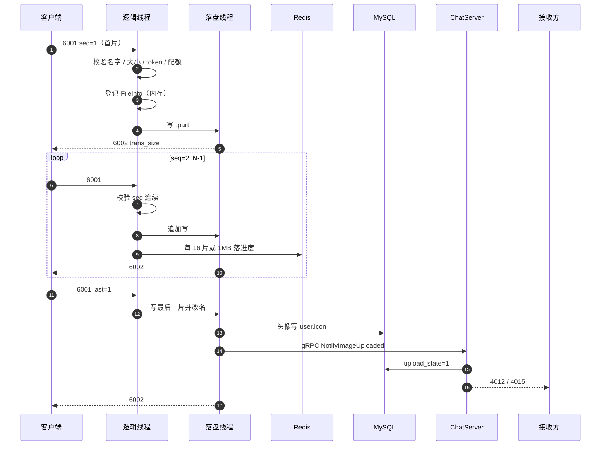
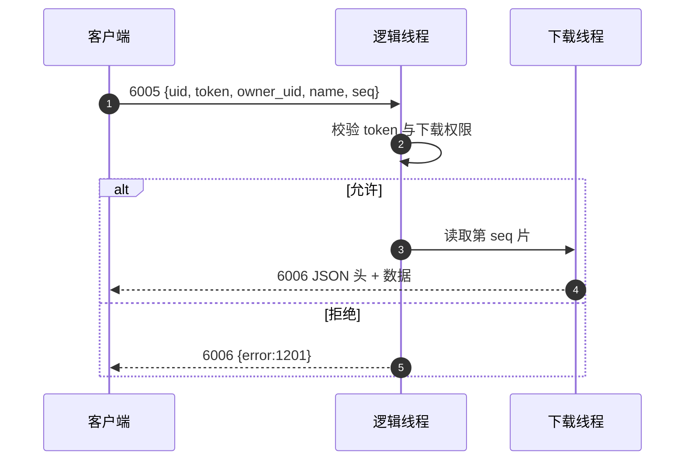
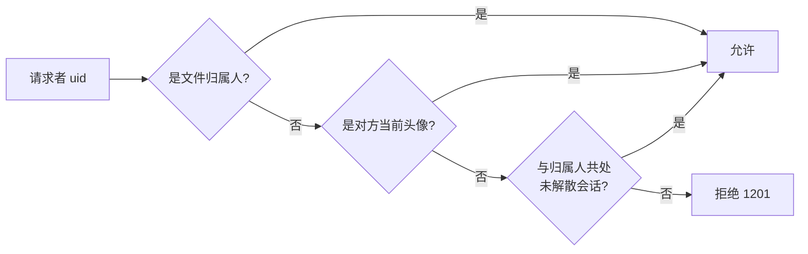

# 11 · ResourceServer

ResourceServer 负责头像与聊天资源（图片、视频、文件）的分片上传、断点续传与下载。它使用独立的 TCP 连接与帧格式，不参与聊天消息的 JSON 帧。

## 11.1 进程与线程



- **逻辑线程**：解析帧、鉴权、校验序号与配额；
- **落盘线程**：同一文件固定到一个线程，避免并发写产生空洞；
- **下载线程**：读文件分片；
- **清理线程**：删除超期的 `.part` 文件。

## 11.2 帧格式

| 字段 | 长度 | 说明 |
| --- | --- | --- |
| `msg_id` | 2 字节，大端 | 6001 / 6003 / 6005 / 6007 及其响应 |
| `length` | 4 字节，大端 | 包体总长度（JSON 头 + 数据） |
| `header_len` | 4 字节，大端 | 后续 JSON 头的字节数 |
| `json` | `header_len` 字节 | 紧凑 JSON，字段随消息号变化 |
| `data` | `length - 4 - header_len` | 原始分片，可为空 |

| 项 | 值 |
| --- | --- |
| 分片大小 | 64 KB |
| 单帧上限 | 128 KB |
| 单文件上限 | 4 GB |
| 上传请求 | JSON 头 + 原始分片 |
| 下载响应 | JSON 头 + 原始分片 |

请求与回包使用同一种包体结构，客户端只有一套拆帧代码。

## 11.3 消息

| 请求 | 响应 | 用途 |
| --- | --- | --- |
| 6001 | 6002 | 通用文件 / 聊天资源分片上传 |
| 6003 | 6004 | 查询续传进度 |
| 6005 | 6006 | 分片下载 |
| 6007 | 6008 | 头像上传（最后一片写 `user.icon`） |

字段定义见 [03 通信协议](03-protocol.md#38-资源通道)。

## 11.4 上传



关键约束：

| 检查 | 规则 |
| --- | --- |
| 资源名 | 32 位 MD5 + 扩展名 |
| 文件名 | 不允许路径分隔符，长度受限 |
| 偏移 | `trans_size == seq × 64KB`（最后一片除外） |
| `last` | 只在 `trans_size == total_size` 时为 1 |
| 序号 | 后续分片必须等于 `accepted_seq + 1` |
| 配额 | 首片按用户目录已用空间 + 本次大小校验 |
| 续传 | 沿用首次请求的路径、总大小、归属与头像标记 |

### 落盘与续传

- 上传期间写 `<资源名>.part`，最后一片成功后改名为正式资源名；中断不会产生"看起来完整"的文件。
- 进度写 Redis `file_upload_<md5>`，TTL 1 小时；换连接后客户端先发 6003 同步，再从缺失分片继续。
- 最后一片回包丢失时，客户端会重发；服务端发现同名同大小的正式文件已存在，直接按成功返回。

## 11.5 下载



- `seq` 从 1 开始，偏移 `(seq-1) × 64KB`；
- `is_last=1` 表示最后一片；
- 拒绝时对外统一返回 `1201`（FileNotExists），不暴露文件是否存在。

## 11.6 下载鉴权



结果缓存 60 秒（键为 `请求者:归属人:资源名`），最多 4096 条，超出整体清空。鉴权粒度为"同会话"，不是"按消息"；取舍见 [16 限制](16-limitations.md)。

## 11.7 存储布局与清理

| 路径 | 内容 |
| --- | --- |
| `storage/<uid>/<md5>.jpg` | 图片原图 |
| `storage/<uid>/<md5>.mp4` | 视频本体 |
| `storage/<uid>/<原文件名>.pdf` | 文件本体 |
| `storage/<uid>/<name>.part` | 上传中的临时文件，完成后改名 |

| 项 | 规则 |
| --- | --- |
| 路径 | `<Storage.Path>/<上传者 uid>/<资源名>` |
| 清理 | `StorageJanitor` 每 `SweepMinutes` 扫描，删除超过 `StaleUploadHours` 的 `.part` |
| 配额 | 按用户目录递归统计已用空间 |
| 删除 | 删除好友、撤回消息都不会删除文件；由配额与人工维护控制 |

## 11.8 头像与群头像

- **个人头像**：走 6007，最后一片落盘后更新 `user.icon` 并刷新资料缓存，然后通过 ChatServer 广播 3015。
- **群头像**：走 6001 通用上传（`message_id=0`），上传完成后由客户端调用 5005 `action=icon` 写 `conversation.icon/icon_owner`，再广播 5009。
- 群头像同样存放在上传者目录；下载时用 `icon_owner` 定位。

## 11.9 错误码

| 码 | 场景 |
| --- | --- |
| 1201 | 传输记录不存在（也用于下载被拒） |
| 1202 | 进度写 Redis 失败 |
| 1203 | 文件不可写 |
| 1204 | 分片数据与偏移不一致 |
| 1205 | 文件名非法 |
| 1206 | 超过 4 GB |
| 1207 | 分片序号不连续 |
| 1208 | 源文件不可读 |
| 1209 | 偏移越界 |
| 1210 | 超出用户配额 |

## 11.10 配置

```ini
[SelfServer]
Port = 9090
SslCert =
SslKey =
SslReloadSeconds = 60

[Storage]
Path = storage
QuotaMB = 1024
StaleUploadHours = 24
SweepMinutes = 60

[Mysql]
Host = 127.0.0.1
Port = 3306
User = root
Passwd = 123456
Schema = yunjian

[Redis]
Host = 127.0.0.1
Port = 6380
Passwd = 123456

[StatusServer]
Host = 127.0.0.1
Port = 50052

[ChatServers]
Servers = chatserver1,chatserver2
```

## 11.11 运维要点

| 现象 | 检查 |
| --- | --- |
| 上传到 99% 失败 | 配额、磁盘空间、`.part` 是否被清理 |
| 下载 1201 | 文件是否已上传完成、请求者与归属人是否共处会话 |
| 头像不更新 | `user.icon` 是否写入、3015 是否广播、客户端缓存是否命中旧文件 |
| 磁盘持续增长 | 调整 `QuotaMB`；检查僵尸 `.part` 与历史资源 |
| 暂停后无法续传 | `file_upload_<md5>` 是否仍在 1 小时 TTL 内 |
