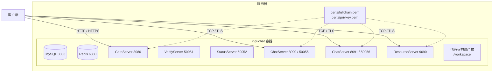
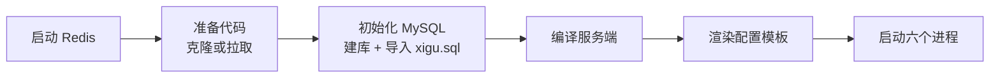

# 12 · 部署与运维

## 12.1 部署形态

| 形态 | 适用 | 组成 |
| --- | --- | --- |
| **单容器 Docker（推荐）** | 云服务器、内网演示 | 一个镜像内运行 MySQL、Redis 与六个服务进程 |
| 裸机 / 多进程 | 开发、性能测试、拆分部署 | MySQL、Redis 独立；五个服务各自启动 |



## 12.2 构建镜像

构建上下文是 `server/` 目录：

```bash
cd server
docker build --platform linux/amd64 -f deploy/docker/Dockerfile -t xiguchat-server:amd64 .
```

| 镜像内容 | 说明 |
| --- | --- |
| 工具链 | GCC 11、CMake 3.31、Ninja、vcpkg（baseline 与 `vcpkg.json` 一致） |
| 依赖 | 预编译到 `/opt/xiguchat/vcpkg_installed`，运行机无需联网拉依赖 |
| 数据库 | MySQL 8（经典协议 3306）+ Redis（6380） |
| 脚本与模板 | `/opt/xiguchat/scripts`、`/opt/xiguchat/config-templates` |

首次构建约 1 小时，主要是 vcpkg 编译依赖；之后命中缓存会快很多。网络受限时传代理：

```bash
docker build --platform linux/amd64 --build-arg PROXY=http://host.docker.internal:7890 \
  -f deploy/docker/Dockerfile -t xiguchat-server:amd64 .
```

> **镜像与代码必须同一提交**：镜像自带脚本与配置模板，业务代码在容器启动时从仓库拉取。只更新代码不重建镜像，会继续使用旧模板；只重建镜像不推代码，拉到的仍是旧代码。

## 12.3 配置与启动

```bash
cd server/deploy/docker
cp .env.example .env
```

| 变量 | 必须 | 说明 |
| --- | --- | --- |
| `PUBLIC_HOST` | 是 | 客户端访问地址；聊天与资源地址由它下发 |
| `GATE_PORT` | 是 | 8080 明文 / 8443 HTTPS |
| `EMAIL_*` | 注册需要 | SMTP 账号与授权码 |
| `XIGU_REPO` / `XIGU_BRANCH` | 否 | 容器拉取的仓库与分支 |
| `AUTO_PULL` | 否 | 启动时是否拉最新代码 |
| `SKIP_BUILD` | 否 | 1 表示跳过编译 |

```bash
docker compose up -d
docker compose logs -f
curl http://<PUBLIC_HOST>:8080/healthz
```

首次启动顺序：



## 12.4 域名与 HTTPS

### 1. 解析

把域名 A 记录指向服务器公网 IP，确认生效：

```bash
dig +short xiguchat.example.com
```

境内服务器需要完成 ICP 备案，否则 80/443 会被拦截。

### 2. 证书

使用云厂商免费 DV 证书（90 天）或已有证书。Nginx 格式解压后：

```bash
mkdir -p certs
cp <证书包>_bundle.crt certs/fullchain.pem   # 必须含中间 CA
cp <证书包>.key          certs/privkey.pem
chmod 600 certs/privkey.pem
```

### 3. 启用

`.env` 修改：

```ini
PUBLIC_HOST=xiguchat.example.com
GATE_PORT=8443
```

`docker compose up -d` 后，`start_stack.sh` 检测到两个证书文件，会把 `SslCert/SslKey` 渲染进 GateServer、两个 ChatServer 与 ResourceServer 的配置。日志应出现：

```text
传输加密：HTTPS 网关(8443) + 聊天(8090/8091) + 资源(9090)
https listening on :8443 cert=... expires_in_days=89
tcp listening on :8090 (tls)
```

### 4. 验证

```bash
# 证书链 + 应用健康
curl -v https://xiguchat.example.com:8443/healthz

# 只看证书
openssl s_client -connect xiguchat.example.com:8443 -servername xiguchat.example.com
```

客户端同步修改：

```ini
[GateServer]
scheme=https
host=xiguchat.example.com
port=8443

[Network]
tls=true
```

> 开启 TLS 后 `host` 必须是证书域名；填 IP 会因证书不匹配失败。证书续期只需覆盖两个文件，服务默认 60 秒内热加载。

## 12.5 数据库与洗库

仓库提供两份结构一致的备份：

| 文件 | 内容 |
| --- | --- |
| `backup/xigu.sql` | 5 个演示账号、一条会话与若干消息 |
| `backup/xigu_clean.sql` | 账号、好友关系与一个空会话，适合正式环境 |

### 全新环境

```bash
docker compose down -v     # 清空 MySQL 与资源卷
docker compose up -d       # 自动导入 xigu.sql
```

### 只洗数据库

```bash
docker exec -i xiguchat bash -c "
  mysql -uroot -p123456 -e 'DROP DATABASE xigu;
    CREATE DATABASE xigu DEFAULT CHARACTER SET utf8mb4;' &&
  mysql -uroot -p123456 xigu < /workspace/backup/xigu.sql"
docker compose restart
```

换 `xigu_clean.sql` 即得到不含演示数据的库。

### 备份

```bash
docker exec xiguchat mysqldump -uroot -p123456 --single-transaction xigu > xigu-$(date +%F).sql
# 卷名带 compose 项目前缀，先确认实际名称
docker volume ls | grep resource-data
docker run --rm -v docker_resource-data:/data -v $PWD:/backup alpine \
  tar czf /backup/resource-$(date +%F).tar.gz -C /data .
```

资源文件与数据库要一起备份：消息里的资源名只有在对应文件存在时才有意义。

## 12.6 升级

```bash
# 服务器上
docker exec xiguchat /opt/xiguchat/scripts/update.sh
```

脚本依次：拉取代码 → 编译 → 停旧服务 → 启动新服务。编译失败会中止，旧服务继续运行。

如果镜像内的模板或脚本有变化（例如新增配置段），必须重新构建镜像；只跑 `update.sh` 不会更新 `/opt/xiguchat` 下的模板。

## 12.7 健康检查与日志

| 项 | 位置 |
| --- | --- |
| 健康检查 | `GET /healthz` 返回 Redis/MySQL 状态与运行时长 |
| 服务 stdout | `/var/log/xigu/<服务>.log`（容器内） |
| 服务文件日志 | `<服务目录>/logs/<服务>.log` |
| 客户端日志 | `<AppData>/XiguChat/xiguchat/logs/client.log` |

建议监控：

| 指标 | 来源 | 告警建议 |
| --- | --- | --- |
| `/healthz` 状态 | 网关 | 连续 3 次非 ok |
| `[stats] online / authed` | ChatServer 日志 | 突降说明连接异常 |
| `logic_queue` / `delivery_queue` | ChatServer 日志 | 持续增长说明处理跟不上 |
| 实例心跳 | StatusServer 日志 | 实例 90 秒未注册 |
| 磁盘使用 | 宿主机 | 超过 80% 检查资源配额 |

## 12.8 端口与防火墙

| 端口 | 用途 | 公网 |
| --- | --- | --- |
| 8080 / 8443 | GateServer | 是 |
| 8090 / 8091 | ChatServer | 是 |
| 9090 | ResourceServer | 是 |
| 50051–50056 | 服务间 gRPC | 否 |
| 3306 / 6380 | MySQL / Redis | 否 |

MySQL 与 Redis 使用 `127.0.0.1` 绑定，需要远程管理时走 SSH 隧道，不要直接开放端口。

## 12.9 裸机部署

```bash
# 依赖
systemctl enable --now mysql redis-server   # 按发行版调整

# 构建
cd server
cmake --preset linux-gcc-release
cmake --build --preset linux-gcc-release

# 启动（每个服务一个 systemd unit 或 supervisor 进程）
cd build/linux-gcc-release/bin
(cd VerifyServer && ./VerifyServer)
(cd StatusServer && ./StatusServer)
(cd ChatServer && ./ChatServer)
(cd ChatServer2 && ./ChatServer)
(cd ResourceServer && ./ResourceServer)
(cd GateServer && ./GateServer)
```

每个服务的 `config.ini` 必须与产物同目录；TLS 证书路径填绝对路径。

## 12.10 常见部署错误

| 现象 | 原因 | 处理 |
| --- | --- | --- |
| 容器启动后立刻退出 | 首次编译失败 | `docker compose logs` 查看 CMake/vcpkg 错误 |
| 客户端登录成功但连不上聊天 | `PUBLIC_HOST` 填了容器内地址 | 改成公网域名或 IP |
| 注册收不到验证码 | SMTP 授权码错误 | 检查 `EMAIL_PASS` 与 VerifyServer 日志 |
| HTTPS 起不来 | 证书只放了一个文件 | `fullchain.pem` 与 `privkey.pem` 必须同时存在 |
| 换端口后客户端连不上 | `GATE_PORT` 与客户端 `port` 不一致 | 两处同步修改 |
| 洗库后登录提示账号不存在 | 导入的是 `xigu_clean.sql` | 用演示库或自行注册 |
