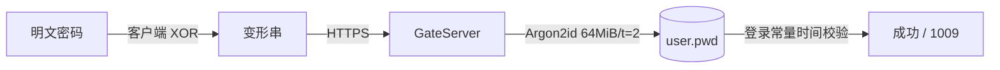
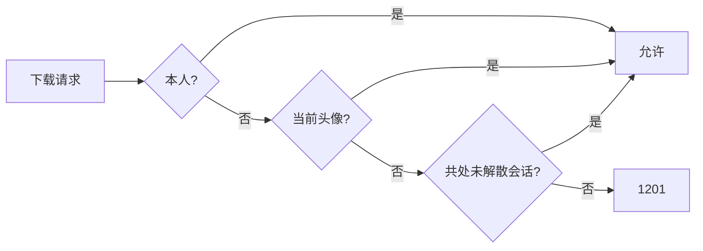

# 13 · 安全设计

这篇文档描述系统保护什么、不保护什么，以及部署时必须补齐的部分。

## 13.1 威胁模型

| 威胁 | 是否防护 | 说明 |
| --- | --- | --- |
| 公网抓包 | 取决于部署 | 配了证书即全链路 TLS；未配证书时密码、令牌与消息都是明文 |
| 撞库 / 暴力破解 | 是 | 账号 5 次/60 秒、IP 20 次/60 秒；验证码 60 秒冷却与小时配额 |
| 令牌被复制 | 部分 | 7 天滑动有效；登出、改密、顶号都会使旧令牌失效 |
| 越权读消息 | 是 | 所有会话/消息查询都校验成员身份；资源下载做归属与会话校验 |
| 越权改群资料 | 是 | 角色矩阵在 DAO 层校验，不依赖客户端隐藏按钮 |
| 设备丢失 | 部分 | 消息缓存与自动登录令牌依赖系统登录口令与全盘加密 |
| 同机其他账号 | 是 | 缓存目录 0700、文件 0600、日志 0600 |
| 服务间窃听 | 否 | gRPC 明文，设计前提是只走回环或容器内网 |
| 恶意客户端刷屏 | 是 | 每连接令牌桶 20/s、突发 50；请求体 8 KB |
| 资源名猜测 | 部分 | 资源名为内容 MD5，随机不可枚举；但鉴权是"同会话"粒度 |

## 13.2 口令

| 项 | 现状 |
| --- | --- |
| 传输前处理 | 逐字符 XOR（`123456` → `745230`） |
| 落库 | libsodium Argon2id，INTERACTIVE 档，64 MiB / t=2 |
| 在线校验 | `crypto_pwhash_str_verify`，常量时间 |
| 哈希位置 | GateServer `PasswordPool`，默认 2 线程 |
| 失败计数 | 只统计失败，成功清零；数据库故障不计入 |

> **XOR 不是加密**。它只避免密码以原样出现在抓包与日志里，真正的保护来自 HTTPS 与 Argon2id。生产部署必须启用 HTTPS。

## 13.3 令牌与会话

| 项 | 设计 |
| --- | --- |
| 令牌格式 | 32 位随机串，存 `utoken_<uid>` |
| 有效期 | 7 天，登录时续期（滑动） |
| 绑定 | 令牌只对 uid 有效；ChatServer 每次登录校验 |
| 单端登录 | 新登录分配更高 `epoch`，旧连接被顶替 |
| 登出 | 删除令牌 + 释放租约 |
| 改密 | 删除令牌；旧自动登录立即失效 |
| 自动登录 | 客户端保存 uid/token/地址，7 天内可直接恢复 |

令牌泄露后的窗口：最长为"最后一次登录 + 7 天"。要缩短窗口可以调小 `kTokenTtlSeconds`，或在敏感部署中关闭自动登录。

## 13.4 传输加密

| 通道 | 默认 | 开启方式 | 覆盖内容 |
| --- | --- | --- | --- |
| 客户端 → GateServer | HTTP | 配置证书，`GATE_PORT=8443` | 密码变形串、验证码、令牌 |
| 客户端 → ChatServer | TCP | `SslCert/SslKey` | 消息、好友、群聊、令牌 |
| 客户端 → ResourceServer | TCP | `SslCert/SslKey` | 头像、图片、视频、文件 |
| 服务间 gRPC | 明文 | 未提供 | 内部通知与租约 |
| Gate → SMTP | SSL | 默认 465 | 验证码邮件 |

规则：

- 证书两项只填一项，进程**拒绝启动**，不静默退回明文。
- 支持热加载：续期覆盖文件后默认 60 秒生效。
- 客户端 `[Network] tls` 必须与服务端一致；开启后 `host` 必须是证书域名。

## 13.5 权限边界

| 对象 | 校验点 |
| --- | --- |
| 会话列表 | `conversation_member.uid` |
| 历史消息 | 必须是会话成员；群已解散时按 `state=0` 过滤 |
| 发送消息 | 单聊要求双向好友；群聊要求当前成员 |
| 群资料修改 | 群名/公告/头像需管理员及以上；群昵称/免打扰只能改自己 |
| 成员操作 | 群主可移除任何人；管理员只能移除普通成员；解散只有群主 |
| 资源下载 | 本人 / 当前头像 / 共处未解散会话 |

客户端隐藏按钮只是体验优化，**所有权限判断在服务端 DAO 层重复执行**。

## 13.6 资源访问

已知取舍：

- 鉴权粒度是"同会话"，不是"该文件是否发在这个会话"；同事关系即可下载对方资源，前提是知道随机资源名。
- 下载结果缓存 60 秒，成员被移出群后最多 60 秒内仍可能命中旧缓存。
- 若合规要求"按消息授权"，需要把 `chat_message.content` 的资源名与请求者会话关联，并同时查归档表。

## 13.7 本地数据

| 数据 | 保护 |
| --- | --- |
| 消息缓存 | 目录 0700、文件 0600、`secure_delete=ON`、清空后 `VACUUM` |
| 自动登录令牌 | 偏好设置（macOS 0600 plist / Windows HKCU），登出与改密清除 |
| 日志 | 0600；不写令牌、密码、消息正文 |
| 临时文件 | 输入区待上传图在登录时清理 |

明文 SQLite 依赖全盘加密（FileVault / BitLocker）。需要"拷走库也不可读"时，按本文 [13.8 升级到 SQLCipher](#138-升级到-sqlcipher) 的路径替换 SQLCipher 驱动。

## 13.8 升级到 SQLCipher

Qt 自带的 QSQLITE 驱动不含 SQLCipher（无 `cipher_version`、无 codec 符号），`PRAGMA key` 不会生效。步骤：

1. vcpkg 安装 `sqlcipher`；
2. 用 Qt 6.5.3 源码的 `sqldrivers/sqlite` 单独构建插件，链接 `libsqlcipher`；
3. 替换 `plugins/sqldrivers/` 下的驱动；
4. 打开连接后执行 `PRAGMA key`，旧库用 `PRAGMA cipher_migrate`；
5. 密钥存系统钥匙串，三平台各产一份驱动；Qt 升级后重编。

代价是客户端多一个原生依赖与按平台的构建/签名流程；收益是库文件离开设备也不可读。

## 13.9 限流与配额

| 维度 | 阈值 | 位置 |
| --- | --- | --- |
| 验证码冷却 | 60 秒 / 邮箱 | Gate |
| 验证码小时配额 | 5 次 / 邮箱，20 次 / IP | Gate |
| 登录失败 | 5 次 / 60 秒 / 账号，20 次 / IP | Gate |
| 登录分配 | 5 次 / 10 秒 / uid | Status |
| 消息写入 | 20 条/秒，突发 50 | Chat |
| 资源配额 | 1024 MB / 用户 | Resource |
| 单帧 | 8 KB（聊天）/ 128 KB（资源） | 两端 |

## 13.10 部署检查单

- [ ] 网关、聊天、资源三条通道都配置了证书，客户端 `tls=true`。
- [ ] `PUBLIC_HOST` 使用证书域名，而不是 IP。
- [ ] MySQL / Redis 只绑回环，不映射公网。
- [ ] 修改默认口令（`root/123456`、Redis 密码）。
- [ ] 终端开启 FileVault / BitLocker；共享电脑设置 `localCache=false`。
- [ ] 日志采集只上传 `logs/`，不上传 `users/` 目录。
- [ ] 定期备份数据库与资源目录，并验证可恢复。
- [ ] 关注 `/healthz`、实例心跳与消息队列深度。

## 13.11 剩余风险

| 风险 | 影响 | 方向 |
| --- | --- | --- |
| 自动登录令牌未进系统钥匙串 | 同用户进程可读取；离线磁盘依赖全盘加密 | 接 Keychain / DPAPI |
| 资源鉴权粒度 | 同会话成员可下载对方其它资源 | 按消息授权 + 归档联合查询 |
| gRPC 明文 | 仅内网安全 | 拆多机时启用 mTLS |
| 单实例控制面 | StatusServer 故障期间无法登录 | 多活或主备 |
| XOR 变形 | 无 HTTPS 时密码可还原 | 改为服务端挑战-响应 |
