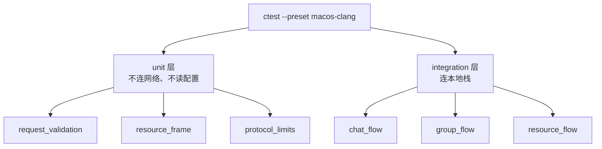
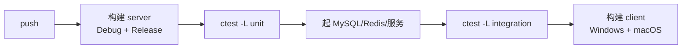

# 14 · 测试

测试分两层：单元测试验证纯函数与协议约束，集成测试直连本地服务栈验证真实链路。全部由 CTest 驱动，不使用第三方断言框架。

## 14.1 分层



| 用例 | 覆盖 |
| --- | --- |
| `unit.request_validation` | `ValidateChatRequest` 的白名单、字段类型、越权校验 |
| `unit.resource_frame` | 资源帧编解码边界、MD5 与文件名规则 |
| `unit.protocol_limits` | 2 字节长度、网络序、UTF-8 字符数、unsigned/NULL 转换 |
| `integration.chat_flow` | 登录、心跳、搜索、好友申请/同意、单聊消息、已读、撤回 |
| `integration.group_flow` | 建群、邀请、改群名、群消息、管理员、移除、退群、解散 |
| `integration.resource_flow` | 上传、续传同步、下载、越权拒绝、头像 |

## 14.2 运行

```bash
cd server
cmake --preset macos-clang -DBUILD_TESTING=ON
cmake --build --preset macos-clang
ctest --preset macos-clang
```

常用参数：

| 参数 | 作用 |
| --- | --- |
| `-L unit` | 只跑单元测试，秒级，任何机器可跑 |
| `-R resource` | 按名字过滤 |
| `-j 4` | 并行；集成测试有 `RESOURCE_LOCK`，不会互相顶号 |
| `--rerun-failed` | 只重跑失败项 |
| `--output-on-failure` | 失败时打印完整输出 |

## 14.3 集成测试的前提

集成测试需要一个已经启动的本地栈：

| 依赖 | 地址 |
| --- | --- |
| GateServer | `127.0.0.1:8080` |
| ChatServer | `127.0.0.1:8090` |
| ResourceServer | `127.0.0.1:9090` |
| MySQL | `127.0.0.1:3306`，schema `yunjian` |
| Redis | `127.0.0.1:6380` |

端口不通时测试进程返回 **77**，CTest 记为 `Skipped`，不会把"忘记起服务"误报成失败。

测试账号在 configure 时传入：

```bash
cmake --preset macos-clang \
  -DYUNJIAN_TEST_EMAIL=456@456.com \
  -DYUNJIAN_TEST_PASSWD=745230 \
  -DYUNJIAN_TEST_GATE=127.0.0.1:8080 \
  -DYUNJIAN_TEST_RESOURCE=127.0.0.1:9090
```

`passwd` 是 XOR 之后的形态（`123456` → `745230`），不是界面输入的明文。

## 14.4 断言与注册

`server/tests/TestSupport.h` 提供：

| 宏 | 作用 |
| --- | --- |
| `YUNJIAN_TEST(名字)` | 注册一个用例，名字可以含空格 |
| `CHECK(expr)` / `CHECK_EQ(a,b)` | 失败后继续执行，汇总报告 |
| `REQUIRE(expr)` | 失败立即结束当前用例 |
| `YUNJIAN_TEST_SUMMARY()` | 打印汇总并返回退出码 |

集成测试用 `TestClient` 封装同步 socket：连接、发送帧、等待指定响应号、跳过无关通知。

## 14.5 新增用例

单元测试放进 `tests/unit/`，只依赖纯函数：

```cpp
#include "TestSupport.h"
#include "RequestValidation.h"

YUNJIAN_TEST(拒绝越权撤回)
{
    Json::Value root;
    root["thread_id"] = Json::Int64(1);
    root["message_id"] = Json::Int64(2);
    CHECK_EQ(ValidateChatRequest(ID_RECALL_MSG_REQ, root, 1004), ErrorCodes::UidInvalid);
}
```

集成测试放进 `tests/integration/`，在 `CMakeLists.txt` 里用 `yunjian_integration_test()` 注册；新用例会自动获得 `RESOURCE_LOCK`，避免并发登录互踢。

## 14.6 手工回归清单

自动化测试不覆盖客户端 UI 与真实网络环境，发版前按下面清单走一遍：

| 场景 | 检查点 |
| --- | --- |
| 注册 / 登录 | 验证码、错误密码、登录后进入聊天页 |
| 自动登录 | 关闭客户端再打开，直接恢复会话；登出后不再自动进入 |
| 好友 | 搜索、申请、同意、备注、删除；对方收到通知 |
| 单聊 | 文本、图片、视频、文件、撤回、已读、转发、本地搜索 |
| 群聊 | 建群、邀请、改群名/公告/头像、@、设管理员、移除、退群、解散 |
| 群头像 | 管理员更换后，其他成员收到推送并下载 |
| 资源 | 上传中断后继续；下载暂停后继续；超配额提示 |
| 断线 | 停掉 ChatServer，客户端退避重连；恢复后消息补齐 |
| 顶号 | 同一账号登录第二端，第一端收到 2007 并停止重连 |
| TLS | 开启证书后三条通道都能连；换 IP 连接应失败 |

## 14.7 CI 建议



- 单元层放在最前面，失败立即停止；
- 集成层用 Docker Compose 起依赖，测试结束清理数据卷；
- 客户端至少保证两个平台编译通过，QML 变更再跑一次启动冒烟。
