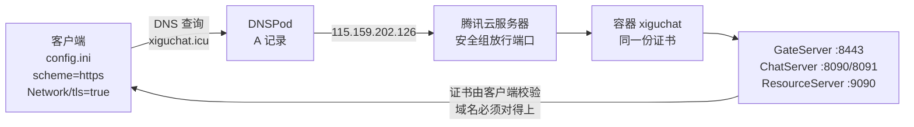

# 14 · 域名与 HTTPS / TLS 部署（腾讯云 + xiguchat.icu）

从零到"客户端连上 `https://xiguchat.icu`"的完整步骤，每一步都能单独验证。
中间牵扯三件互相独立的事：**域名解析**、**ICP 备案**、**TLS 证书**。卡在哪一步就查哪一节。

一张证书同时保护三条通道：网关（8443）、聊天长连接（8090/8091）、文件传输（9090）。



## 14.1 三件事分别是什么

| 事项 | 作用 | 谁提供 | 耗时 | 没做会怎样 |
| --- | --- | --- | --- | --- |
| 域名解析 | 把 `xiguchat.icu` 指向服务器 IP | 腾讯云 DNSPod（注册域名时自带） | 10 分钟生效 | 域名根本打不开 |
| ICP 备案 | 让**境内**服务器可以合法地用域名对外服务 | 腾讯云备案系统 → 省通信管理局 | 1–20 个工作日 | 80/443 被云厂商拦截，返回"未备案"页 |
| TLS 证书 | 证明域名归属 + 加密链路 | 腾讯云 SSL 证书（免费 DV） | 几分钟到 1 个工作日 | 三条通道都只能明文，密码与聊天内容等同裸奔 |

三者的关系：**解析**决定流量去哪，**证书**决定这条流量是否加密、以及客户端是否相信对端，**备案**是境内机房的合规前提。
证书和备案没有依赖关系——没备案也能申请证书、也能在非标端口上用 HTTPS。

> 关键结论先说：**启用 HTTPS 后客户端必须用域名连接，不能再用 IP。** 免费证书只能绑定域名，
> 用 `https://115.159.202.126:8443` 访问会报证书不匹配（hostname mismatch）。这是设计使然，不是配置错误。

## 14.2 第 1 步：域名解析

控制台：**云解析 DNS → 我的域名 → xiguchat.icu → 记录管理 → 添加记录**

| 主机记录 | 类型 | 线路 | 记录值 | TTL |
| --- | --- | --- | --- | --- |
| `@` | A | 默认 | `115.159.202.126` | 600 |
| `www` | A | 默认 | `115.159.202.126` | 600 |

- `@` 代表 `xiguchat.icu` 本身；`www` 只是顺带，客户端用不到就可不加。
- 域名注册后 5 天内要完成**实名认证**，否则解析会被暂停，控制台会有红字提示。
- 验证（本机执行，走系统 DNS 而不是本机代理）：

```bash
dig +short xiguchat.icu
# 期望输出 115.159.202.126
nslookup xiguchat.icu 8.8.8.8   # 换一个公共 DNS 再确认一次
```

解析没生效之前不要往下走，否则后面所有"连不上"都是同一个原因。

## 14.3 第 2 步：ICP 备案（境内服务器绕不过）

大陆机房对未备案域名，**80 / 443 端口会被云厂商拦截**，访问时返回"未备案禁止访问"的提示页。
这不是腾讯云故意卡人，是《互联网信息服务管理办法》的要求，接入商有连带责任。

**备案条件**（个人网站最常见的一类）：

- 服务器是**包年包月**且剩余时长 ≥ 3 个月（按量计费的机器没有备案服务号）
- 域名已完成实名认证，且域名后缀在工信部许可列表内（`.icu` 是许可的）
- 身份证、手机号、人脸核验；备案主体与域名持有者一致

**操作路径**：控制台搜「备案」→ 开始备案 → 选服务器 → 填主体信息与网站信息 →
上传证件 → 腾讯云初审（1–2 天）→ 短信核验 → 管局审核（1–20 个工作日）→ 下发备案号。

几个容易踩的点：

- 备案期间**网站必须关闭**，80/443 不能对外提供内容；所以现在先用 8443 端口内测，不去占用 80/443。
- 备案免费，任何"代备案""加急备案"都是骗钱的。
- 备案通过后想用不带端口的地址：把容器 `GATE_PORT` 改成 `443`（容器内是 root，可以直接监听 443），
  客户端 `port` 留空即可。没备案之前 `GATE_PORT=443` 会被拦，别浪费时间排查。

> 现阶段建议：**先不备案，用 8443 端口跑 HTTPS 内测。** 等确实要对外公开了再走备案，
> 期间把端口固定成 8443，代码和客户端配置都不用再动。

## 14.4 第 3 步：申请证书

控制台：**SSL 证书 → 我的证书 → 申请免费证书**。

| 项 | 填什么 | 说明 |
| --- | --- | --- |
| 证书类型 | 免费 DV（TrustAsia） | 只验证域名归属，不显示企业名称，够用 |
| 绑定域名 | `xiguchat.icu` | 免费证书**单域名**，不支持通配符；`www` 要另申请一张 |
| 申请邮箱 | 你的常用邮箱 | 签发/到期通知发这里 |
| 验证方式 | **DNS 验证** | 不受服务器端口影响，最稳 |
| 密钥算法 | RSA 2048 | 兼容性最好 |

DNS 验证：腾讯云会给出 TXT 记录（主机记录形如 `_dnsauth`，记录值是一长串），
在 DNSPod 加进去，回控制台点验证；域名就在腾讯云时通常会自动加、几分钟内签发。

**有效期 90 天，且不支持续费**——到期前重新申请一张新的，覆盖文件即可（见 14.8）。

签发后下载：**下载 → Nginx 格式**，解压得到 4 个文件，真正要用的只有两个：

| 下载到的文件 | 改成 | 是什么 |
| --- | --- | --- |
| `xiguchat.icu_bundle.crt` | `fullchain.pem` | 证书链：你的证书 + 中间 CA，**必须整份** |
| `xiguchat.icu.key` | `privkey.pem` | 私钥，不能泄露 |

`*.csr` 和 `*_bundle.pem` 用不到。**只截取 crt 的第一段**是最常见的错误：
浏览器/客户端能连，但 Android、部分 Qt 版本、命令行工具会报"证书链不完整"。

## 14.5 第 4 步：装到服务器

本地把两个文件传上去（服务器目录以 `~/xiguchat/` 为例，与 `docker-compose.yml` 同级）：

```bash
ssh ubuntu@115.159.202.126 'mkdir -p ~/xiguchat/certs'
scp fullchain.pem privkey.pem ubuntu@115.159.202.126:~/xiguchat/certs/
ssh ubuntu@115.159.202.126 'chmod 600 ~/xiguchat/certs/privkey.pem && ls -l ~/xiguchat/certs'
```

改 `.env`（同目录）：

```ini
PUBLIC_HOST=xiguchat.icu
GATE_PORT=8443
```

> `PUBLIC_HOST` 必须是**域名**。ChatServer 的 `AdvertiseHost` 与 StatusServer 下发的资源地址都取自它，
> 客户端拿着这个地址去连聊天与文件通道，用 IP 会直接证书不匹配。

`docker-compose.yml` 已经把 `./certs` 挂到容器的 `/etc/xiguchat/certs`（只读），
端口也写成了 `${GATE_PORT}:${GATE_PORT}`，所以只需要重启：

```bash
cd ~/xiguchat && docker compose up -d
docker compose logs -f | head -40
```

三个服务读同一份证书：网关走 HTTPS，ChatServer（8090/8091）与 ResourceServer（9090）
在启动时检测到 `fullchain.pem` 存在，就把客户端连接切成 TLS。启动日志应该能对上：

```
[start] 传输加密：HTTPS 网关(8443) + 聊天(8090/8091) + 资源(9090)，证书 /etc/xiguchat/certs/fullchain.pem
... https listening on :8443 cert=/etc/xiguchat/certs/fullchain.pem expires_in_days=89
tcp listening on :8090 (tls)
tcp listening on :9090 (tls)
```

腾讯云控制台的**安全组**要放行 TCP 8443（和 8090/8091/9090 一样，这些是客户端直连的端口）。

## 14.6 第 5 步：验证

在**本机**（不是服务器上）执行，走的才是真实公网路径：

```bash
# 1) 证书 + 链路 + 应用都通
curl -v https://xiguchat.icu:8443/healthz
# 期望: SSL certificate verify ok. + {"mysql":true,"redis":true,"status":"ok",...}

# 2) 只看证书（按 Ctrl+C 退出交互）
openssl s_client -connect xiguchat.icu:8443 -servername xiguchat.icu
# 期望: Verify return code: 0 (ok) / subject=CN=xiguchat.icu
#       以及 Protocol: TLSv1.3

# 3) 明文访问同一个端口应该失败
curl -m 5 http://xiguchat.icu:8443/healthz
# 期望: 空响应或 reset，因为服务端在等 TLS 握手

# 4) 聊天与文件通道（握手后服务端在等私有协议帧，超时退出是正常的）
openssl s_client -connect xiguchat.icu:8090 -servername xiguchat.icu -brief </dev/null
openssl s_client -connect xiguchat.icu:9090 -servername xiguchat.icu -brief </dev/null
# 期望: Verification: OK / Protocol version: TLSv1.3
```

用 IP 访问 `https://115.159.202.126:8443` 会报证书不匹配，这是**正确**行为。

## 14.7 第 6 步：客户端配置

`client/config.ini`（与可执行文件同目录）：

```ini
[GateServer]
scheme=https
host=xiguchat.icu
port=8443

[Network]
tls=true
```

- `scheme` 不写时默认 `http`，老配置不受影响。
- `port` 留空表示用协议默认端口（http 80 / https 443）。
- `Network/tls` 控制**聊天与文件通道**是否加密，必须与服务端证书开关一致；不写默认 `false`。
- 客户端用 Qt 的 `QNetworkAccessManager` 与 `QSslSocket`，证书校验走**操作系统信任库**：
  Windows 用系统证书存储（Schannel），macOS 用钥匙串（SecureTransport），Linux 用 `ca-certificates`。
  公共 CA 签发的证书天然受信，客户端不需要额外打包证书。

## 14.8 续期（每 90 天一次）

免费证书不能续费，只能重新申请一张。到期前 2 周操作一次即可：

1. 控制台重新申请 `xiguchat.icu`（DNS 验证，通常几分钟签出）
2. 下载 Nginx 格式，按 14.4 改名
3. 覆盖服务器上的 `fullchain.pem` 与 `privkey.pem`（两条命令连着敲，别只换一个就停）
4. **不用重启**：三个服务各自按 `SslReloadSeconds`（默认 60）秒比对两个文件的 mtime，
   变化后重建 TLS 上下文；已建立的连接继续用旧证书，新连接立即用新的

日志会明确记录：

```
tls cert file changed, reloading
tls cert ready subject=xiguchat.icu expires_in_days=89
tls cert reloaded, new connections use the new certificate
```

失败保护：如果新文件有问题（链不完整、私钥不匹配、文件截断），服务**保留旧证书继续服务**并记一条
`tls cert load failed`，不会因为一次手滑把线上打挂；把第二文件也换好后，下一次比对会自动恢复。

> 两个文件不是原子替换：先换证书、后换私钥的几秒里，检查点可能正好落在中间态并报一次不匹配，
> 这是正常的。想避免就把两条 `cp` 写成一行，缩短时间窗。

剩余不足 15 天时，日志每天提醒一次。

建议在日历上记第 75 天的提醒，别等到过期——证书过期后客户端会直接连不上，且报错文案通常很含糊。

## 14.9 本地还能不能测？能

启用加密 **不是**"只能连服务器"。TLS 只是一个配置开关：`SslCert`/`SslKey` 留空就是明文，
和以前完全一样（网关、聊天、文件三条通道都是）。三种本地测法：

| 方式 | 做法 | 适合 | 代价 |
| --- | --- | --- | --- |
| A. 明文（默认） | 本地 `config.ini` 不填证书，客户端 `scheme=http host=127.0.0.1 port=8080` | 日常开发，改业务代码 | 测不到 TLS 相关路径 |
| B. hosts + 真证书 | `hosts` 里加 `127.0.0.1 xiguchat.icu`，三个服务都指向真证书，客户端 `scheme=https host=xiguchat.icu port=8443` + `Network/tls=true` | 上线前验证完整 HTTPS 链路 | 改 hosts 期间访问线上会指向本机，测完删掉 |
| C. 自签证书 | `openssl` 自己签一张，把自签 CA 导入系统信任库 | 完全离线、没有域名 | 每台测试机都要装 CA，不推荐长期用 |

方式 B 是推荐的"本地复刻线上"：同一个域名、同一张证书、同一个端口语义，
客户端代码和配置与生产只有 host 一处差别。三个服务的 config.ini 都填同一份证书路径：

```bash
# 1) 把证书放到本地任意目录
mkdir -p /tmp/xiguchat-certs && cp fullchain.pem privkey.pem /tmp/xiguchat-certs/

# 2) GateServer / ChatServer / ChatServer2 / ResourceServer 的 config.ini 都加同样四项
[GateServer]            # ChatServer 与 ResourceServer 写在各自的 [SelfServer] 段
Port = 8443
SslCert = /tmp/xiguchat-certs/fullchain.pem
SslKey = /tmp/xiguchat-certs/privkey.pem
SslReloadSeconds = 60

# 3) hosts 加一行（macOS/Linux: /etc/hosts，Windows: C:\Windows\System32\drivers\etc\hosts）
127.0.0.1 xiguchat.icu

# 4) 起服务，客户端 scheme=https host=xiguchat.icu port=8443 且 Network/tls=true
curl --resolve xiguchat.icu:8443:127.0.0.1 https://xiguchat.icu:8443/healthz
```

方式 C 自签的命令（生成的 CA 要导入系统信任库，否则客户端仍会拒绝）：

```bash
openssl req -x509 -newkey rsa:2048 -nodes -keyout ca.key -out ca.pem -days 30 \
  -subj "/CN=XiguChat Local Test CA" -addext "basicConstraints=critical,CA:TRUE"
openssl req -newkey rsa:2048 -nodes -keyout privkey.pem -out server.csr -subj "/CN=xiguchat.icu"
printf "subjectAltName=DNS:xiguchat.icu\nextendedKeyUsage=serverAuth\n" > server.ext
openssl x509 -req -in server.csr -CA ca.pem -CAkey ca.key -CAcreateserial \
  -out leaf.pem -days 30 -extfile server.ext
cat leaf.pem ca.pem > fullchain.pem
```

> 三条通道要么都开、要么都不开，`Network/tls` 与服务端证书必须一致：
> 服务端配了证书而客户端 `tls=false`，握手不会发生，服务端会把明文帧当坏包断掉；
> 反过来客户端要求 TLS 而服务端没证书，`QSslSocket` 会报握手失败并提示 `sig_con_failed`。

## 14.10 常见错误对照

| 现象 | 原因 | 处理 |
| --- | --- | --- |
| `curl: (60) SSL certificate problem` | 证书链不完整 / 用 IP 访问 | 用 `_bundle.crt` 整份；host 改成域名 |
| `hostname mismatch` | 客户端 host 与证书域名不一致 | 客户端 `host` 填 `xiguchat.icu`，服务端 `AdvertiseHost` 也必须是域名 |
| `wrong version number` | 明文打到了 HTTPS/TLS 端口，或客户端开关写错 | 两边协议对齐 |
| 连接超时 | 安全组没放行端口 / 容器没映射 / 服务没起 | 依次查安全组 → `docker compose ps` → 容器日志 |
| 登录成功但一直卡在"连接聊天服务" | 服务端开了 TLS 而客户端 `Network/tls=false`（或反过来） | 两边开关按 14.7 对齐 |
| 客户端提示 TLS 握手失败 | 证书域名与连接地址不一致，或系统缺根证书 | 用域名连；Linux 装 `ca-certificates` |
| 容器日志 `tls cert load failed` | 私钥与证书不匹配、文件截断 | 重新下载，两个文件必须成对覆盖 |
| 服务起不来且日志 `SslCert and SslKey must be set together` | 只配了其中一项 | 两项都填，或都留空 |
| 突然全部客户端连不上 | 证书过期 | 看日志 `expires_in_days`，按 14.8 续期 |
| `certificate is not yet valid` | 服务器或客户端系统时间不对 | `timedatectl` / 开启自动对时 |

## 14.11 这次 TLS 覆盖到哪

| 通道 | 端口 | 现状 |
| --- | --- | --- |
| HTTP 网关（登录、注册、验证码、改密） | 8443 | **已加密** |
| 聊天长连接 | 8090 / 8091 | **已加密**（TLS 1.2/1.3，帧格式不变） |
| 资源传输（头像、图片、文件） | 9090 | **已加密**（同上，64KB 分片照旧） |
| 服务间 gRPC | 50051/50052/50055/50056 | 明文，仅容器内网可达 |

服务端实现：`xiguchat_common` 里的 `TlsContext`（证书加载 / 到期提示 / 热加载）与
`TlsSocket`（明文或 TLS 的统一读写封装）。ChatServer 与 ResourceServer 的会话层只换了
socket 类型，帧协议、读写队列、令牌桶、心跳逻辑都没动——所以两端升级后协议完全兼容。

仍未加密的是**服务间 gRPC**，这是有意为之：

- 它只走回环或容器内网，流量不出宿主机，中间人接触不到；
- TLS 1.3 握手只在建连时发生（连接池 5 条通道），AES-GCM 走 AES-NI，
  相对数据库往返的开销可以忽略——**不加密不是性能考虑，而是复杂度**：
  多 10 处配置、证书轮换要连内部服务一起重启（凭据是启动时构建的，不能热加载）、
  还会引入"只配了一半"的新故障类型。

真正需要它的场景：服务拆到多台机器 / 跨 VPC / 跨机房，或者要过等保（要求全链路传输加密）。
到那时在 `xiguchat_common` 里加一个凭据工厂，服务端 `AddListeningPort`、客户端
`CreateCustomChannel` 各换一处即可，业务代码不用动。
