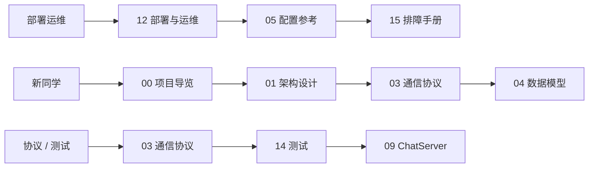

# 文档索引

这套文档面向三类读者：**部署运维**、**客户端/服务端开发**、**协议对接与测试**。每篇只讲一个主题，术语与端口在全套内保持一致。

## 文档地图

| 编号 | 文档 | 适合谁 | 主要内容 |
| --- | --- | --- | --- |
| 00 | [项目导览](00-tour.md) | 第一次阅读代码的人 | 进程分工、登录与消息的代码路径、日志、最小运行 |
| 01 | [架构设计](01-architecture.md) | 开发、架构评审 | 分层、线程模型、核心时序、路由、容错边界 |
| 02 | [构建与运行](02-build.md) | 开发、发布 | CMake 预设、vcpkg、多实例、产物布局、客户端打包 |
| 03 | [通信协议](03-protocol.md) | 客户端/服务端开发、测试 | 帧格式、消息号、字段、HTTP、gRPC、错误码 |
| 04 | [数据模型](04-data-model.md) | 后端开发、DBA | 七张表、索引、查询模式、Redis 键、本地 SQLite |
| 05 | [配置参考](05-configuration.md) | 运维、开发 | 每个服务的配置项、默认值、常见变更 |
| 06 | [客户端](06-client.md) | 客户端开发、UI | 分层、通信、状态、QML、主题、缓存与日志 |
| 07 | [GateServer](07-gate-server.md) | 后端开发 | HTTP 管线、口令线程池、登录限流、TLS |
| 08 | [StatusServer](08-status-server.md) | 后端开发、运维 | 令牌、租约、epoch、实例注册、选路与排空 |
| 09 | [ChatServer](09-chat-server.md) | 后端开发 | 连接状态机、逻辑分片、消息与群聊、跨实例投递 |
| 10 | [VerifyServer](10-verify-server.md) | 后端开发、运维 | 验证码、邮件投递、CA 解析、错误映射 |
| 11 | [ResourceServer](11-resource-server.md) | 后端开发、运维 | 分片协议、续传、配额、清理、下载鉴权 |
| 12 | [部署与运维](12-deployment.md) | 运维 | Docker、TLS、域名、洗库、升级、健康检查 |
| 13 | [安全设计](13-security.md) | 安全评审、运维 | 威胁模型、口令、令牌、传输、资源、本地数据 |
| 14 | [测试](14-testing.md) | 开发、CI | 单元/集成测试、运行方式、扩展方法 |
| 15 | [排障手册](15-troubleshooting.md) | 运维、值班 | 按症状定位问题与常用诊断命令 |
| 16 | [已知限制](16-limitations.md) | 所有人 | 当前边界、影响与演进方向 |

## 建议阅读路径

## 术语

| 术语 | 含义 |
| --- | --- |
| **会话（thread）** | 单聊或群聊的统一标识 `thread_id`；数据库表 `conversation` 一行 |
| **会话租约** | Redis 中 `sess_<uid>` 的哈希，记录 `sid / inst / epoch`，代表某账号当前的在线连接 |
| **epoch** | 每次登录自增的围栏令牌；续租、释放、踢人时用它判断连接是否仍然有效 |
| **实例** | 一个 ChatServer 进程，名字来自配置（如 `chatserver1`），注册到 StatusServer |
| **逻辑分片** | ChatServer 内按会话哈希分配到 4 个业务线程之一，保证同一连接消息有序 |
| **资源名** | 落盘文件名，格式为内容 MD5 加扩展名；消息里只存资源名，不存路径 |
| **合并转发** | 把多条消息打成 JSON 快照，作为一条 `msg_type=7` 的文本消息发送 |
| **洗库** | 删除数据库并从 `backup/*.sql` 重新导入，用于重置演示或测试环境 |

## 约定

- 端口、消息号、配置项均以源码为准；文档与代码冲突时先改文档。
- 图表统一使用 Mermaid，在 GitHub、Gitee 与支持 Mermaid 的 IDE 中直接渲染。
- 协议号段：`1xxx` 仅用于 HTTP 网关内部；长连接 `2xxx–5xxx`；资源通道 `6xxx`；错误码 `1xxx / 11xx / 12xx`。
- 时间统一使用 UNIX 秒；会话列表与消息里的 `time` 字段均为秒级时间戳。
- 默认口令 `123456` 只用于本地演示，生产部署必须修改。
